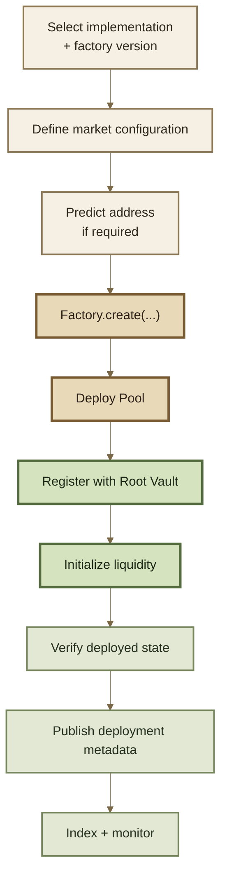

# Factories & Deployment

## Factories & Deployment

Factories make Pool deployment **repeatable, attributable, and discoverable**.

They connect a deployed contract to a known implementation family and can coordinate the registration configuration that turns that contract into a Root Pool.

Deployment provenance is therefore part of the market's identity—but it is only one part.


**Verify three different layers:**

1. **Implementation** — what code does this Pool run?
2. **Registration** — how is this Pool configured in the Vault?
3. **Deployment identity** — which factory, version, network, and address does ROOTSTOCK recognize?


***

### What a factory proves

A standard factory can provide evidence that a Pool was created through a known deployment path.

The inherited v3 factory model can provide:

* a known Pool creation code path;
* consistent constructor handling;
* Pool-family provenance;
* parameter validation defined by that factory;
* predictable address derivation;
* coordinated Vault registration;
* a record of Pools created by the factory;
* creation events for indexers.

For standard Pool families, use the canonical ROOTSTOCK factory for the target release rather than deploying an equivalent contract ad hoc.

#### Factory provenance is not a safety certificate

A known factory does **not** mean every Pool created by it has identical risk.

A Pool's behavior can also depend on:

* registered tokens;
* rate providers;
* Hooks;
* swap-fee configuration;
* liquidity-management flags;
* role accounts;
* mutable external dependencies.

```
factory provenance
        +
Pool implementation
        +
Vault configuration
        +
external dependencies
        =
actual deployed market
```


**“Created by a canonical factory” and “safe Pool” are not equivalent statements.**

Factory provenance establishes lineage. The complete configuration still needs to be inspected.


***

### Factory, Vault, and registry are different layers

These mechanisms answer different questions.

| Layer                   | Question                                                           |
| ----------------------- | ------------------------------------------------------------------ |
| **Factory**             | Where did this contract come from?                                 |
| **Vault registration**  | How does this market operate inside ROOTSTOCK?                     |
| **Deployment registry** | Which contracts does this ROOTSTOCK release recognize and support? |

A Pool may technically be compatible with the Vault without being created by a canonical factory.

Likewise, a contract existing onchain does not automatically make it a supported ROOTSTOCK deployment.

***

### Standard deployment flow

The inherited standard factory pattern combines Pool creation and Vault registration.

Initialization establishes the first funded state afterward.



For the standard inherited factory flow:

```
factory.create(...)
    ↓
deploy Pool
    ↓
record factory provenance
    ↓
Vault.registerPool(...)
```

Creation and registration happen as one coordinated transaction.

That protects against a third party registering the new Pool first with unintended configuration.

***

### 1. Select the implementation and factory

Before deployment, identify the exact:

* Pool family;
* Pool implementation version;
* factory version;
* source commit;
* target network;
* Root Vault deployment.

Do not rely on the Pool family's human-readable name alone.

```
"Weighted Pool"
    = protocol concept

WeightedPool implementation vX
    = executable code

WeightedPoolFactory vY
    = deployment path

0x...
    = one deployment on one network
```

These are related but distinct identities.

***

### 2. Define the full configuration

Record the intended deployment configuration before broadcasting a transaction.

#### Pool implementation

* Pool family;
* implementation/version;
* invariant parameters;
* Pool name and symbol where applicable.

#### Tokens

* token addresses;
* canonical token ordering;
* token type;
* rate provider where applicable;
* yield-fee configuration where applicable.

#### Market parameters

* normalized weights or other invariant parameters;
* initial static swap fee;
* supported liquidity behavior;
* donation support where applicable.

#### Extensions

* Hook address;
* enabled Hook behavior;
* Hook-adjusted-amount requirements;
* external dependencies.

#### Authority

* `pauseManager`;
* `swapFeeManager`;
* `poolCreator`;
* any Pool-specific administrators;
* pause-window assumptions.

#### Initialization

* initial assets;
* initial amounts;
* intended starting price;
* initializer account;
* authorization required to fund initialization.


The deployment specification should be written **before** deployment.

The post-deployment audit can then compare intended state against actual state instead of reconstructing intent afterward.


***

### 3. Understand deterministic deployment

The inherited base factory uses `CREATE2`, allowing a Pool address to be predicted before deployment.

But the address does not depend on the user-provided salt alone.

In the default inherited factory design, the effective salt is derived from:

```
caller
+
chain ID
+
user-provided salt
        ↓
effective deployment salt
```

Conceptually:

```
predicted address
    =
factory
+ creation code
+ constructor arguments
+ effective salt
```

The default effective salt is derived from:

```
keccak256(
    caller,
    chainId,
    userSalt
)
```

This means the same human-selected salt does **not** imply the same Pool address across callers or chains.


A predictable address proves only that the deployment matches the relevant `CREATE2` inputs.

It does not prove that the factory, bytecode, constructor parameters, Hook, tokens, or registration configuration are canonical.


Record the salt and every other address-determining input when reproducibility matters.

***

### 4. Deploy and register

For standard Pool families, the preferred path is:

```
canonical factory
        ↓
create Pool
        ↓
factory records Pool
        ↓
Vault registration
```

The inherited factory records created Pools and exposes provenance checks equivalent to:

```
isPoolFromFactory(pool)
```

It also emits a Pool-creation event.

The Vault separately emits registration state and stores the Pool's operating configuration.

#### Direct registration exists at the architecture level

The inherited Vault does not require every compatible Pool to come from an approved factory.

A compatible contract can technically be registered through a different deployment path.

That flexibility is not the recommended identity model for standard public ROOTSTOCK Pools.


**Factory creation is provenance. Vault registration is protocol admission.**

They are related operations, but they are not the same operation.


***

### 5. Initialize deliberately

A registered Pool does not yet have its first funded market state.

Initialization establishes:

* initial Pool balances;
* first RPT supply;
* initial market state.

The standard inherited factories normally **do not initialize during `create`** because initialization requires funding and authorization that may belong to another account.

That creates a launch-time consideration.

#### Initialization front-running

Initialization can occur only once.

If deployment and intended initialization happen in separate transactions, another account may be able to initialize first.

Upstream characterizes this primarily as a denial-of-service risk rather than a direct theft mechanism, but it can still disrupt the intended launch.


Where preventing initialization front-running matters, design the launch so that **create + register + initialize** can execute atomically.

Otherwise, explicitly accept and monitor the initialization window.


See Pool Lifecycle.

***

### 6. Verify what was actually created

A successful deployment transaction proves that a transaction succeeded.

It does not prove that the resulting market matches the intended specification.

Verify the result independently.

#### Factory provenance

Check:

* expected factory address;
* factory version;
* Pool creation event;
* factory provenance getter;
* predicted vs actual deployment address where applicable.

#### Contract identity

Check:

* runtime bytecode;
* verified source;
* implementation/version identifier;
* constructor-derived state;
* source commit or build artifact.

#### Vault registration

Query the Vault for:

* Pool registration state;
* tokens;
* token configuration;
* role accounts;
* Hook address;
* Hook flags;
* static swap fee;
* liquidity-management configuration;
* pause configuration;
* applicable protocol-fee state.

#### Pool-specific configuration

Check parameters such as:

* normalized weights;
* amplification or other invariant parameters;
* custom Pool state;
* external dependencies.

#### Initialization

Confirm:

* initialized state;
* starting balances;
* RPT supply;
* intended recipient/owner of initial RPT;
* expected initial market price.

***

### 7. Test the deployed market

After state verification, exercise the actual deployment with controlled operations.

Where applicable:

1. query a small exact-in swap;
2. query a small exact-out swap;
3. execute a controlled swap;
4. add liquidity;
5. remove liquidity;
6. verify Hook behavior;
7. verify rate-provider behavior;
8. verify permissions;
9. confirm expected events;
10. confirm indexer discovery.

Use the deployed contracts—not only local test instances.

***

### 8. Publish deployment metadata

A public deployment should be reproducible from machine-readable metadata.

At minimum, record:

| Field                        | Why it matters                                     |
| ---------------------------- | -------------------------------------------------- |
| **Chain ID**                 | Identifies the network                             |
| **Contract address**         | Identifies the deployment                          |
| **Contract role**            | Vault, Router, factory, Hook, etc.                 |
| **Implementation/version**   | Identifies behavior                                |
| **Factory**                  | Establishes Pool provenance                        |
| **Source commit**            | Links deployment to source                         |
| **Deployment task/release**  | Links it to a reproducible release process         |
| **Transaction hash**         | Links it to onchain creation                       |
| **Verification status**      | Indicates whether source/bytecode can be inspected |
| **Active/deprecated status** | Tells integrations whether it is recommended       |

For Pool instances, also record enough configuration to reconstruct their identity or link to indexed Vault state.


The public documentation should be generated from deployment artifacts where possible.

Do not make hand-maintained prose the primary database of contract addresses.


***

### Factory lifecycle and deprecation

Factories themselves have a lifecycle.

In the inherited base factory model, an authorized governance action can **disable** a factory.

Once disabled:

```
new Pool creation
    → blocked

existing Pools
    → unaffected
```

The inherited base implementation treats this disable action as irreversible.

This provides a clean way to retire a deployment generation without invalidating markets that were previously created through it.


**Deprecated does not mean nonexistent.**

Old factories, Routers, and Pools can remain deployed and operational after a newer generation becomes canonical.


Integrations therefore need explicit active/deprecated metadata rather than assuming the newest-looking name is the only valid contract.

***

### Versioning

Keep three layers separate.

#### Protocol concept

The stable mental model.

Examples:

```
Weighted Pool
Router
Hook
Vault
```

#### Implementation version

The exact executable behavior.

A new version may change:

* ABI;
* bytecode;
* validation;
* gas usage;
* permissions;
* bug fixes;
* supported features.

#### Deployment

One contract instance on one network.

```
concept
    ↓
implementation version
    ↓
deployment address
```

A single concept can have several implementation generations and many deployed addresses.

***

### Routers and other peripherals

Routers are versioned deployments too, but they do not follow the Pool lifecycle.

A Router is generally:

```
deploy
→ verify
→ publish
→ support / deprecate
```

rather than:

```
deploy
→ register with Vault
→ initialize
```

The deployment registry should therefore record Routers, factories, Hooks, and other supported peripherals independently from individual Pool registration state.

See Build a Custom Router.

***

### ROOTSTOCK deployment boundary

The architecture above describes the inherited deployment model.

It does **not** establish current ROOTSTOCK production addresses by itself.

Before publishing an address as canonical ROOTSTOCK infrastructure, verify it against the project's generated deployment artifacts and release metadata.

The canonical Deployments reference should ultimately be generated from those artifacts and distinguish at least:

```
active
deprecated
network
version
address
source / release provenance
```


**Do not copy Balancer addresses into ROOTSTOCK documentation.**

Shared code lineage does not imply shared deployment identity.

