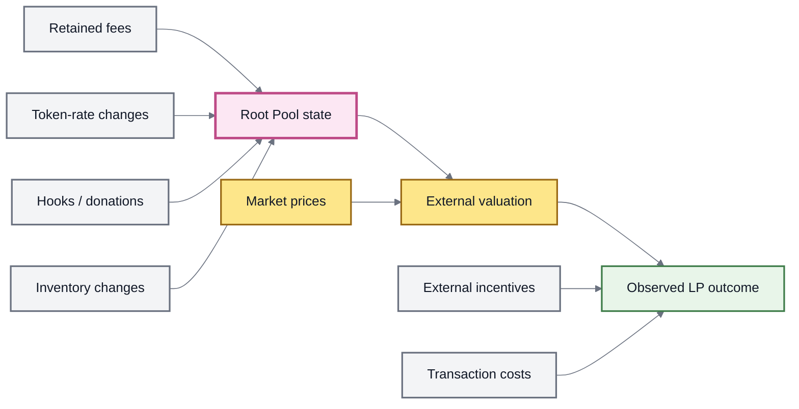
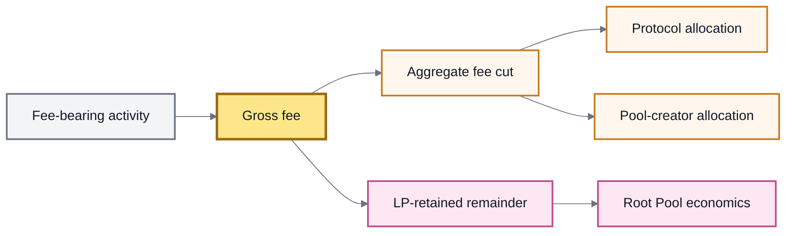

# 💱 Fees & LP Returns

## Fees & LP Returns

A **Root Pool Token (RPT)** represents ownership of a changing pool.

An LP outcome is therefore not produced by one universal “yield” mechanism. It depends on what actually happens to the pool and to the assets represented by it: swaps, non-proportional liquidity, asset-price movement, rate changes, fee allocation, Hooks, and any external incentive programs.

A pool can also spend a period with no fee-bearing activity, no positive rate growth, and no incentives.


**The mental model:** RPT records ownership. Returns come from changes in the state and value represented by that ownership.

A fee rate, token rate, incentive APR, and market-price change are different mechanisms and should not be collapsed into one number.


### What can change an LP position?

| Event or condition                     | What must happen                                                             | Possible effect on the RPT position                                                                     |
| -------------------------------------- | ---------------------------------------------------------------------------- | ------------------------------------------------------------------------------------------------------- |
| **Swap**                               | A trade executes and a swap fee applies                                      | Part of the input is collected as a fee; the LP-retained portion remains attributable to pool liquidity |
| **Non-proportional liquidity**         | An unbalanced or single-token liquidity operation changes relative inventory | Its swap-like portion can incur swap-fee treatment                                                      |
| **External asset-price movement**      | Markets reprice assets held by the pool                                      | The marked value of the pool can rise or fall                                                           |
| **Rate-bearing asset change**          | A supported token's external exchange rate changes                           | Its accounted value inside the pool can change                                                          |
| **Protocol / creator fee allocation**  | Applicable fee percentages are non-zero                                      | Less of the gross fee remains attributable to LP liquidity                                              |
| **External incentive program**         | A funded program exists and the position satisfies its rules                 | Separate reward assets may be distributed                                                               |
| **Donation / Hooks / custom behavior** | A configured pool-specific mechanism executes                                | Pool economics can change according to that mechanism                                                   |
| **Rounding**                           | Fixed-point operations cannot represent an exact final unit                  | Conservative rounding can leave a very small residual in the pool                                       |

These effects can occur independently or at the same time.

### Three layers of LP economics

A useful way to read an LP position is to separate three layers.



#### 1. Pool state

What assets and economics are represented by the RPT?

This includes inventory, LP-retained fees, supported rate changes, and pool-specific behavior.

#### 2. External valuation

What are those assets worth in the market?

The pool can be economically unchanged onchain while external prices move substantially.

#### 3. Position-level effects

Does the holder receive separate incentives or incur costs outside the pool?

These are not part of the RPT accounting itself.

Keeping these layers separate prevents double-counting.

### Swap fees

A **swap fee** is charged when fee-bearing activity uses a Root Pool.

In the inherited v3 accounting model, the fee is always charged on the **input side**:

* for an exact-input swap, the fee applies to the given input amount;
* for an exact-output swap, the input is calculated and the fee applies to that calculated amount.

Swap-fee logic also applies to the **non-proportional portion** of add and remove liquidity operations.

#### A simple retained-fee example

Assume, only for illustration, that every other variable is held constant:

```
Pool before:                  1,000
LP ownership:                   10%
LP claim before:                100

LP-retained fees added:          10

Pool after:                   1,010
LP ownership:                   10%
LP claim after:                 101
```

The ownership percentage did not change.

**The state represented by that ownership changed.**

In a real pool, swaps, market prices, liquidity operations, rates, and other mechanisms can all move simultaneously.

### Fees on non-proportional liquidity

An unbalanced or single-token liquidity operation can change relative pool inventory.

The inherited v3 model separates the economically proportional portion from the part that behaves like a trade.

For example:

```
Pool-compatible proportional portion:
10 A + 10 B

Actual contribution:
15 A + 10 B

Swap-like imbalance:
5 A
```

The additional `5 A` changes the pool composition and is subject to swap-like fee treatment.

This preserves the principle that an economically equivalent inventory change should not become cheaper merely because it is expressed as a liquidity operation rather than a direct swap.

See Adding & Removing Liquidity.

### Static and dynamic swap fees

ROOTSTOCK inherits two conceptually distinct fee paths from v3.



A pool has a configured static swap fee stored in Vault state.

Who may update that fee depends on the pool's configured roles and permissions.

Fee bounds are defined by the **pool type**, not by one universal Vault-wide percentage. A custom pool therefore needs fee bounds appropriate to its own mathematics and constraints.



A pool configured for dynamic fees asks its Hook for the fee to use on the current swap through the dynamic-fee callback.

The Hook can use whatever information its implementation permits—for example, swap direction or market conditions.

The exact formula belongs to the Hook, not to one universal ROOTSTOCK formula.



Even a pool configured for dynamic fees retains a static fee value. In the inherited architecture that value is passed to the dynamic-fee Hook as a reference.

See Dynamic Fees.

### Gross fee is not the same as LP-retained fee

The fee charged to an operation and the amount ultimately attributable to LP liquidity are different quantities.

The inherited v3 model can divide swap and yield economics among:

* LP liquidity;
* the protocol; and
* a registered pool creator.



Conceptually, if:

```
F = gross fee
p = protocol fee percentage
c = pool-creator fee percentage applied after the protocol cut
```

then:

```
protocol allocation = F × p

remaining after protocol = F × (1 - p)

creator allocation = F × (1 - p) × c

LP-retained amount = F × (1 - p) × (1 - c)
```

The actual contracts handle fixed-point precision, rounding, aggregation, and collection.


The Vault stores an **aggregate fee percentage** so it can take the protocol-and-creator cut efficiently on the critical path. The `ProtocolFeeController` later separates collected aggregate fees into protocol and pool-creator balances.

The LP share is economically the remainder that stays with pool liquidity rather than a separate fee balance LPs must claim.


#### Pool-creator fees

In the inherited v3 design, a `poolCreator` address is established when the pool is registered and cannot later be replaced through the normal creator-fee mechanism.

Pool-creator swap and yield fee percentages begin at **0%** and can be configured later if a creator address was registered.

A higher creator allocation leaves a smaller share of applicable fee economics with LP liquidity.

ROOTSTOCK documentation should not hard-code a current protocol or creator percentage here. Those values are deployment state and should be read from the relevant deployed fee-controller configuration.

### Rate-bearing assets

Some pool assets represent claims whose exchange rate to another asset can change.

Examples can include:

* wrapped staking assets;
* lending positions;
* tokenized vault shares;
* other supported rate-bearing claims.

A **Rate Provider** reports that relationship to the Vault.

It does **not** create the economic growth.

```
external asset mechanism
        ↓
exchange-rate state
        ↓
Rate Provider
        ↓
Vault accounting
        ↓
RPT represents the resulting pool state
```

A reported rate can rise, remain unchanged, or behave unexpectedly depending on the underlying asset and its mechanism.

See Rate Providers.

### Yield fees are separate from token yield

Balancer v3 defines a specific fee mechanism for eligible rate-bearing tokens.

The important distinction is:

```
asset has a rate
        ≠
rate increased
        ≠
yield fee applies
        ≠
LP outcome is guaranteed positive
```

In the inherited v3 implementation, a yield fee applies only when:

1. the token is registered as `WITH_RATE`;
2. `paysYieldFees` is enabled for that token;
3. its current live balance is greater than the previously stored live balance; and
4. a state-changing Vault interaction triggers the fee computation.

The fee is calculated on the positive live-balance growth using the pool's configured aggregate yield-fee percentage.


`STANDARD` tokens do not use a Rate Provider and should not be configured to pay this rate-based yield fee. A token having a price, appreciation, or external market return is not sufficient to make it a v3 `WITH_RATE` yield-fee token.


#### What happens when the rate falls?

The v3 implementation does **not** charge a yield fee when the current live balance is below the previously stored live balance.

This matters for unusual rate providers whose reported rates can move down and later recover. An up → down → up path can make fee accounting more complicated because the same apparent recovery can cross previously charged territory.

For a rate expected to behave non-monotonically, the upstream design recommends treating yield-fee configuration with care rather than assuming monotonic growth.

#### Yield-fee allocation

A yield fee is not the same thing as the asset's full rate growth.

Conceptually:

```
positive rate growth
        ↓
aggregate yield-fee cut, if applicable
        ↓
protocol / creator allocation
        +
LP-retained economic remainder
```

The current fee percentages for a specific ROOTSTOCK deployment should come from deployment state, not from historical Balancer governance values.

### Aggregate fees are collected separately

For performance, the inherited v3 Vault does not fully split protocol and creator fees on every swap or yield event.

Instead, it tracks aggregate swap and yield fee amounts per pool and token.

The `ProtocolFeeController` can later collect those accumulated aggregate fees and assign them to the protocol and pool-creator balances.

This creates an important accounting distinction:

```
fee economically incurred
        ↓
aggregate amount tracked by Vault
        ↓
later collection
        ↓
protocol / creator balances
```

The timing of fee collection is therefore not the same thing as the timing of the underlying swap or rate event.

### Rounding can leave tiny value in the pool

Balancer v3 deliberately rounds user-facing fixed-point calculations in the direction that protects the pool:

* amounts a user receives are rounded down;
* amounts the user pays or burns are rounded up.

As a consequence, a round trip cannot extract value solely from rounding.

A tiny residual may remain in the pool and therefore belongs economically to pool liquidity.


This is a safety property, not a meaningful yield strategy.

The amounts are intended to be tiny. The deeper rules belong in Rounding & Invariant Approximation.


### External incentives

An external incentive program can distribute additional assets to eligible LPs or to positions deposited into another contract.

Such a program has its own:

* funding;
* duration;
* eligibility rules;
* reward asset;
* accounting mechanism;
* distribution schedule.

External incentives are therefore separate from Root Pool swap-fee and rate accounting.

Historical Balancer gauge, liquidity-mining, or reward systems do **not** automatically become ROOTSTOCK incentives.

A ROOTSTOCK incentive should only be documented as active when a corresponding current program exists.

### The no-activity case

Liquidity does not mechanically create fee accrual simply by existing.

Consider a period with:

* no fee-bearing swaps;
* no non-proportional liquidity operations;
* no positive eligible rate growth;
* no external incentive distributions;
* no donation or other pool-specific value transfer.

None of those mechanisms adds economic value to the position during that period.

The underlying assets can still move in external markets, so the marked value of the RPT position may rise or fall even while the pool itself is otherwise quiet.

### LP return is not one accounting equation

There is no universal formula of the form:

```
LP return = fees + yield + rewards - impermanent loss
```

That shorthand mixes quantities from different semantic categories.

A cleaner model is:

| Quantity                 | Meaning                                                  |
| ------------------------ | -------------------------------------------------------- |
| **Pool inventory**       | Assets currently represented by the RPT position         |
| **LP-retained fees**     | Fee value left attributable to pool liquidity            |
| **Rate changes**         | Changes in supported rate-bearing assets                 |
| **Market valuation**     | External value assigned to the represented assets        |
| **External rewards**     | Assets distributed through separate incentive programs   |
| **Transaction costs**    | Costs of entering, managing, or leaving the position     |
| **Relative performance** | How the LP position performed against a chosen benchmark |

#### Impermanent loss is a comparison, not a fee

Impermanent loss—or divergence loss—is not an amount removed from the Vault as another protocol charge.

It compares the value of an LP position against a benchmark such as simply holding the starting assets.

That distinction matters because subtracting “impermanent loss” as though it were another onchain fee can double-count the same price-and-inventory path already reflected in the LP position.

See LP Risk & Impermanent Loss.

### How to evaluate a specific pool



#### 1. Identify what the RPT owns

Inspect the pool's current assets, balances, weights or other pool parameters, and any supported rate-bearing tokens.



#### 2. Inspect fee configuration

Determine whether the pool uses a static or dynamic swap fee and inspect the current protocol and pool-creator fee configuration.



#### 3. Measure actual activity

Look at fee-bearing swaps and non-proportional liquidity operations that actually occurred.

Configured fees without activity do not produce swap-fee accrual.



#### 4. Inspect rate-bearing assets

Determine whether rates changed and whether the relevant tokens are configured for yield-fee treatment.



#### 5. Add external programs separately

Include incentives only when a funded program actually applies to the position.



#### 6. Choose a benchmark

Compare the resulting position with the benchmark relevant to the analysis, such as holding the starting assets.



The result can be positive, negative, or approximately unchanged depending on the path through those states.

### v2 → v3 fee lineage

Older Balancer v2 documentation often described the LP mechanism more simply as **trading fees accruing to pool liquidity**, with a protocol fee taking a percentage of those collected trading fees.

That economic intuition remains useful.

Balancer v3 makes the accounting more explicit:

```
v2 mental model
trade → fee → pool / protocol split

v3 architecture
operation → swap or yield economics
          → aggregate fee accounting in the Vault
          → protocol / creator allocation
          → LP-retained remainder represented by the pool
```

ROOTSTOCK follows the v3 architecture as the primary inherited model while retaining the simpler v2 explanation where it improves intuition.

### What fees and LP returns are not

They are not:

* a guaranteed APY;
* one universal fee percentage across every Root Pool;
* proof that a pool will have trading volume;
* proof that a rate-bearing asset will appreciate;
* the same thing as external incentives;
* the same thing as asset-price appreciation;
* a guarantee that fees will offset divergence loss;
* a reason to treat historical Balancer incentive programs as ROOTSTOCK programs.

### The model to remember

```
activity and asset state
        ↓
Root Pool changes
        ↓
applicable aggregate cuts
        ↓
LP-retained pool state
        ↓
RPT ownership
        ↓
external market valuation
        +
separate incentives / costs
        ↓
observed LP outcome
```

**RPT tells you what share you own. Pool activity and asset behavior determine what that share represents. External markets determine what it is worth.**

### Continue

| Page                               | What it explains                                        |
| ---------------------------------- | ------------------------------------------------------- |
| Liquidity Providers                | The economic role of an LP position                     |
| Root Pool Tokens                   | How proportional ownership is represented               |
| Adding & Removing Liquidity        | Why non-proportional liquidity can incur swap-like fees |
| LP Risk & Impermanent Loss         | Relative performance and LP risk                        |
| Dynamic Fees                       | How Hooks can calculate per-swap fees                   |
| Rate Providers                     | How external rates enter Vault accounting               |
| Rounding & Invariant Approximation | Conservative rounding and generalized liquidity math    |
