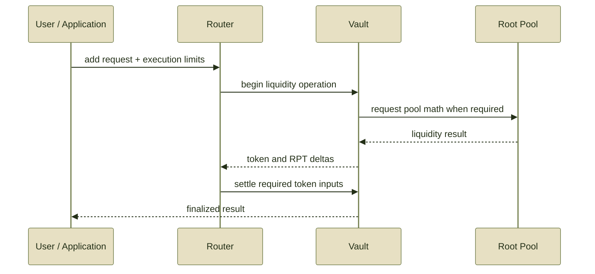

# Add Liquidity


Adding liquidity supplies assets to a Root Pool.

For normal **share-issuing** liquidity operations, the provider receives newly minted **Root Pool Tokens (RPTs)** representing the resulting ownership position.

The safe integration pattern is:

**select the operation → query the same operation → derive limits → authorize → execute → verify**


**Donation is the exception.**

A donation adds assets without minting RPT. It is a specialized pool operation, not a normal way to become a liquidity provider.


See Adding & Removing Liquidity for the economics behind proportional, non-proportional, and donation operations.

***

### 1. Inspect the Root Pool

Before constructing a transaction, determine:

* the Root Pool address;
* registered pool tokens and their order;
* whether the pool is initialized;
* which add-liquidity modes it supports;
* whether Hooks affect liquidity operations;
* whether any assets have special token or rate behavior;
* which deployed Router supports the intended path.

Do not assume every Root Pool exposes every liquidity mode.


**Initialization is a separate operation.**

In the inherited v3 architecture, a newly registered pool must be initialized before normal add-liquidity operations begin.

If the pool is not initialized, use the deployment's initialization flow rather than treating the first deposit as an ordinary add.


***

### 2. Choose the liquidity operation

The inherited v3 model defines five add-liquidity kinds.

| Operation                  | User fixes                            | Protocol calculates                 | Execution protection                        |
| -------------------------- | ------------------------------------- | ----------------------------------- | ------------------------------------------- |
| **Proportional**           | exact RPT to receive                  | proportional token amounts required | maximum token inputs                        |
| **Unbalanced**             | exact amounts of pool tokens supplied | RPT received                        | minimum RPT output                          |
| **Single-token exact out** | exact RPT to receive                  | required amount of one token        | maximum token input                         |
| **Donation**               | assets contributed                    | no RPT                              | specialized operation; not a normal LP flow |
| **Custom**                 | pool-defined                          | pool-defined                        | defined by that pool and Router path        |

#### Proportional

A proportional add scales the pool without intentionally changing its relative inventory.

The provider chooses the exact amount of RPT they want to receive. The required pool-token amounts are then calculated proportionally.

```
exact RPT wanted
       ↓
query
       ↓
required token amounts
       ↓
set maximum token inputs
```

Because there is no non-proportional component, this is the simplest add-liquidity shape to reason about.

#### Unbalanced

An unbalanced add starts from exact token amounts.

```
exact token amounts
        ↓
query
        ↓
expected RPT out
        ↓
set minimum RPT out
```

The non-proportional part changes relative pool inventory and therefore contains swap-like economics.

Swap fees can apply to that non-proportional component.

#### Single-token exact out

A single-token add fixes the amount of RPT to mint and calculates how much of one pool asset is required.

```
exact RPT wanted
       ↓
selected token
       ↓
query
       ↓
required token input
       ↓
set maximum token input
```

Because the operation is one-sided, price impact and swap-fee effects can matter.

#### Custom

A custom add has semantics defined by the pool.

Do not infer its behavior from the standard liquidity modes. The pool documentation must define:

* accepted inputs;
* output behavior;
* `userData`, if required;
* supported limits;
* Hook interactions;
* any additional constraints.

Custom liquidity must also be explicitly supported by the pool configuration.

***

### Donation is not ordinary LPing

A donation transfers assets into the Root Pool **without minting corresponding RPT**.

```
pool assets ↑
RPT supply  unchanged
```

The sender therefore gives value to the pool without receiving an equivalent ownership claim.


**Do not expose donation as a generic “Add Liquidity” button.**

In the inherited v3 model, donation must be explicitly enabled for the pool. It also makes the pool-share rate directly manipulable, which has important consequences for nesting and for systems that rely on that rate externally.

Use donation only for an explicitly designed use case.


***

### 3. Query the exact action

Before submitting a share-issuing add, simulate the same action against current state.

The query and execution should agree on all economically relevant inputs:

```
Root Pool
+ liquidity operation
+ token amounts / exact RPT target
+ sender
+ userData
+ relevant route
        ↓
      query
        ↓
 expected result
```

This equivalence matters because pool state, Hooks, and caller-dependent behavior can affect the result.


**Do not quote one operation and execute another.**

An unbalanced-add quote is not a proportional-add quote.

A query using different `userData`, sender assumptions, tokens, or pool state may also produce a result that is inappropriate for the eventual transaction.


See Query & Simulate.

***

### 4. Turn the quote into limits

A query gives an expectation.

The transaction needs an enforceable boundary.

#### Proportional add

The desired RPT amount is exact.

The variable side is the amount of each pool token required.

```
query → expected token inputs
                 ↓
          apply tolerance
                 ↓
        maximum token inputs
```

Execution should revert rather than consume more than those maxima.

#### Unbalanced add

The token amounts supplied are exact.

The variable side is the RPT received.

```
query → expected RPT out
                ↓
         apply tolerance
                ↓
          minimum RPT out
```

Execution should revert if the resulting RPT falls below that minimum.

#### Single-token exact out

The RPT output is exact.

The variable side is the required input token amount.

```
query → expected token input
                 ↓
          apply tolerance
                 ↓
          maximum input
```

The application should never implement this protection only as a UI warning.

The limit must be encoded into the transaction.

***

### 5. Prepare authorization

The Router must be able to source the required input assets.

The inherited Balancer v3 retail Router design uses **Permit2** for add-liquidity token authorization. That is an upstream architectural pattern, not sufficient evidence by itself that every ROOTSTOCK Router deployment uses the same configuration.

Use the deployed ROOTSTOCK Router and its documented authorization path as the authority.

Verify:

* the network;
* token contract addresses;
* the authorized spender;
* the amount being authorized;
* expiration or nonce rules where applicable;
* whether the authorization is reusable or single-use;
* the Router that will actually execute the transaction.


Never copy an approval target from a Balancer deployment or another ROOTSTOCK Router version.

Authorization must correspond to the actual deployed execution path.


Prefer bounded or expiring permissions where the deployed authorization system supports them rather than granting unnecessary standing access.

***

### 6. Execute through the Router

For normal integrations, the Router is the application-facing entry point.



The exact internal path depends on the liquidity kind.

For example, proportional operations can rely primarily on shared Vault liquidity math, while non-proportional or custom operations can require additional pool-specific calculations.

An application integrating an existing Router should not reproduce the Vault's transient accounting or settlement machinery itself.

That belongs to Architecture and Build a Custom Router.

***

### 7. Use public token units

Token amounts submitted through the public Router interface use the token units expected by that interface.

For standard ERC-20 paths, this means the token's native decimals.

For example:

```
1 USDC
=
1,000,000 raw units
```

when USDC uses 6 decimals.

Do not pre-apply the Vault's internal decimal scaling or rate scaling to these public amounts.

```
application
    ↓
raw token amount
    ↓
Router
    ↓
Vault
    ↓
decimal / rate scaling
    ↓
pool mathematics
```

The Vault owns that accounting transformation.

See Token Scaling.

***

### Rate-aware assets

Some pool tokens can be configured with a **Rate Provider**.

In the inherited v3 accounting model, the Vault applies configured token rates during liquidity operations so pool mathematics can work with rate-adjusted live balances.

The integration boundary remains the same:

**submit public token amounts; let the Vault perform internal scaling.**

An application should not independently transform its transaction amounts using a Rate Provider unless a specific interface explicitly requires that behavior.

See Rate Providers.

***

### ERC-4626 underlying assets

A pool can contain an ERC-4626 wrapper while a user holds the wrapper's underlying asset.

Those are not automatically the same integration path.

Where the deployed ROOTSTOCK stack provides an initialized buffer and a Router capable of handling the wrapper/underlying conversion, the application can use that specialized route.

Conceptually:

```
underlying asset
      ↓
specialized Router / buffer path
      ↓
ERC-4626 pool token
      ↓
Root Pool
```

Do not send an underlying asset to a standard pool-token add path merely because it corresponds economically to an ERC-4626 wrapper.

See ERC-4626 Buffers and the deployed Router reference for supported paths.

***

### 8. Verify execution

After the transaction is included, verify the result rather than relying on the earlier quote.

Check:

* transaction success;
* Root Pool address;
* Router address;
* actual token amounts supplied;
* RPT actually minted or received;
* recipient address;
* relevant Vault or pool events;
* Hook-dependent outcomes where relevant.

A quote/execution difference inside the user's limits is expected when state changes.

A persistent or unexpectedly large discrepancy can instead indicate:

* stale quotes;
* wrong token decimals;
* incorrect token ordering;
* querying and executing different operation types;
* different `sender` or `userData`;
* rate changes;
* dynamic fee behavior;
* Hook behavior;
* an integration bug.

***

### Failure checklist

If an add-liquidity transaction reverts, check these in order:

1. **Correct network and deployment** — the application is using the intended ROOTSTOCK contracts.
2. **Pool state** — the pool is registered and initialized for a normal add.
3. **Supported mode** — the pool allows the requested liquidity operation.
4. **Correct Router** — the Router supports that pool and operation.
5. **Token ordering** — array inputs match the interface's required token order.
6. **Token units** — amounts use the expected raw token decimals.
7. **Balance** — the sender owns enough of each required asset.
8. **Authorization** — the actual execution path has sufficient valid permission.
9. **Query equivalence** — quote and execution use the same operation, sender assumptions, and `userData`.
10. **Limits** — maximum inputs or minimum output still hold.
11. **Hooks and custom rules** — attached logic permits the operation.
12. **Token compatibility** — the asset behaves as expected by the Vault.
13. **Contract error** — inspect the current ROOTSTOCK error reference.

***

### Integration invariant

The most useful way to reason about an add is to identify **which side is fixed and which side may move**.

| Add type               | Fixed side     | Variable side | Protect the variable side with |
| ---------------------- | -------------- | ------------- | ------------------------------ |
| Proportional           | RPT out        | token inputs  | maximum inputs                 |
| Unbalanced             | token inputs   | RPT out       | minimum output                 |
| Single-token exact out | RPT out        | token input   | maximum input                  |
| Donation               | donated assets | no RPT exists | specialized flow               |
| Custom                 | pool-defined   | pool-defined  | pool-defined limits            |


**Query the variable side. Bound the variable side. Then execute.**


***

### Related reference

Use these pages when you need implementation-level details:

* Router APIs
* Vault API
* Protocol Interfaces
* Errors
* Token Compatibility

For the economic model behind these operations, return to Adding & Removing Liquidity.
