# Aggregator Integration

## Aggregator Integration

An aggregator can model an eligible Root Pool as a **stateful pricing edge** inside a larger routing graph.

But a Root Pool is not only an invariant.

Correct integration can depend on:

* pool type and parameters;
* current balances;
* Vault decimal and rate scaling;
* static or dynamic swap fees;
* Hooks;
* token behavior;
* wrapper or buffer steps;
* exact rounding behavior;
* Router and settlement model.

The production pipeline is therefore:

**discover → classify → ingest state → quote → search → validate → execute → reconcile**

***

### Integration model

```mermaid
%%{init: {"theme":"base","themeVariables":{
  "primaryColor":"#E7E0C3",
  "primaryTextColor":"#243018",
  "primaryBorderColor":"#6F7B48",
  "lineColor":"#7A6847",
  "secondaryColor":"#DCE8CB",
  "tertiaryColor":"#F3EBD8",
  "fontFamily":"Inter, ui-sans-serif, system-ui"
}}}%%
flowchart LR
    D["Discover<br/>Root Pools"] --> C["Classify<br/>capabilities"]
    C --> S["Ingest<br/>current state"]
    S --> M["Fast offchain<br/>quote adapters"]
    M --> R["Route<br/>search"]
    R --> Q["Protocol-native<br/>query validation"]
    Q --> E["Aggregator<br/>execution adapter"]
    E --> X["Events +<br/>reconciliation"]

    classDef source fill:#F5F0E3,stroke:#8B7754,stroke-width:2px,color:#2E281D;
    classDef model fill:#E3E8D5,stroke:#75845A,stroke-width:2px,color:#25301E;
    classDef execution fill:#D5E3BE,stroke:#536B3F,stroke-width:3px,color:#1D2816;
    classDef validation fill:#F0E4B9,stroke:#917634,stroke-width:2px,color:#2B2516;

    class D,C source;
    class S,M,R model;
    class Q validation;
    class E,X execution;
```



Each layer answers a different question.

| Layer            | Question                                                    |
| ---------------- | ----------------------------------------------------------- |
| Discovery        | What markets exist?                                         |
| Classification   | Which markets can this adapter safely model?                |
| State ingestion  | What is their current executable state?                     |
| Offchain quoting | What do candidate trades approximately calculate?           |
| Route search     | Which candidate route best satisfies the routing objective? |
| Query validation | What does the deployed protocol calculate now?              |
| Execution        | How is the validated route settled atomically?              |
| Reconciliation   | What actually executed?                                     |

***

### 1. Discover Root Pools

Discovery should establish the identity and static configuration of each candidate market.

Useful metadata includes:

* Root Pool address;
* factory or deployment provenance;
* pool family;
* registered tokens;
* token ordering;
* pool implementation or version where relevant;
* weights for Weighted Pools;
* amplification parameters for Stable-style pools;
* Hook address and known Hook type;
* token types;
* Rate Provider addresses;
* configured liquidity capabilities;
* other pool-specific immutable or slowly changing parameters.

Do not treat:

```
registered
```

as equivalent to:

```
routable
```

A deployed pool may be uninitialized, paused, unsupported by the adapter, dependent on unknown custom behavior, or otherwise unsuitable for routing.

***

### Classify capabilities explicitly

Each discovered pool should be assigned an integration status.

For example:

| Status          | Meaning                                                                                       |
| --------------- | --------------------------------------------------------------------------------------------- |
| **Supported**   | Adapter understands the complete execution behavior needed for routing                        |
| **Query-only**  | Can be validated through protocol queries but is not safely modeled for broad offchain search |
| **Unsupported** | Required pool, Hook, token, or Router behavior is not implemented                             |
| **Unavailable** | Pool exists but current protocol state prevents the intended operation                        |

This taxonomy is an **aggregator integration policy**, not a ROOTSTOCK protocol classification.

Its purpose is to prevent unsupported behavior from silently entering the routing graph.


**Unknown should not mean approximately supported.**

If a custom pool or Hook changes swap behavior in a way the adapter does not understand, exclude it from normal offchain routing until that behavior is modeled or explicitly handled.


***

### 2. Maintain current state

A pricing adapter needs more than static pool metadata.

Depending on the pool, current state can include:

* raw token balances;
* scaled/live balances or the information required to derive them;
* token rates;
* swap fee state;
* dynamic-fee inputs;
* changing pool parameters;
* pause state;
* Hook-dependent state;
* wrapper or buffer state.

Separate **static configuration** from **dynamic pricing state**.

```
pool identity + configuration
            +
current balances + rates + fees + Hook state
            ↓
       quote state
```

This distinction makes cache invalidation and incremental indexing much safer.

***

### Use the chain as execution authority

APIs, subgraphs, databases, and cached state can make discovery and routing dramatically faster.

They are not substitutes for the execution state of the deployed contracts.

A robust architecture can use:

```
API / indexer
    ↓
fast discovery + candidate state

chain reads / Router queries
    ↓
execution-critical validation
```

Where ROOTSTOCK exposes a canonical data service, it can be used as a discovery or indexing surface according to its documented guarantees.

For execution-sensitive decisions, validate the state required by the route against the relevant deployed contracts or query surfaces.

***

### Events and reconciliation

Events are useful for maintaining an incremental local model.

Relevant state changes can include:

* swaps;
* liquidity additions;
* liquidity removals;
* swap-fee changes;
* pause-state changes;
* pool-specific configuration changes.

An indexer can apply those events to its local state rather than reconstructing every pool from scratch on every block.

But event ingestion needs a recovery strategy.

After:

* missed blocks;
* RPC failure;
* indexer downtime;
* chain reorganization;
* detected state inconsistency;

reconcile the derived state against authoritative contract state before relying on it for execution-critical routing.


Events are excellent for **incremental state maintenance**.

Contract state is the checkpoint used to confirm that the local model has not drifted.


See Events & Indexing.

***

### 3. Implement pool adapters

The routing engine needs a quote adapter for each supported economic behavior.

A useful abstraction is:

```
pool state
+ swap kind
+ token pair
+ amount
       ↓
pool adapter
       ↓
calculated amount
```

For standard pool families, ROOTSTOCK may inherit deterministic mathematics that can be reproduced offchain.

Typical examples include:

* Weighted Pool math;
* Stable Pool math.

Custom pools need corresponding custom adapters unless the integration deliberately treats them as query-only.

***

### Pool type is not enough

Two pools using the same underlying invariant can still produce different execution behavior.

For example:

```
Stable Pool
+ static fee
```

and:

```
Stable Pool
+ dynamic-fee Hook
```

do not necessarily expose the same pricing edge.

Likewise:

```
same pool math
+ different token rates
```

can produce different executable results.

The adapter key may therefore need to include more than:

```
poolType
```

A safer model is closer to:

```
pool implementation
+ configuration
+ Hook behavior
+ token behavior
+ current state
```

***

### Reproduce protocol rounding

Offchain arithmetic must respect the same fixed-point conventions and rounding direction as the deployed protocol.

This matters particularly around exact-output routing.

An optimistic one-unit difference can turn:

```
quoted required input
<
actual required input
```

into an execution revert when the route's maximum input is too low.

Do not replace protocol integer arithmetic with unconstrained floating-point calculations.

See Rounding & Invariant Approximation.

***

### 4. Reproduce Vault normalization

Pool contracts do not necessarily receive raw ERC-20 balances directly.

In the inherited v3 accounting model, the Vault can transform values before passing them into pool math.

Conceptually:

```
raw token amount
       ↓
decimal scaling
       ↓
rate scaling where configured
       ↓
yield-fee adjustment where applicable
       ↓
live scaled balance
       ↓
pool math
```

An offchain adapter that feeds raw USDC and WETH balances directly into invariant code while the deployed pool operates on normalized live balances can produce incorrect quotes.


**Do not mix accounting domains.**

`raw` token units and `liveScaled18` values represent different stages of the calculation.


See Token Scaling and Rate Providers.

***

### Rate Providers are live pricing inputs

For a token configured with a Rate Provider, the rate participates in the Vault's normalization process during swaps.

An aggregator therefore needs to distinguish:

```
token balance
```

from:

```
effective balance used by pool math
```

The rate can change independently of ordinary swap events.

Do not assume that replaying only pool `Swap` events is sufficient to reconstruct every input that can affect a quote.

***

### 5. Model fees

Swap fees are part of the executable market edge.

A quote adapter can need to account for:

* static swap fees;
* dynamic swap fees;
* exact-in vs exact-out fee treatment;
* pool-specific fee behavior;
* fees encountered at every hop.

For a multi-pool route:

```
A
↓ fee + Pool 1
B
↓ fee + Pool 2
C
```

the final route result depends on the fee behavior of every step.

#### Dynamic fees

A cached static fee is insufficient when the pool uses a dynamic-fee Hook.

The effective fee may depend on current state or other Hook inputs at quote time.

An aggregator should either:

1. reproduce the supported Hook's fee logic faithfully; or
2. treat the pool as query-only / unsupported for offchain search.

Do not silently fall back to the pool's static fee when execution uses a dynamic fee.

***

### Hooks are part of the market

A Hook is not merely pool metadata.

It can participate in the execution behavior that determines the result.

The routing model should therefore track:

* Hook address;
* known Hook implementation or family;
* enabled callbacks;
* whether it computes a dynamic swap fee;
* whether it can adjust swap results where supported;
* any external state required by its logic.

Conceptually:

```
Root Pool invariant
       +
Vault accounting
       +
Hook behavior
       ↓
executable pricing edge
```

Two pools with identical invariant parameters but different Hooks should not automatically share the same quote adapter.


A conservative aggregator policy is to mark an unknown custom Hook **unsupported for optimized routing** until its execution behavior is understood.

The protocol may still be able to execute the pool; the aggregator simply does not claim it can safely model it.


See Hooks.

***

### 6. Search routes offchain

Calling the protocol for every possible route is generally too expensive or slow for broad route search.

A production router can instead use fast local adapters to explore candidates.

```
large routing graph
       ↓
local quote adapters
       ↓
candidate routes
       ↓
rank / prune
       ↓
shortlist
```

Possible routing objectives can include combinations of:

* output amount;
* required input;
* gas;
* path length;
* execution reliability;
* application-specific constraints.

ROOTSTOCK does not define the aggregator's route-ranking objective.

That belongs to the routing system.

***

### Offchain math is not execution authority

A locally reproduced quote is only as accurate as the model and state supplied to it.

For a standard pool under identical state and fully reproduced accounting, the local implementation may closely match protocol execution.

But parity can fail if the adapter misses:

* rounding;
* a token rate;
* a dynamic fee;
* Hook state;
* wrapper behavior;
* a changing pool parameter;
* current chain state.

The production pattern should therefore be:

```
fast offchain math
      ↓
route search
      ↓
shortlisted route
      ↓
protocol-native query
      ↓
validated quote
```


**Offchain math searches.**

**Protocol queries validate.**

**Transaction limits protect execution.**


***

### 7. Validate the selected route

Before execution, query the route through the Router surface that corresponds to the planned transaction.

Validate:

* Exact In vs Exact Out;
* path ordering;
* pools;
* intermediate tokens;
* amount;
* sender context where relevant;
* `userData`;
* wrapper or buffer steps;
* final calculated amount.

If the protocol-native result materially disagrees with the local adapter, treat that as a model discrepancy rather than simply widening the user's slippage.

```
local quote
    ≠
Router query
    ↓
invalidate / investigate adapter
```

The query result is still not a guarantee of execution.

Convert it into an explicit minimum output or maximum input according to the application's execution policy.

See Query & Simulate.

***

### Do not derive onchain limits from manipulable queries

The query-validation step above is normally an **offchain routing step**.

A contract should not call a query during execution and blindly use that result to create its own protection threshold.

The transaction should arrive with an independently meaningful limit already encoded.

```
offchain route validation
        ↓
user / solver execution policy
        ↓
min output / max input
        ↓
onchain execution
```

***

### 8. Use the appropriate Aggregator Router

The inherited v3 architecture separates retail and aggregator settlement.

#### Retail model

A typical user-side Router can pull input assets using its configured authorization mechanism.

#### Aggregator model

The dedicated aggregator path is designed for contract callers that already control the input assets.

The inherited model is:

```
aggregator / solver contract
          ↓
transfer input to Vault
          ↓
Aggregator Router
          ↓
Vault verifies prepaid settlement
          ↓
swap execution
          ↓
output
```

No Permit2 approval is needed for this prepaid path.

The input transfer and Router execution occur atomically within the caller's transaction.


**Prepaid does not mean unaccounted.**

The Vault's settlement accounting still verifies that the required input has actually been supplied.


***

### Single-pool vs batch aggregator execution

The inherited architecture distinguishes two execution surfaces.

| Route                     | Inherited execution model |
| ------------------------- | ------------------------- |
| Single Root Pool          | Aggregator Router         |
| Multihop / multiple paths | Aggregator Batch Router   |

The batch form can execute paths containing multiple steps and multiple independent paths in one transaction.

Use the ROOTSTOCK deployment registry and current Developer Reference to determine which Router implementations are actually deployed.

Do not copy Balancer addresses or assume an upstream Router is available unchanged.

***

### Aggregator execution is not retail execution

Do not construct aggregator transactions as if they were retail Router calls.

The inherited prepaid aggregator path differs in material ways:

* input is transferred to the Vault by the caller;
* Permit2 is not used;
* retail approval helpers are not part of the flow;
* Router calldata can differ;
* native-ETH conveniences available on another Router should not be assumed.

The execution adapter should target the exact deployed aggregator ABI.

***

### 9. Bound every route

Protocol validation does not replace execution protection.

For Exact In:

```
fixed input
    ↓
validated output quote
    ↓
minimum output
```

For Exact Out:

```
fixed output
    ↓
validated input quote
    ↓
maximum input
```

Also apply a deadline where the deployed Router exposes one.

The route should revert rather than execute outside the user's accepted bounds.

***

### 10. Reconcile execution

After inclusion, reconcile the transaction against the route that was submitted.

Useful records include:

* transaction hash;
* block;
* Router implementation;
* Exact In / Exact Out;
* supplied route;
* pools;
* input token and amount;
* output token and amount;
* per-pool swap events;
* effective swap fee data where emitted;
* quoted result;
* execution limit;
* actual result.

Vault swap events can provide per-pool execution evidence.

For multi-step transactions, distinguish:

```
route-level result
```

from:

```
individual pool events
```

Both are useful, but they answer different questions.

***

### Do not trust events blindly as accounting truth

Decoded events are valuable for observability and indexing.

For critical accounting, reconcile them with:

* the transaction result;
* token balance changes where appropriate;
* expected route structure;
* relevant contract state.

This is especially useful for complex transactions containing multiple paths or other composed operations.

***

### Adapter versioning

Treat adapters as versioned protocol integrations.

A practical compatibility key can include:

```
chain
+ Vault version
+ pool implementation / family
+ Hook implementation
+ Router implementation
+ adapter version
```

Not every field must change for every pool.

The point is to avoid the assumption that:

```
same pool math
=
same complete integration
```

A Router upgrade can change calldata or settlement behavior without changing the invariant.

A Hook upgrade path or new pool implementation can change pricing behavior without changing the aggregator's public token pair.

***

### Safety policy

A production aggregator should define explicit exclusion rules.

A conservative baseline is:

* reject unsupported pool implementations;
* reject unmodeled custom Hooks from optimized routing;
* validate token compatibility;
* verify pool operational state;
* detect stale or failed Rate Providers where possible;
* reject stale state snapshots according to application policy;
* cap route length and computational complexity;
* account for gas when comparing routes;
* preserve exact integer rounding;
* protect every execution with min/max limits;
* use deadlines where supported;
* validate shortlisted routes through protocol queries;
* fail closed when adapter and protocol results disagree materially;
* reconcile execution after inclusion.


**Do not guess through unknown protocol behavior.**

Skipping a candidate market is safer than producing an optimistic route that cannot execute.


***

### Integration invariant

An aggregator does not integrate only a formula.

It integrates an execution system.

```
Root Pool math
      +
Vault accounting
      +
fees
      +
rates
      +
Hooks
      +
token behavior
      +
Router settlement
      ↓
routable ROOTSTOCK edge
```

The complete pipeline is:

```
discover
   ↓
classify
   ↓
ingest current state
   ↓
model locally
   ↓
search routes
   ↓
query shortlist
   ↓
set execution bounds
   ↓
prepay + execute atomically
   ↓
reconcile actual result
```


**Search with models.**

**Validate against protocol behavior.**

**Execute through the deployed Router.**

**Trust the receipt over the quote.**


***

### Useful reference

* Swaps
* Batch & Multihop Swaps
* Queries & Simulation
* Router Types
* Token Scaling
* Rate Providers
* Hooks
* Token Compatibility
* Router APIs
* Events
* Pool Data
