```mermaid
%%{init: {"theme":"base","themeVariables":{
  "primaryColor":"#E7E0C3",
  "primaryTextColor":"#243018",
  "primaryBorderColor":"#6F7B48",
  "lineColor":"#7A6847",
  "secondaryColor":"#DCE8CB",
  "tertiaryColor":"#F3EBD8",
  "fontFamily":"Inter, ui-sans-serif, system-ui, sans-serif"
}}}%%
flowchart LR
    I["User intent"]
    D["Discover<br/>pool + route"]
    Q["Query<br/>expected result"]
    P["Protect<br/>limits + deadline"]
    A["Authorize<br/>tokens / shares"]
    R["Router<br/>execute"]
    V["Vault + Root Pool<br/>account + calculate"]
    C["Validate<br/>receipt + events"]

    I --> D
    D --> Q
    Q --> P
    P --> A
    A --> R
    R --> V
    V --> C

    classDef intent fill:#F5F0E3,stroke:#8B7754,stroke-width:2px,color:#2E281D;
    classDef preparation fill:#E3E8D5,stroke:#75845A,stroke-width:2px,color:#25301E;
    classDef protection fill:#F0E4B9,stroke:#917634,stroke-width:2px,color:#2B2516;
    classDef execution fill:#D5E3BE,stroke:#536B3F,stroke-width:3px,color:#1D2816;
    classDef validation fill:#E8D9B9,stroke:#7A5C34,stroke-width:2px,color:#2C2116;

    class I intent;
    class D,Q preparation;
    class P,A protection;
    class R,V execution;
    class C validation;
```

# Overview

## Integration Guides

Integration Guides explain **how an application turns user intent into a protected ROOTSTOCK transaction**.

They assume the conceptual model introduced in Start Here: applications normally interact through a **Router**, the **Vault** coordinates accounting and settlement, and **Root Pools** provide market-specific mathematics.

These guides focus on the workflow an integrator must get right:

**discover → query → protect → authorize → execute → validate**

Exact contract signatures, deployed addresses, ABIs, events, and error identifiers belong in Developer Reference.


**Use ROOTSTOCK deployment data.**

Router addresses, Vault addresses, ABIs, and other deployment-specific configuration must come from ROOTSTOCK deployment artifacts or the ROOTSTOCK contract registry.

Do not substitute Balancer addresses merely because ROOTSTOCK inherits architecture from Balancer v3.


***

### Integration flow





The exact contracts and parameters differ by operation, but the integration pattern stays largely the same.

***

### From intent to transaction



#### 1. Discover

Identify the market and execution path required for the user's action.

That normally means determining:

* the Root Pool;
* the input and output tokens;
* the type of operation;
* the appropriate Router;
* any relevant Hook, fee, or token behavior.

Do not assume that every pool or Router supports every operation.



#### 2. Query

Estimate the result against current protocol state before submitting the transaction.

The query should represent the **same economic action** you intend to execute. Changing the pool, path, tokens, operation type, or Router can make the quote irrelevant.

A query is useful for constructing the transaction. It is not itself execution protection.



#### 3. Protect

Convert the expected result into limits that the transaction can enforce.

Depending on the operation, these can include:

* minimum output;
* maximum input;
* minimum Root Pool Tokens received;
* minimum underlying tokens received;
* maximum tokens supplied;
* a deadline, where supported.

If execution moves outside the user's permitted bounds, the transaction should revert.



#### 4. Authorize

Authorize the exact contract and assets required by the selected execution path.

Approval mechanisms can differ between Routers and operations. An integration should derive the spender and authorization method from the ROOTSTOCK deployment it is actually using rather than assuming another Router follows the same pattern.



#### 5. Execute

Submit the protected operation through the appropriate Router.

The Router translates the user's requested workflow into Vault operations. The application should not reproduce the Vault's accounting and settlement machinery unless it is intentionally building lower-level protocol infrastructure.



#### 6. Validate

After inclusion, verify the actual transaction result.

Check:

* transaction success;
* final token or Root Pool Token amounts;
* the expected pool and Router;
* emitted events when they are part of the integration;
* any application state that depends on the result.

The quoted amount displayed before submission is not proof of what executed.



***

### Choose the workflow

| Goal                                         | Guide                  | Primary execution protection                     |
| -------------------------------------------- | ---------------------- | ------------------------------------------------ |
| Supply assets to a Root Pool                 | Add Liquidity          | maximum token inputs and/or minimum RPT output   |
| Redeem a Root Pool Token                     | Remove Liquidity       | minimum token outputs and/or maximum RPT input   |
| Exchange assets                              | Swap                   | minimum output or maximum input                  |
| Estimate an operation                        | Query & Simulate       | quote freshness + explicit execution limits      |
| Route ROOTSTOCK liquidity from an aggregator | Aggregator Integration | path validation + token, fee, and Hook awareness |

The exact protections available depend on the operation and deployed Router.

***

### A quote is a snapshot, not a guarantee

A query describes what an operation would produce against a particular protocol state.

That state can change before the transaction executes.

For example:

* another trade can change pool balances;
* a token rate can update;
* a dynamic swap fee can change;
* Hook state can change;
* another transaction can execute first;
* an arbitrageur can move the pool toward an external market price;
* a multihop route can change at more than one pool.


**Quote ≠ limit.**

A quote tells the application what it currently expects.

A limit tells the protocol what the user is still willing to accept.

The transaction needs the second one.


For an exact-input swap, that commonly means deriving a **minimum amount out** from the quote.

For an exact-output swap, it commonly means deriving a **maximum amount in**.

Liquidity operations use the same principle with their corresponding token and Root Pool Token bounds.

See Price Impact & Slippage for the underlying concept.

***

### Authorization depends on the execution path

Do not assume every ROOTSTOCK Router uses the same token-transfer or authorization model.

The application should determine:

1. which Router it will call;
2. which assets that Router needs to source;
3. who the authorized spender must be;
4. whether the operation uses an allowance, permit, prepayment, or another supported mechanism;
5. whether any existing authorization is sufficient.

The authoritative ROOTSTOCK behavior should be documented alongside each deployed Router in Developer Reference.


**Balancer v3 inheritance note**

Upstream Balancer v3 retail Router flows use **Permit2** for ERC-20 inputs to common swap and add-liquidity operations. Pool-share removal uses a pool-token authorization path, while aggregator-oriented Routers can instead use a prepaid settlement model.

These patterns are useful for understanding the inherited architecture, but they should not be treated as ROOTSTOCK deployment facts until the corresponding ROOTSTOCK Router is documented and verified.


***

### Public units, internal accounting

Integrators should provide token amounts exactly as required by the deployed public Router interface.

Do not attempt to reproduce the Vault's internal scaling, rate adjustment, or settlement accounting in application code unless the integration specifically requires lower-level protocol behavior.

The boundary is intentional:

```
application amounts
        ↓
     Router
        ↓
Vault accounting / scaling
        ↓
    Root Pool math
```

See Token Scaling for the accounting model and Developer Reference for exact interface requirements.

***

### Hooks and fees are execution behavior

A pool's configuration affects more than its mathematical curve.

Configured Hooks can run around supported operations, and dynamic fees can change the effective result of an interaction. Applications and aggregators should therefore treat them as part of the market's execution behavior rather than as optional descriptive metadata.

This is especially important when:

* comparing routes;
* caching pool state;
* estimating output;
* reproducing pool mathematics offchain.

See Hooks and Dynamic Fees.

***

### Integration rules

A ROOTSTOCK integration should preserve a few simple invariants:

* **Use the correct Router.** Different workflows can have different entry points.
* **Query the action you intend to execute.** A quote from another path is not equivalent.
* **Protect the transaction itself.** UI estimates are not execution constraints.
* **Derive approvals from the deployed Router.** Never guess the spender.
* **Use the public interface's token units.** Do not manually imitate Vault scaling.
* **Check token compatibility.** Not every ERC-20 behaves safely or predictably.
* **Account for Hooks and dynamic fees.** They can affect execution.
* **Treat RPTs as pool shares.** They are not fixed claims on predetermined token quantities.
* **Separate pool math from routing math.** A valid trade through one pool does not imply that a multi-pool route is economically good.
* **Validate what executed.** Transaction results, not pre-transaction estimates, are authoritative.

See Token Compatibility before integrating unfamiliar assets.

***

### Continue

Choose the operation your application needs:

* Add Liquidity — supply assets and receive Root Pool Tokens
* Remove Liquidity — redeem Root Pool Tokens for pool assets
* Swap — execute exact-input or exact-output exchanges
* Query & Simulate — estimate operations before execution
* Aggregator Integration — expose ROOTSTOCK liquidity to routing systems

Use Developer Reference when you need exact contract interfaces, addresses, ABIs, events, or errors.
