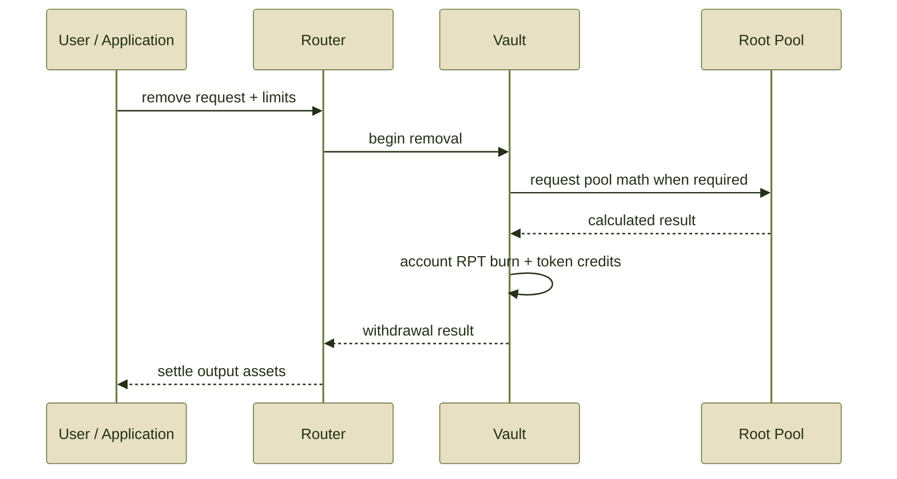

# Remove Liquidity

## Remove Liquidity

Removing liquidity exchanges **Root Pool Token (RPT)** ownership for assets from a Root Pool.

The safe integration pattern is:

**select the exit → query the same exit → derive limits → authorize RPT → execute → verify**

For most users, **proportional removal** is the baseline exit. It redeems a share of the pool's current assets without intentionally changing their relative composition.

See Adding & Removing Liquidity for the economic model behind each exit type.

***

### 1. Inspect the position and pool

Before constructing a removal, determine:

* the Root Pool;
* the user's RPT balance;
* whether the RPT is directly available to the user;
* the pool's registered tokens and their order;
* the desired removal mode;
* whether that mode is supported by the pool;
* whether Hooks affect removals;
* whether the pool is paused or in Recovery Mode;
* whether wrapped or rate-aware assets require a specialized route.

If the RPT is held inside another protocol, wrapper, escrow, staking system, or nested position, it may need to be made available before the selected Router can redeem it.


Removing liquidity redeems the pool's **current state**.

It does not reverse the original deposit or guarantee the same token quantities that were initially supplied.


***

### 2. Choose the removal operation

The inherited v3 model defines four standard remove-liquidity kinds.

| Operation                  | User fixes                           | Protocol calculates          | Execution protection  |
| -------------------------- | ------------------------------------ | ---------------------------- | --------------------- |
| **Proportional**           | exact RPT to redeem                  | proportional token basket    | minimum token outputs |
| **Single-token exact in**  | exact RPT to redeem                  | amount of one selected token | minimum token output  |
| **Single-token exact out** | exact amount of one token to receive | RPT required                 | maximum RPT input     |
| **Custom**                 | pool-defined                         | pool-defined                 | pool-defined limits   |

There is no generic standard **unbalanced remove** corresponding directly to an unbalanced add. Standard non-proportional exits are expressed through the single-token removal modes.

***

### Proportional removal

A proportional removal burns an exact amount of RPT and returns the corresponding share of each registered pool asset.

```
exact RPT in
     ↓
   query
     ↓
expected token basket
     ↓
minimum token outputs
```

Because the operation scales the pool down without intentionally changing relative inventory, the inherited v3 model gives proportional removal:

* no price impact from an implicit rebalance; and
* no swap fee for such a rebalance, because no implicit trade is required.


**Proportional removal is the cleanest exit model.**

It changes pool size while preserving the pool's relative composition.


***

### Single-token exact in

A single-token exact-in removal burns a known amount of RPT and returns one selected pool asset.

```
exact RPT in
     ↓
selected token
     ↓
   query
     ↓
expected token out
     ↓
minimum token out
```

The RPT input is fixed.

The token output is the calculated side and should therefore be protected with a minimum.

Because the operation converts the user's proportional ownership into a single asset, it changes relative pool inventory and contains swap-like economics.

Price impact and swap-fee treatment can therefore apply.

***

### Single-token exact out

A single-token exact-out removal starts from the opposite direction.

The user specifies exactly how much of one pool asset they want to receive.

```
exact token out
      ↓
    query
      ↓
required RPT in
      ↓
 maximum RPT in
```

The token output is fixed.

The RPT required is the calculated side and should therefore be constrained with a maximum.

If execution would require burning more than that maximum, the transaction should revert.

***

### Custom removal

A custom removal is defined by the Root Pool.

Its semantics are not implied by the generic ROOTSTOCK architecture.

A pool-specific integration should document:

* what the user fixes;
* what the pool calculates;
* how RPT input is bounded;
* how token outputs are bounded;
* required `userData`;
* relevant Hook behavior;
* any pool-specific restrictions.

Do not expose a custom removal merely because the protocol can represent `CUSTOM`. The Root Pool must explicitly support and define it.

***

### 3. Query the exact exit

Query the same economic operation that you intend to execute.

The relevant state should match as closely as possible:

```
Root Pool
+ removal kind
+ exact RPT or token amount
+ selected output token
+ sender
+ userData
+ route
        ↓
      query
        ↓
 expected result
```

The inherited Router query model passes the sender and `userData` because those values can affect results when pool or Hook behavior is caller-dependent.


**Do not query proportional removal and execute single-token removal.**

They are different economic operations.

Likewise, changing the sender, output token, `userData`, route, or pool state can make the original quote inappropriate for execution.


Queries simulate execution. They do not reserve liquidity or lock the quoted result.

See Query & Simulate.

***

### 4. Protect the calculated side

The useful rule is the same across liquidity operations:

**identify what is fixed, then bound what is calculated.**

| Removal type           | Fixed side         | Calculated side    | Protect with        |
| ---------------------- | ------------------ | ------------------ | ------------------- |
| Proportional           | RPT in             | token basket out   | minimum outputs     |
| Single-token exact in  | RPT in             | selected token out | minimum output      |
| Single-token exact out | selected token out | RPT in             | maximum RPT input   |
| Custom                 | pool-defined       | pool-defined       | pool-defined bounds |

#### Proportional

The RPT amount is exact.

Apply tolerance to each expected output token and encode those values as minimum acceptable amounts.

#### Single-token exact in

The RPT amount is exact.

Apply tolerance to the expected selected-token output and encode a minimum output.

#### Single-token exact out

The desired token amount is exact.

Apply tolerance to the expected RPT requirement and encode a maximum RPT input.


A UI warning is not slippage protection.

The minimum or maximum must be enforced by the transaction itself.


***

### 5. Authorize RPT

Removal spends **RPT**, not the pool assets being returned.

This makes its authorization path different from a normal add-liquidity operation.

In upstream Balancer v3, the Router can burn pool shares using either:

* a standard ERC-20 allowance granted to the Router; or
* an EIP-2612 permit signature.

That authorization does **not** use the normal Permit2 input-token flow.

ROOTSTOCK integrations should still treat the deployed ROOTSTOCK Router as authoritative rather than assuming every inherited deployment detail is unchanged.

Before execution, verify:

* the RPT contract;
* the Router being authorized;
* the maximum RPT amount it may spend;
* permit nonce and deadline where applicable;
* the account from which RPT will be burned.


**Queries do not need RPT approval.**

The inherited v3 query path can simulate a removal without actually holding or burning the user's pool shares. Authorization is required only for state-changing execution.


***

### 6. Execute through the Router

For ordinary application integrations, removal should be sent through the appropriate Router.



The exact internal path depends on the removal kind.

A proportional removal requires less pool-specific calculation because it simply scales ownership and balances down proportionally.

Non-proportional and custom paths can require pool invariant or custom calculations.

The application should not reproduce Vault settlement itself unless it is intentionally building a Router.

***

### Non-proportional removal includes a trade-like component

A single-token exit is not economically equivalent to taking a proportional basket.

Conceptually:

```
proportional ownership
        ↓
proportional basket
        +
internal rebalance
        ↓
single output token
```

That rebalance changes relative inventory just as a trade would.

The inherited v3 accounting model therefore applies swap-like economics to the non-proportional component rather than allowing liquidity removal to become a fee-free trading path.


**The operation name does not determine the economics.**

A transaction called “remove liquidity” can still contain an implicit trade.


See Fees & LP Returns.

***

### Public token units

Token amounts returned through public Router interfaces use the units defined by those interfaces.

For ordinary ERC-20 routes, applications should reason in raw token units:

```
1 USDC
=
1,000,000 raw units
```

when USDC uses 6 decimals.

Do not reproduce the Vault's internal decimal or rate scaling when constructing public Router limits.

The Vault owns those accounting transformations.

See Token Scaling.

***

### Rate-aware assets

If a Root Pool contains tokens configured with Rate Providers, the inherited v3 Vault applies those rates internally during liquidity operations.

This can affect the calculated result even though the application continues to submit and receive public token amounts through the Router interface.

```
RPT
 ↓
Router
 ↓
Vault
 ↓
rate + decimal accounting
 ↓
Root Pool calculation
 ↓
raw token outputs
```

The integration should not independently reproduce this scaling unless a specific interface explicitly requires it.

See Rate Providers.

***

### ERC-4626 underlying assets

A Root Pool can hold an ERC-4626 wrapped asset while the user prefers to receive its underlying asset.

Those are different routing paths.

In upstream v3, a specialized Composite Liquidity Router can perform a **proportional removal** from supported ERC-4626 pools and unwrap selected outputs through initialized buffers.

Conceptually:

```
RPT
 ↓
proportional pool removal
 ↓
registered ERC-4626 asset
 ↓
buffer / unwrap route
 ↓
underlying asset
```

Do not assume that receiving the underlying asset is automatically supported because the Root Pool contains its wrapper.

The required Router and buffers must exist in the ROOTSTOCK deployment.

See ERC-4626 Buffers.

***

### Recovery removal

**Recovery Mode** provides a separate emergency withdrawal path.

It is not another normal removal strategy.

The inherited v3 architecture provides a constrained **proportional recovery removal**:

```
exact RPT in
     ↓
Vault recovery path
     ↓
proportional pool assets out
```

The purpose is to preserve a minimal LP exit when normal pool behavior should not be relied upon.


Recovery Mode is an **exit mechanism**, not a repair mechanism.

It does not make a broken token, failed wrapper, compromised Rate Provider, or damaged external protocol safe.


Pause and Recovery Mode should also be treated as separate state facts. An integration should check both rather than reducing them to a single generic pool status.

The inherited v3 security model also contains specific rules governing who can enable Recovery Mode, including emergency behavior when the pool or Vault is paused. ROOTSTOCK permissions and deployment-specific controls should be verified against the active ROOTSTOCK contracts.

See Emergency Controls.

***

### 7. Verify execution

After inclusion, verify what actually executed.

Check:

* transaction success;
* Root Pool address;
* Router address;
* RPT actually burned;
* each token actually received;
* output recipient;
* relevant Vault or pool events;
* Hook-dependent results where applicable.

For a single-token exit, do not compare the received value to a proportional basket as though the two operations should produce identical economics.

The single-token path includes a non-proportional inventory change.

***

### Quote divergence

Some difference between query and execution can be normal if pool state changes while the transaction is pending.

Possible causes include:

* swaps changing pool balances;
* another LP adding or removing liquidity;
* changing token rates;
* dynamic swap fees;
* Hook state;
* different sender or `userData`;
* different token or route selection.

A persistent or unexpectedly large difference can instead indicate:

* stale state;
* wrong token decimals;
* incorrect token ordering;
* different query and execution modes;
* incorrect limit construction;
* misunderstood Hook behavior;
* an integration bug.

***

### Failure checklist

If a removal reverts, check:

1. **Network and deployment** — correct ROOTSTOCK contracts are being used.
2. **Pool state** — the pool is initialized and the requested operation is currently available.
3. **Removal mode** — the Root Pool supports the selected exit.
4. **RPT balance** — the account has sufficient redeemable RPT.
5. **RPT availability** — the position is not still locked inside another wrapper or protocol.
6. **Authorization** — the execution Router can spend the required RPT.
7. **Correct Router** — the selected Router supports the desired output path.
8. **Token ordering** — output arrays follow the required registration order.
9. **Query equivalence** — query and execution use the same mode, sender, token, and `userData`.
10. **Limits** — minimum outputs or maximum RPT input still hold.
11. **Hooks and custom rules** — attached logic permits the operation.
12. **Pause / Recovery state** — the integration is using the appropriate normal or recovery path.
13. **Token compatibility** — returned assets behave as expected.
14. **Contract error** — inspect the current ROOTSTOCK error reference.

***

### Integration invariant

The core removal model is:

```
RPT ownership
     ↓
choose exit shape
     ↓
query calculated side
     ↓
bound calculated side
     ↓
authorize RPT
     ↓
execute
     ↓
receive current pool assets
```


**Exact RPT in → protect token output.**

**Exact token out → protect RPT input.**


***

### Related reference

* Adding & Removing Liquidity
* Router APIs
* Vault API
* Events
* Errors
* Emergency Controls
* Token Compatibility
