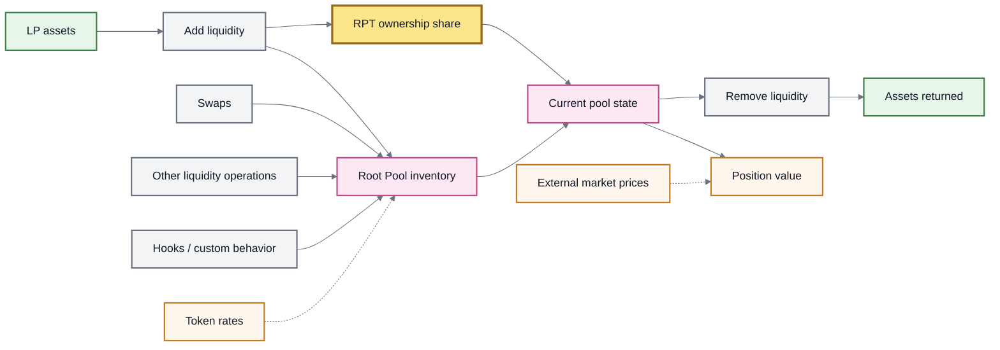
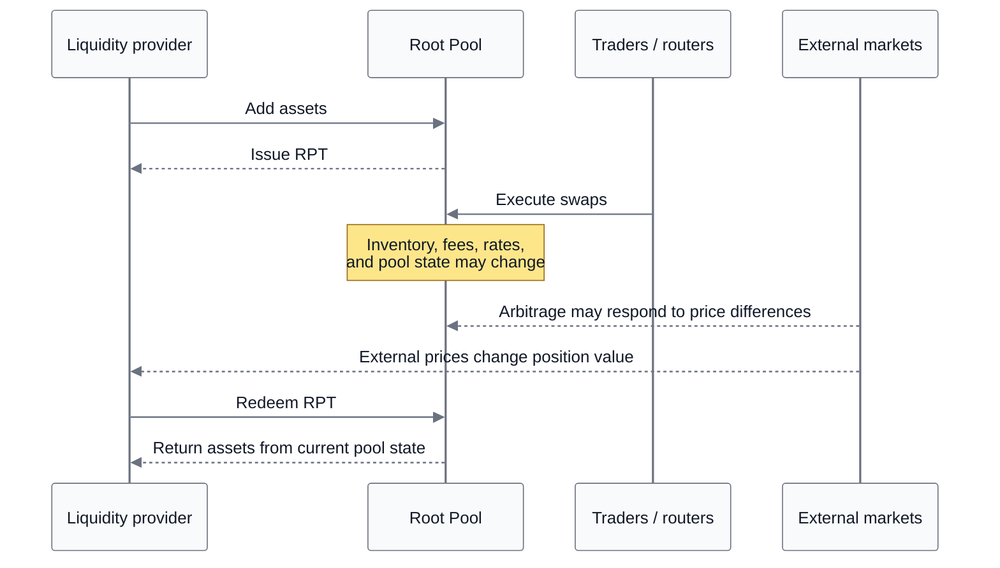

# 🚜 Liquidity Providers

## Liquidity Providers

A **liquidity provider (LP)** supplies assets to a **Root Pool** so those assets can be used as market inventory.

In a share-issuing liquidity operation, the LP receives **Root Pool Tokens (RPTs)** representing a proportional share of the pool. The position then follows the pool's **current state** rather than preserving the exact token quantities originally deposited.

> **Core idea:** an LP owns a share of changing pool inventory, not a fixed bag of the tokens originally supplied.

### Why pools need liquidity

An AMM can only exchange assets that are available to trade. LP capital supplies that inventory.

For a given pool design, deeper liquidity generally lets larger trades occur with less price impact because each trade changes a smaller fraction of the available balances.

Liquidity does **not** guarantee trading activity or returns. It makes execution possible when traders, routers, arbitrageurs, or other contracts choose to interact with the pool.

### What an LP owns

Suppose an LP owns 10% of a Root Pool. That 10% is a claim on the **current pool**, as represented by the LP's RPT position.

The pool may hold different quantities later because its state can change through:

* swaps;
* other liquidity additions and removals;
* arbitrage when profitable opportunities are actually executed;
* rate changes for supported rate-bearing assets;
* Hooks or custom pool behavior where configured.

External market prices can also change the economic value of the position without changing the raw token balances held by the pool.

The result is a position whose **composition and value can both evolve over time**.

### From assets to a pool share





The RPT tracks ownership while the underlying pool state can change.

See Root Pool Tokens for the share-token and accounting model.

### Entering a Root Pool

ROOTSTOCK follows the inherited v3 liquidity model, which defines several ways to add assets. The exact operations available depend on the pool and its configuration.

<table><thead><tr><th width="232">Add-liquidity type</th><th>What it does</th></tr></thead><tbody><tr><td><strong>Proportional</strong></td><td>Adds assets in the pool's current proportions and receives a specified amount of RPT.</td></tr><tr><td><strong>Unbalanced</strong></td><td>Adds exact amounts of one or more pool assets in proportions that may differ from the pool.</td></tr><tr><td><strong>Single-token exact out</strong></td><td>Adds one pool asset to receive an exact amount of RPT.</td></tr><tr><td><strong>Donation</strong></td><td>Adds assets without issuing RPT. This increases pool inventory but does <strong>not</strong> create an LP position.</td></tr><tr><td><strong>Custom</strong></td><td>Uses add-liquidity logic defined by the pool.</td></tr></tbody></table>

Non-proportional liquidity operations contain swap-like economics because they change relative inventory. The non-proportional portion can therefore experience **price impact and swap-fee treatment**.

#### Donation is not liquidity provision

Donation is a special case. Assets enter the pool, but the sender receives no corresponding RPT ownership.

In the inherited v3 model, donation must be explicitly enabled. It is intended for narrow use cases and has important consequences: allowing donation can make the pool-token rate directly manipulable, so donation-enabled pools should not be treated as safely nestable or as a reliable external-rate source without additional safeguards.

The detailed mechanics belong in Adding & Removing Liquidity.

> **ERC-4626 pools:** where a Root Pool contains supported ERC-4626 wrapped assets and the required buffers are initialized, routing can allow liquidity operations using the wrapper's underlying asset. See Adding & Removing Liquidity and ERC-4626 Buffers.

### While liquidity is in the pool

Several independent processes can affect an LP position.





**Swaps** change pool balances. If a swap fee applies, the trade can also contribute fees to the pool's economics.

**Arbitrage** can move pool prices and inventory toward surrounding markets when an executable profit opportunity exists. Arbitrage is not guaranteed to occur, and it is not itself an LP reward.

**Other liquidity operations** change pool inventory and can change RPT supply when shares are minted or burned.

**Rate changes** can change the accounted value of supported rate-bearing assets.

**Hooks and custom logic** can add pool-specific behavior around swaps and liquidity operations, including dynamic fee logic where configured.

A pool can also pass through periods with little or none of this activity.

### How LP returns can change

An LP position can be affected by several economic mechanisms at the same time.

#### Swap fees

A swap fee is charged on swaps and on the **non-proportional portion** of add/remove liquidity operations.

The portion retained for LP liquidity becomes part of the pool economics represented by RPT rather than a separate reward balance that each LP must manually claim.

```
fee-bearing activity
        ↓
     swap fee
        ↓
 applicable fee split
        ↓
 LP-retained portion
        ↓
pool state represented by RPT
```

No fee-bearing activity means no swap-fee accrual from that mechanism.

Protocol-level or pool-creator fee allocations, where configured, can reduce the portion of gross fees attributable to LP liquidity. Dynamic swap fees can also change the fee charged from one operation to another.

See Fees & LP Returns.

#### Rate-bearing assets

Some pools can contain assets whose exchange rate to an underlying asset changes over time.

A **Rate Provider** reports that exchange relationship to the protocol. It does not create the economic change that the rate describes. In the inherited v3 accounting model, token rates are refreshed as needed during swaps and liquidity operations so live balances can reflect the configured rate.

The underlying rate can increase, remain unchanged, or decrease. The token or rate mechanism can also introduce additional risk.

Where a rate-bearing token is configured to pay a protocol yield fee, part of positive rate growth may be allocated away from LP liquidity according to the applicable fee configuration.

See Rate Providers and Fees & LP Returns.

#### External incentives

Separate programs may distribute additional assets to eligible LP positions.

These programs have their own funding, duration, eligibility, and distribution rules. They are **not** part of the base ownership relationship between an LP, a Root Pool, and its RPT.

Historical Balancer incentive systems therefore do not imply a ROOTSTOCK incentive program.

### Removing liquidity

An LP exits by using a supported remove-liquidity operation to exchange RPT ownership for assets from the pool.

The assets available at exit reflect the **current pool state**, not the token quantities originally deposited.

The inherited v3 model defines four removal types:

<table><thead><tr><th width="227">Remove-liquidity type</th><th>What it does</th></tr></thead><tbody><tr><td><strong>Proportional</strong></td><td>Burns RPT and returns the LP's proportional share across the pool's current balances. This has zero price impact and avoids the swap fee charged on non-proportional exits.</td></tr><tr><td><strong>Single-token exact in</strong></td><td>Burns an exact amount of RPT and returns one pool token.</td></tr><tr><td><strong>Single-token exact out</strong></td><td>Returns an exact amount of one pool token and calculates the RPT required.</td></tr><tr><td><strong>Custom</strong></td><td>Uses remove-liquidity logic defined by the pool.</td></tr></tbody></table>

Single-token and other non-proportional exits can contain swap-like economics, including price impact and swap-fee treatment.

See Adding & Removing Liquidity for operation mechanics, limits, routing, and underlying-token handling.

### LP exposure

Providing liquidity creates several kinds of exposure at once.

<table><thead><tr><th width="246">Exposure</th><th>What it means</th></tr></thead><tbody><tr><td><strong>Asset exposure</strong></td><td>The economic behavior of the assets represented by the pool.</td></tr><tr><td><strong>Inventory-path exposure</strong></td><td>The pool's token composition can change as swaps and liquidity operations occur.</td></tr><tr><td><strong>Relative-performance risk</strong></td><td>The LP position can perform differently from simply holding the same starting assets.</td></tr><tr><td><strong>Pool-configuration risk</strong></td><td>Weights, invariant, fees, permissions, and other pool parameters affect behavior.</td></tr><tr><td><strong>Token and rate risk</strong></td><td>Token mechanics, wrappers, or rate mechanisms can fail or behave unexpectedly.</td></tr><tr><td><strong>Hook risk</strong></td><td>Attached logic can alter pool behavior at configured lifecycle points.</td></tr><tr><td><strong>Protocol and integration risk</strong></td><td>Smart contracts, accounting, routing, or external integrations can introduce additional failure modes.</td></tr></tbody></table>

Swap fees, rate growth, or external incentives can offset adverse outcomes during a particular period, but none guarantees profitability.

See LP Risk & Impermanent Loss.

### RPTs beyond the pool

An RPT represents a Root Pool position in token form.

Because RPTs are ERC-20-compatible pool-share tokens in the inherited architecture, an RPT can potentially become an input to another pool, application, or protocol:

```
Root Pool
   ↓
  RPT
   ↓
other pool / application / protocol
```

That composability does **not** make every RPT equally safe to integrate. Pool configuration, valuation method, rate behavior, Hooks, donation support, and the assumptions of the external protocol all matter.

An external system should therefore evaluate the specific Root Pool rather than treating every RPT as interchangeable collateral or a universally safe price source.

See RPT Valuation & Oracles.

### LP lifecycle

The complete relationship is:

**assets → share-issuing liquidity operation → Root Pool + RPT ownership → pool state evolves → supported removal → current share of pool assets**

The central variable throughout the lifecycle is the **current pool state**.

The RPT records the LP's share of that state.

### Continue

* Root Pool Tokens
* Adding & Removing Liquidity
* Fees & LP Returns
* LP Risk & Impermanent Loss
