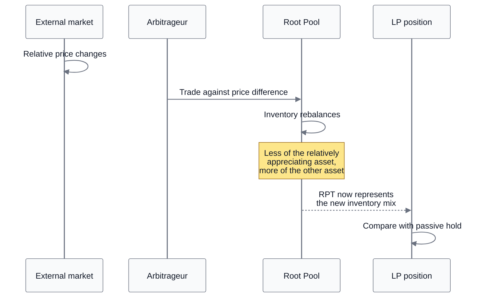

# ❗ LP Risk & Impermanent Loss

## LP Risk & Impermanent Loss

Providing liquidity is a **market-making position with inventory exposure**.

An LP supplies assets to a Root Pool, receives RPT ownership, and allows the pool's invariant to rebalance that inventory as users trade and external prices change.

The correct benchmark is therefore not a savings account and not simply “fees earned.”

It is:

> **What happened to the LP position compared with what would have happened if the starting assets had simply been held?**


**The risk mental model:** RPT owns changing inventory.

Fees can compensate the LP for supplying that inventory, but the pool's rebalancing rule, the assets themselves, and every dependency underneath the pool determine the final outcome.


### Start with the benchmark

**Impermanent loss (IL)**—also called **divergence loss** or **rebalancing loss**—measures the performance difference between:

1. providing a set of assets as liquidity; and
2. passively holding the same starting assets.

When isolating the AMM rebalancing effect from fees, incentives, and other external cash flows:

$$
IL = \frac{\text{LP value}}{\text{hold value}} - 1
$$

A negative result means the LP position is worth less than the passive-hold benchmark at the same ending market prices.


Impermanent loss is a **relative-performance measurement**.

It is not a fee deducted from the Vault, a separate token balance, or an additional accounting debit.


### Why AMMs create divergence loss

Suppose a pool contains two assets and one becomes more valuable relative to the other.

The pool's internal price does not update because an oracle announces the new market price. Instead, traders and arbitrageurs interact with the pool.



For a conventional constant-product example, arbitrage tends to remove some of the relatively appreciating asset from the pool and leave more of the relatively underperforming asset behind.

The LP therefore ends with a different asset mix than the passive holder.

That difference is the source of divergence loss.

### “Impermanent” does not mean unreal

The word **impermanent** describes the fact that the relative-performance gap can shrink or disappear if relative prices later converge.

It does **not** mean:

* the loss is imaginary;
* prices are guaranteed to reverse;
* an LP can always wait long enough to recover;
* every other loss affecting the position is reversible.

If the relative price relationship returns to the starting relationship, the pure divergence component can move back toward zero.

But the complete LP outcome can still differ because of fees, external incentives, transaction costs, asset failures, rate changes, Hooks, or other events that occurred along the path.

For this reason, **divergence loss** is often the clearer term.

### The 50/50 case

For a simple two-asset 50/50 constant-product pool, let:

```
r = ending relative price / starting relative price
```

Ignoring fees and other effects:

$$
IL_{50/50}(r)
=
\frac{2\sqrt{r}}{1+r}-1
$$

Some examples:

| Relative-price change | 50/50 divergence loss |
| --------------------: | --------------------: |
|                `1.0×` |                  `0%` |
|                `1.5×` |        about `-2.02%` |
|                `2.0×` |        about `-5.72%` |
|                `4.0×` |                `-20%` |

A doubling of one asset relative to the other does **not** mean the LP lost 5.72% in absolute terms.

It means the LP position underperformed the passive-hold benchmark by about 5.72%, before considering fees and other effects.

The LP position itself may still have increased substantially in market value.

### Weighted Pools change the exposure

Weighted Pools generalize constant-product market making beyond 50/50.

The weights determine both:

* how much economic exposure the pool keeps in each asset; and
* how the pool rebalances as relative prices change.

For a constant-weight pool, ignoring fees, let:

* (p\_i) be each asset's price-change factor from the starting point;
* (w\_i) be its normalized pool weight; and
* (\sum\_i w\_i = 1).

The divergence component can be expressed as:

$$
IL
=
\frac{\prod_i p_i^{w_i}}
{\sum_i w_i p_i}
-1
$$

The numerator represents the constant-weight AMM path. The denominator represents passively holding the initial weighted portfolio.

#### Why 80/20 behaves differently from 50/50

Suppose Asset A doubles while Asset B remains unchanged.

If A begins as the heavily weighted asset:

| Pool          | Approximate divergence loss |
| ------------- | --------------------------: |
| **50/50 A/B** |                    `-5.72%` |
| **80/20 A/B** |                    `-3.27%` |

The 80/20 pool keeps more exposure to A, so it sells less of the appreciating asset than a 50/50 pool would.

That reduces divergence loss **for that price path**.


Lower divergence loss is not free.

Balancer's Weighted Pool design also illustrates the trade-off: highly asymmetric weights leave less inventory on the lightly weighted side, which can increase price impact for trades involving that side.

Weights are therefore a **portfolio and market-design choice**, not merely a display setting.


See Weighted Pools.

### Multi-asset pools

With three or more assets, there is no single pairwise price move that describes the position.

Every asset can move relative to every other asset.

The generalized weighted formula becomes useful because the LP result depends on the full vector:

```
price changes
    ×
pool weights
    ×
AMM rebalancing
```

A useful mental model is:

> **a multi-asset LP is continuously rebalanced according to the pool's invariant and weights.**

If every asset moves by the same proportional amount, there is no divergence from the initial weighted hold benchmark.

If the relative price vector spreads apart, the pool's inventory changes relative to passive holding.

### Stable Pools change the assumption

Stable Pools are designed for assets expected to:

* trade near parity; or
* maintain a known, slowly changing exchange relationship.

Their Stable Math curve provides much deeper liquidity near that expected relationship than an ordinary weighted constant-product curve.

That changes the risk profile.

#### Correlation is part of the thesis

A Stable Pool is capital-efficient because it assumes the assets are meaningfully correlated.

If that relationship breaks—for example, a stablecoin loses its peg or a derivative materially diverges from its underlying—the pool is no longer operating in the market regime for which its high near-parity efficiency was intended.

Arbitrage can then change the pool's composition substantially.


**Low expected divergence is not the same as low asset risk.**

A pool of two assets expected to remain near 1:1 can have little ordinary divergence during normal conditions while still carrying severe tail risk if one asset fails.

Stable Math changes the trading curve. It does not remove credit, bridge, issuer, staking, lending, or depeg risk.


The amplification parameter also changes how strongly the pool behaves like a near-constant-sum market around parity.

See Stable Pools.

### Fees can offset divergence loss

Trading fees compensate LP liquidity when fee-bearing activity actually occurs.

This means the economically relevant comparison is not:

```
fees earned
```

in isolation.

It is closer to:

```
LP position after pool economics
        versus
passive hold of the starting assets
```

A period with enough LP-retained fees can offset part or all of the divergence loss measured against the hold benchmark.

A quiet pool may not generate enough fee income to do so.


High configured fees do not guarantee high LP returns.

The pool still needs fee-bearing activity, and higher fees can also alter trading behavior and routing.


See Fees & LP Returns.

### Impermanent loss and LVR are not the same thing

**Impermanent loss** compares an LP position with passive holding at a chosen endpoint.

**Loss-versus-rebalancing (LVR)** asks a different market-microstructure question: how much value does a passive AMM lose because its prices become stale and better-informed arbitrageurs trade against those stale prices before the AMM catches up with the external market?

The concepts are related, but they are not interchangeable.

```
Impermanent / divergence loss
    → endpoint comparison against holding

Loss-versus-rebalancing
    → adverse-selection cost from AMM price updating through arbitrage
```

This distinction matters because a mechanism can target LVR without eliminating the inventory exposure that creates divergence loss.

The inherited v3 Hooks architecture explicitly supports designs intended to reduce LVR or alter dynamic fees.

See Hooks.

### Risk extends beyond impermanent loss

Impermanent loss is only one component of LP risk.

```mermaid
%%{init: {"theme":"base","themeVariables":{"fontFamily":"Inter, ui-sans-serif, system-ui","primaryTextColor":"#111827","lineColor":"#6B7280","clusterBkg":"#F9FAFB","clusterBorder":"#D1D5DB"}}}%%
flowchart TD
    RPT["RPT position"]

    RPT --> M["Market & inventory risk"]
    RPT --> A["Underlying asset risk"]
    RPT --> P["Protocol & contract risk"]
    RPT --> C["Configuration risk"]
    RPT --> X["External dependency risk"]

    M --> IL["Divergence / IL"]
    M --> LVR["LVR / adverse selection"]
    M --> FLOW["Volume & liquidity path"]

    A --> PEG["Peg / issuer / bridge"]
    A --> YIELD["Staking / lending / vault"]

    P --> VAULT["Vault / pool / Router"]
    P --> HOOK["Hooks"]

    C --> W["Weights / amplification"]
    C --> F["Fees / permissions"]

    X --> RATE["Rate Providers"]
    X --> WRAP["Wrappers / integrations"]

    classDef root fill:#FCE7F3,stroke:#BE4B87,stroke-width:3px,color:#111827;
    classDef risk fill:#FDE68A,stroke:#9A6A16,stroke-width:2px,color:#111827;
    classDef detail fill:#F3F4F6,stroke:#6B7280,stroke-width:2px,color:#111827;

    class RPT root;
    class M,A,P,C,X risk;
    class IL,LVR,FLOW,PEG,YIELD,VAULT,HOOK,W,F,RATE,WRAP detail;
```



#### Underlying asset risk

A pool is only as economically sound as the assets it holds.

An asset can fail because of:

* issuer or collateral problems;
* stablecoin depegging;
* bridge failure;
* staking slashing or validator risk;
* lending losses;
* vault or wrapper failure;
* governance or upgrade risk.

The AMM cannot remove those fundamental risks.

In some cases, AMM rebalancing can leave LPs holding **more** of the failing asset as arbitrageurs remove the stronger asset from the pool.

That loss should not be mislabeled as ordinary impermanent loss.

#### Smart-contract risk

An LP position can depend on multiple contracts:

```
token
  ↓
Router
  ↓
Root Vault
  ↓
Root Pool
  ↓
optional Hook / Rate Provider / wrapper
```

A defect or exploit at any relevant layer can affect the position.

Audits, tests, formal reasoning, permissions, and conservative architecture can reduce risk; they do not mathematically eliminate it.

#### Pool-configuration risk

Configuration changes how the pool behaves.

Relevant parameters can include:

* asset weights;
* amplification;
* static or dynamic swap fees;
* invariant limits;
* liquidity-management settings;
* Hook configuration;
* token types and Rate Providers;
* pause controls;
* role accounts.

Two pools holding the same assets can therefore have materially different risk surfaces.

#### Rate-provider risk

For a `WITH_RATE` asset, the Vault uses an external **Rate Provider** to translate between the token and its underlying economic unit.

This is a critical dependency.

Balancer's v3 guidance explicitly warns that:

* a Rate Provider that begins reverting can cause swaps through the pool to revert; and
* a Rate Provider that returns unexpected values can expose the pool to being drained.

Rate Providers should therefore be evaluated as part of the pool's trust and accounting surface, not as passive metadata.

See Rate Providers.

#### Yield-bearing asset risk

A Rate Provider can report the exchange relationship of a yield-bearing token, but it does not guarantee the safety of the system producing that yield.

An LP can simultaneously face:

* AMM inventory risk;
* the economic risk of the yield-bearing asset;
* Rate Provider risk;
* wrapper or ERC-4626 risk;
* protocol risk in the external lending or staking system.

Positive yield does not cancel those dependencies.

#### Hook risk

Hooks are standalone contracts that can participate at multiple points in a pool's lifecycle, including swaps and liquidity operations, and can compute dynamic swap fees.

This makes Hooks powerful.

It also means a pool with a Hook has a larger behavior and trust surface than the base invariant alone describes.

The relevant questions are not only:

> What pool type is this?

but also:

> What Hook is attached, what callbacks are enabled, and what can that Hook change?

See Hooks.

#### Permission and emergency-control risk

Some pool behavior can depend on configured roles such as pause or swap-fee management.

A pause can intentionally restrict normal state-changing operations during an incident.

In the inherited v3 architecture, **Recovery Mode** provides a minimal proportional-withdrawal path intended to remain available during emergencies. v3 moved this recovery mechanism into the Vault so it is shared across pool types rather than depending on each pool to implement its own exit logic.

Recovery Mode reduces one class of fund-locking risk.

It does not make the underlying assets or external integrations safe.

See Emergency Controls.

#### Liquidity and exit risk

RPT redemption and external liquidity are different things.

A position may be technically redeemable while the assets received are:

* volatile;
* thinly traded elsewhere;
* paused or rate-limited by another protocol;
* difficult to bridge;
* expensive to unwind;
* themselves represented by wrappers or nested positions.

Non-proportional exits can also introduce price impact and swap-like fees.

The existence of an exit function therefore does not guarantee a particular liquidation value in external markets.

#### Composability risk

RPT can potentially be used by other pools, vaults, strategies, or lending systems.

That creates another dependency layer.

A failure in the downstream system may affect the holder even if the underlying Root Pool continues to operate normally.

Likewise, systems that use RPT as collateral or rely on its valuation need manipulation-resistant pricing and must respect the Vault's transient-accounting model.

See RPT Valuation & Oracles.

### Risk depends on pool design

Different pool families intentionally expose LPs to different market structures.

| Pool design           | Primary assumption                                                | Important LP risk question                                                           |
| --------------------- | ----------------------------------------------------------------- | ------------------------------------------------------------------------------------ |
| **Weighted Pool**     | Assets can trade at arbitrary relative prices                     | Are the chosen weights appropriate for the desired exposure and expected divergence? |
| **Stable Pool**       | Assets remain near parity or a known rate                         | What happens if the correlation or peg breaks?                                       |
| **Rate-bearing pool** | External rate accurately represents the asset relationship        | Can the underlying asset or Rate Provider fail or behave unexpectedly?               |
| **Hook-enabled pool** | Additional logic safely modifies lifecycle behavior               | What can the Hook change, and what external state does it trust?                     |
| **Custom Pool**       | Custom invariant and rules are economically and technically sound | What assumptions does the custom math introduce?                                     |

There is therefore no protocol-wide number called **LP risk**.

Risk belongs to the specific pool and its dependency graph.

### Evaluate the whole pool

A useful LP analysis follows the dependencies outward.



#### 1. Define the benchmark

Decide what the alternative is.

For impermanent-loss analysis, the usual benchmark is passive holding of the same starting assets.



#### 2. Understand the pool math

Identify the invariant, weights, amplification, and other parameters that determine how inventory changes.



#### 3. Inspect the assets

Evaluate correlation assumptions, issuer or bridge dependencies, wrappers, staking or lending exposure, and external liquidity.



#### 4. Inspect fees and expected flow

Determine the static or dynamic fee structure and whether realistic fee-bearing activity can compensate for the inventory risk being taken.



#### 5. Inspect extensions and accounting dependencies

Check Hooks, Rate Providers, ERC-4626 wrappers, custom logic, and any nested positions.



#### 6. Inspect permissions and emergency behavior

Understand who can change relevant parameters, when the pool can be paused, and what exit path exists under Recovery Mode.



#### 7. Inspect downstream dependencies

If RPT is deposited elsewhere, include those contracts, valuation assumptions, liquidation rules, and permissions in the analysis.



#### 8. Match the position to the intended horizon

A pool appropriate for one market regime or holding period may be unsuitable for another.



### What impermanent loss is not

Impermanent loss is **not**:

* every way an LP can lose money;
* a protocol fee;
* a smart-contract exploit;
* a stablecoin depeg;
* a bad Rate Provider;
* a bridge failure;
* a guarantee that losses reverse;
* automatically equal to loss-versus-rebalancing;
* automatically offset by trading fees.

It is specifically the **relative performance of AMM liquidity against the chosen hold benchmark due to the pool's rebalancing exposure**.

### The model to remember

```
starting assets
      ↓
Root Pool invariant
      ↓
market prices change
      ↓
trading / arbitrage changes inventory
      ↓
RPT represents the new inventory
      ↓
+ LP-retained fees
+/- rate and pool-specific effects
      ↓
compare with passive hold
      ↓
relative LP performance
```

Around that market-making path sit additional risks:

```
assets
contracts
configuration
Hooks
Rate Providers
permissions
wrappers
external protocols
exit conditions
```

**Impermanent loss describes one comparison. LP risk describes the entire system the position depends on.**

### Continue

<table><thead><tr><th width="285">Page</th><th>What it explains</th></tr></thead><tbody><tr><td>Liquidity Providers</td><td>What an LP owns and how the position evolves</td></tr><tr><td>Root Pool Tokens</td><td>How pool ownership is represented</td></tr><tr><td>Adding &#x26; Removing Liquidity</td><td>How inventory and ownership change</td></tr><tr><td>Fees &#x26; LP Returns</td><td>How fees, rates, and incentives affect LP economics</td></tr><tr><td>Weighted Pools</td><td>Weight-based market structure and exposure</td></tr><tr><td>Stable Pools</td><td>Correlated-asset pool design</td></tr><tr><td>Rate Providers</td><td>External rate accounting</td></tr><tr><td>Hooks</td><td>Programmable pool extensions</td></tr><tr><td>Security Model</td><td>Protocol trust boundaries and security assumptions</td></tr><tr><td>Emergency Controls</td><td>Pause and recovery behavior</td></tr><tr><td>RPT Valuation &#x26; Oracles</td><td>Safe valuation of pool-share tokens</td></tr></tbody></table>
