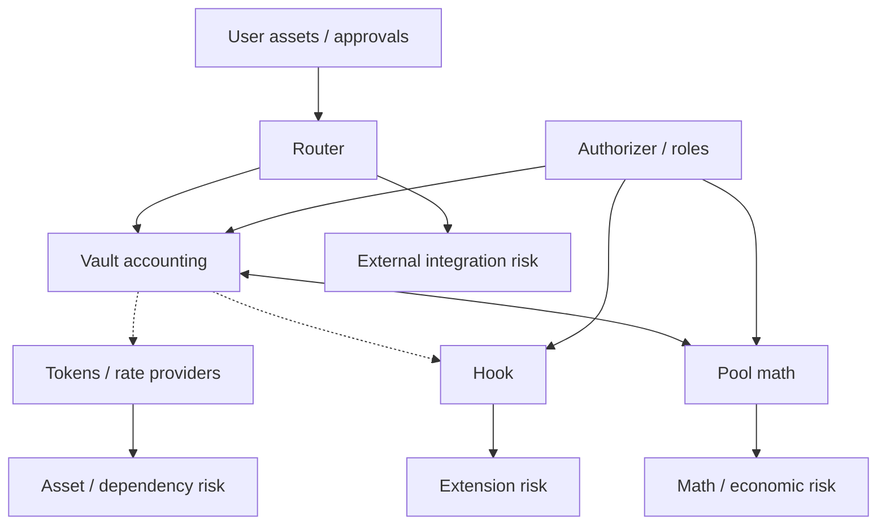

# Overview

## Security

ROOTSTOCK security is layered. Shared Vault accounting removes duplicated settlement code from individual pools, but it does not eliminate risk: custom market math, hooks, token behavior, rate providers, permissions, Routers, and external integrations each create independent trust boundaries.


Security claims must be version-specific. An upstream Balancer v3 audit does not automatically audit modifications made by the ROOTSTOCK fork.


### Security model at a glance

### Security layers

* **Contract correctness** — arithmetic, state transitions, settlement, reentrancy, access control.
* **Economic correctness** — invariant behavior, fee fairness, LP-share accounting, manipulation resistance.
* **Asset safety** — token compatibility, wrapper/rate-provider behavior, external protocol solvency.
* **Privilege safety** — what authorized roles can change or pause.
* **Integration safety** — approvals, Router selection, slippage limits, stale quotes, aggregator assumptions.
* **Operational safety** — deployment provenance, monitoring, incident response, vulnerability disclosure.

### Read in this order

1. Security Model
2. Trust Boundaries
3. Permissions
4. Token Compatibility
5. Emergency Controls
6. Audits
7. Vulnerability Reporting

### User rule

Never treat the ROOTSTOCK brand name alone as proof that a pool, hook, Router, or token is canonical. Verify deployment provenance, configuration, and the exact contracts involved.
