# AutoRange Pools

## AutoRange Pools

An **AutoRange Pool** is a fungible concentrated-liquidity Pool whose shared price range can **move automatically** as trading pushes the Pool away from its center.

A fixed-range Pool concentrates liquidity efficiently, but its range eventually becomes stale if the market moves far enough.

AutoRange adds a response:

> **When the Pool drifts too far from center, its liquidity range gradually shifts in the same direction.**

LPs continue sharing one Pool and one fungible RPT. They do not individually choose or manage separate ranges.

***

### Why AutoRange exists

Concentrated liquidity makes capital more useful by focusing it around a limited price region.

That creates a new problem.

A range that is well positioned today may not be well positioned tomorrow.

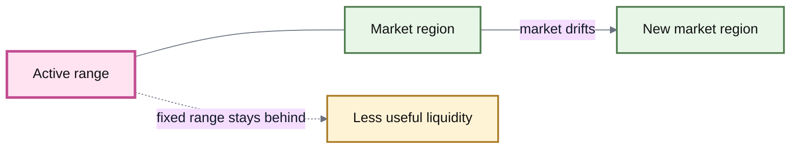

With fixed-range concentrated liquidity, maintaining efficiency may eventually require someone to withdraw liquidity and redeploy it around a new price region.

AutoRange moves that responsibility into the Pool itself.

***

### A shared moving range

Every LP in an AutoRange Pool participates in the same concentrated-liquidity range.

That gives the Pool a very different structure from systems where every LP chooses an individual position.

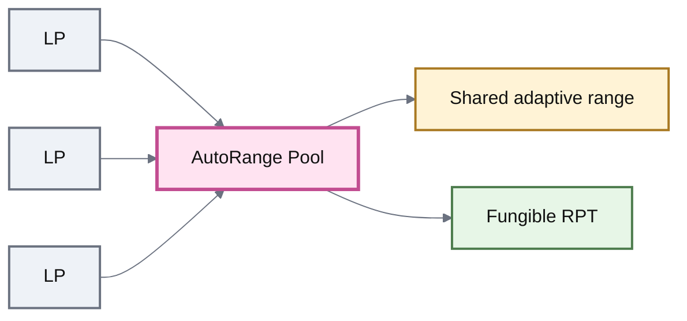

All LPs therefore experience the same:

* lower and upper price bounds;
* degree of concentration;
* range movement;
* Pool inventory changes.

This shared state is what allows the LP position to remain fungible.

***

### The starting range

An AutoRange Pool begins with three intuitive price inputs:

| Parameter         | Meaning                                          |
| ----------------- | ------------------------------------------------ |
| **Minimum price** | Lower boundary of the initial concentrated range |
| **Target price**  | Price around which the Pool begins centered      |
| **Maximum price** | Upper boundary of the initial concentrated range |

Conceptually:

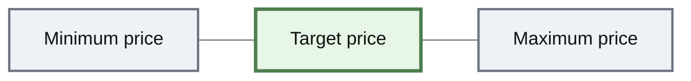

The Pool converts these starting values into the internal state required to create the concentrated price curve.

After initialization, the important question is no longer merely **where the range started**.

It is:

> **Where is the Pool inside that range now?**

***

### Virtual balances create the range

AutoRange uses **virtual balances** to concentrate liquidity between finite price bounds.

A virtual balance is an offset added to the Pool's real token balance for purposes of its pricing curve.

Conceptually:

effective balance=real balance+virtual balance\text{effective balance} = \text{real balance} + \text{virtual balance}

The Pool trades real tokens.

The virtual balances reshape the curve those real tokens trade along.

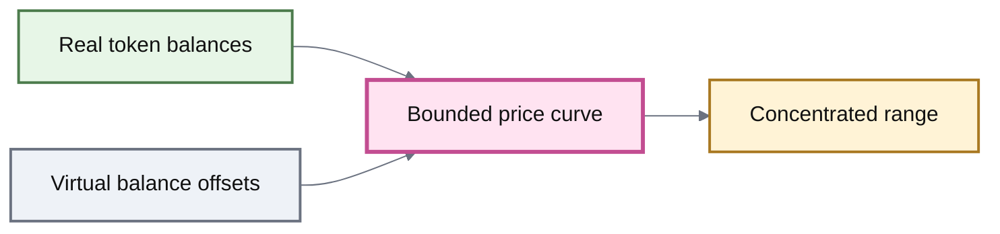

Larger virtual balances relative to the real balances create stronger concentration.

The exact invariant and virtual-balance calculations belong in the technical reference. The important idea here is that **changing the virtual balances can move the concentrated range without moving LP funds into a different Pool**.

***

### Centeredness

AutoRange needs a way to determine whether its active range is still well positioned.

It does this using **centeredness**.

Centeredness describes how close the Pool's real balances are to the center of its current range.

At initialization, the Pool should begin close to its center:

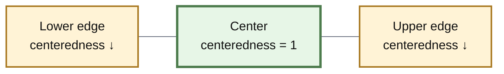

As swaps change the real balances, the Pool moves away from that centered state.

Centeredness declines as the Pool approaches either side of the range.

This gives AutoRange a signal derived entirely from its own state.

***

### The centeredness margin

AutoRange does not start moving its range after every small price movement.

Instead, it has a **centeredness margin**.

The margin defines how far the Pool can drift before automatic range movement begins.

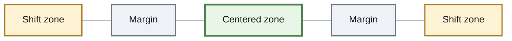

Inside the centered zone, the range remains where it is.

Once Pool state moves beyond a margin, the range begins shifting.

The margin therefore controls **sensitivity**.

A Pool configured to react sooner follows changing conditions more aggressively.

A Pool allowed to drift farther behaves more like a fixed-range Pool.

***

### How the range follows the market

Consider a Pool that begins centered.

Trading pressure gradually moves its state toward the upper side of the range.

Once the centeredness margin is crossed, AutoRange starts moving the range in that direction.

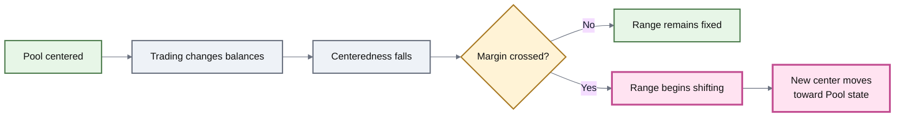

The shift is gradual rather than instantaneous.

As the range moves, its virtual balances change with it.

This lets concentrated liquidity migrate along the price curve while LPs remain in the same Pool.

***

### AutoRange does not need an external oracle

One of the most important properties of the design is what **does not** control the range.

AutoRange does not need an external price feed to decide:

> “the market moved, so move the Pool.”

Instead, swaps change the Pool's own balances.

Those balances change its centeredness.

Centeredness then determines whether the range should begin moving.

```mermaid
%%{init: {"theme":"base","themeVariables":{
  "fontFamily":"Inter, ui-sans-serif, system-ui, sans-serif",
  "primaryTextColor":"#111827",
  "lineColor":"#6B7280"
}}}%%
flowchart LR
    SWAP["Trading pressure"]
    BAL["Real balances change"]
    CENTER["Centeredness changes"]
    SHIFT["Range adjustment"]
    NEW["New active region"]

    SWAP --> BAL --> CENTER --> SHIFT --> NEW

    classDef action fill:#EEF2F7,stroke:#6B7280,stroke-width:2px,color:#111;
    classDef state fill:#E7F6E7,stroke:#4D7C4D,stroke-width:2px,color:#111;
    classDef pool fill:#FFE3F1,stroke:#C24D91,stroke-width:3px,color:#111;

    class SWAP action;
    class BAL,CENTER state;
    class SHIFT,NEW pool;
```

This creates an endogenous feedback loop:

**trading → Pool state → centeredness → range movement**

\{% hint style="info" %\}\
The Pool is responding to its own state, not independently discovering an external “correct price.”

That distinction matters for understanding both AutoRange behavior and its manipulation risk.\
\{% endhint %\}

***

### How fast does the range move?

Crossing the margin does not teleport the range to a new center.

AutoRange has a **price-shift rate** that controls how quickly its virtual balances—and therefore its active range—can move.

This creates another important trade-off.

\{% tabs %\}

\{% tab title="🐢 Slower response" %\}\
The range follows sustained market movement more cautiously.

This gives the Pool less ability to chase rapid price changes, but reduces how aggressively a short-lived imbalance can move the range.\
\{% endtab %\}

\{% tab title="⚡ Faster response" %\}\
The range adapts to changing conditions more quickly.

That can keep liquidity centered more effectively during genuine movement, but it also increases sensitivity to trading that temporarily pushes the Pool away from center.\
\{% endtab %\}

\{% endtabs %\}

The margin determines **when** AutoRange reacts.

The shift rate determines **how quickly** it reacts.

Those are separate controls.

***

### “Out of range” means something specific here

There is an important terminology difference between generic concentrated liquidity and AutoRange.

In generic concentrated-liquidity discussion, **out of range** often means that market price has moved beyond the Pool's hard liquidity bounds.

In AutoRange, the Pool can enter its range-adjustment state **before reaching those hard bounds**.

The price is still inside the Pool's price interval, but it has moved beyond the configured centeredness margin.

```mermaid
%%{init: {"theme":"base","themeVariables":{
  "fontFamily":"Inter, ui-sans-serif, system-ui, sans-serif",
  "primaryTextColor":"#111827",
  "lineColor":"#6B7280"
}}}%%
flowchart LR
    MIN["Hard lower bound"]
    LM["Lower margin"]
    CENTER["Centered region"]
    UM["Upper margin"]
    MAX["Hard upper bound"]

    MIN --- LM --- CENTER --- UM --- MAX

    classDef hard fill:#EEF2F7,stroke:#6B7280,stroke-width:2px,color:#111;
    classDef margin fill:#FFF3D6,stroke:#A97922,stroke-width:2px,color:#111;
    classDef center fill:#E7F6E7,stroke:#4D7C4D,stroke-width:3px,color:#111;

    class MIN,MAX hard;
    class LM,UM margin;
    class CENTER center;
```

Crossing a margin is what gives the Pool room to begin following the movement **before** one real token balance is driven toward zero.

That early response is central to the design.

***

### Fixed range vs AutoRange

| Fixed-range concentrated Pool              | AutoRange Pool                               |
| ------------------------------------------ | -------------------------------------------- |
| Liquidity concentrated inside price bounds | Liquidity concentrated inside price bounds   |
| Shared range can remain fixed              | Shared range can move                        |
| Market can drift toward an obsolete range  | Pool can re-center around sustained movement |
| LPs may need to migrate liquidity          | Range management occurs inside the Pool      |
| Simpler state                              | Additional adaptive state and parameters     |
| Range selection is the main decision       | Range selection + response behavior matter   |

AutoRange therefore does not eliminate the concentrated-liquidity trade-off.

It **adds a mechanism for managing it**.

***

### AutoRange remains fungible

The entire Pool shares one adaptive range.

Individual LPs do not have separate bounds that must be tracked independently.

That means an LP position can still be represented by a fungible RPT.

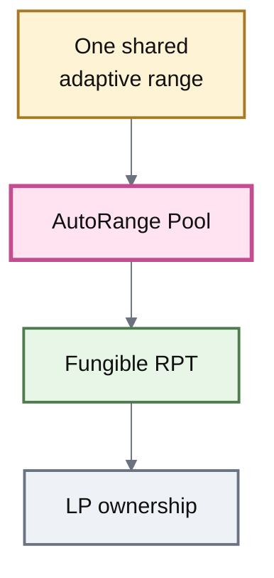

This makes AutoRange structurally compatible with the broader Root Pool model: shared state, shared liquidity, proportional fungible ownership.

***

### What AutoRange is good at

The design is aimed at markets where concentrated liquidity is useful but the relevant price region may move over time.

That makes AutoRange particularly suited to **maintaining ongoing two-asset liquidity** without requiring LPs to repeatedly reposition a shared range themselves.

Its main advantage is the combination:

> **concentration + fungibility + automatic range management**

A fixed-range Pool gives the first two.

AutoRange adds the third.

***

### What AutoRange is not for

Automatic movement introduces assumptions of its own.

A Pool that reacts to its own balances can also react to trading that does not represent durable market movement.

This makes AutoRange less suitable for assets with:

* very shallow external liquidity;
* highly manipulable prices;
* unreliable price discovery;
* launch-phase price discovery where large directional movement is expected by design.

\{% hint style="warning" %\}

#### AutoRange follows trading pressure; it does not know fundamental value

The Pool has no independent oracle telling it whether a price movement is “real.”

Range movement therefore has to be slow and constrained enough that manipulating the Pool's state is not an easy way to manipulate the range itself.\
\{% endhint %\}

For intentional token-price discovery, see **Liquidity Bootstrapping Pools** instead.

***

### The range can also change width

Moving the range and changing the **width** of the range are different operations.

AutoRange's normal feedback loop moves the active region along the price curve.

Separately, the distance between the lower and upper bounds can be adjusted gradually where the implementation permits it.

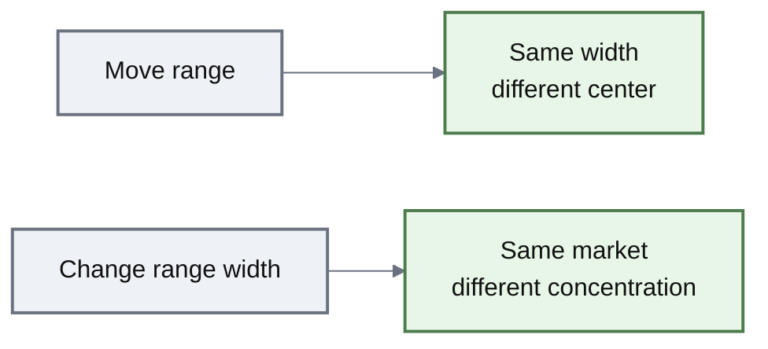

Moving the range answers:

**Where should liquidity be centered?**

Changing its width answers:

**How concentrated should liquidity be?**

Authority and constraints around changing those parameters belong in **Pool Configuration & Roles**.

***

### Additional state means additional safety constraints

A simple Pool can often calculate its behavior entirely from current balances and immutable parameters.

AutoRange also maintains adaptive state associated with its virtual balances and moving range.

That means some emergency operations require special handling.

In particular, recovery withdrawals can affect real balances without performing the normal AutoRange state updates. A Pool that has undergone such a withdrawal cannot safely be treated as though its adaptive state were still synchronized.

\{% hint style="warning" %\}\
AutoRange has stricter recovery assumptions than ordinary stateless Pool designs.

The exact pause, recovery, and restart constraints belong in **Emergency Controls** rather than being duplicated here.\
\{% endhint %\}

***

### AutoRange vs other Pool designs

| Pool design             | Main idea                                                            |
| ----------------------- | -------------------------------------------------------------------- |
| **Weighted Pool**       | General-purpose weighted liquidity across the price curve            |
| **Stable Pool**         | Efficient liquidity around a known asset relationship                |
| **Fixed-range CL Pool** | Concentrate liquidity inside fixed price bounds                      |
| **AutoRange Pool**      | Concentrate liquidity inside bounds that can re-center automatically |
| **LBP**                 | Intentionally move weights to drive price discovery                  |
| **Custom Pool**         | Define different market mathematics                                  |

The important distinction is purpose.

AutoRange is not trying to conduct an auction or discover an initial token price.

It is trying to keep concentrated liquidity useful as an established market moves.

***

### The model to remember

\{% hint style="success" %\}

#### AutoRange in one sentence

**An AutoRange Pool keeps all LPs in one fungible concentrated-liquidity position and gradually moves that shared range when Pool balances drift too far from center.**\
\{% endhint %\}

The causal loop is:

**trading changes balances → centeredness falls → margin is crossed → virtual balances shift → the active range moves**

And the two most important controls are:

**margin → when the Pool reacts**

**shift rate → how quickly the Pool reacts**

***

### Deployment boundary

The inherited v3 AutoRange design includes a two-token fungible concentrated-liquidity implementation commonly represented by reCLAMM.

This page describes that architecture as source material for ROOTSTOCK. It does not establish that a particular ROOTSTOCK deployment currently exposes:

* an AutoRange factory;
* specific range limits;
* centeredness parameters;
* shift-rate parameters;
* administrator permissions;
* mutable range-width controls;
* deployed AutoRange Pools.

Those properties must be verified from the ROOTSTOCK implementation and deployment registry before they are documented as live behavior.

***

### Continue

| Page                              | What it explains                                          |
| --------------------------------- | --------------------------------------------------------- |
| **Concentrated Liquidity**        | Why liquidity is focused inside a price range             |
| **Root Pool Tokens**              | Fungible ownership of shared Pool liquidity               |
| **Pool Configuration & Roles**    | Authority over AutoRange parameters                       |
| **LP Risk & Impermanent Loss**    | The economic consequences of range and inventory movement |
| **Emergency Controls**            | AutoRange-specific pause and recovery constraints         |
| **Liquidity Bootstrapping Pools** | Markets designed for intentional price discovery          |
| **Custom Pools**                  | How other adaptive market designs can be implemented      |
