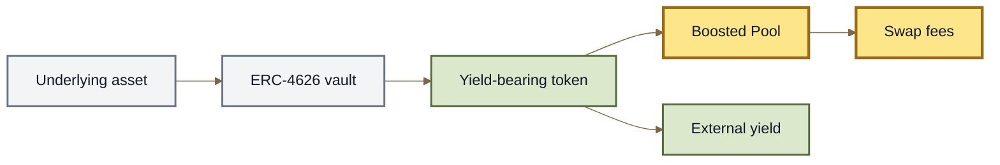

# Boosted Pools

## Boosted Pools

A **Boosted Pool** is a Root Pool that holds yield-bearing assets so LP capital can earn external yield while still participating in an AMM.

For example, instead of holding:

```
USDC
DAI
```

a Boosted Pool could hold yield-bearing versions such as:

```
ERC-4626 USDC vault shares
ERC-4626 DAI vault shares
```

The Pool can then earn:

```
swap fees
    +
yield from the underlying vaults
```

> **Boosted describes how Pool assets earn yield. It does not define a new AMM invariant.**

***

### Why Boosted Pools exist

Most AMMs need substantial token balances to provide deep liquidity.

But only part of that liquidity may be actively involved in trades at any one time.

Boosted Pools let the Pool hold yield-bearing versions of those assets instead of leaving the capital completely idle.





The result is a Pool whose liquidity can remain productive even when it is not currently being traded.

***

### The Pool can be fully boosted

In the v3 architecture, a Pool can be built entirely from yield-bearing assets.

For example:

```
Yield-bearing USDC
        +
Yield-bearing DAI
        ↓
100% Boosted Stable Pool
```

The LP position can therefore remain fully exposed to the yield-bearing tokens rather than requiring a large portion of the Pool to sit in their underlying assets.

This is one of the main differences between modern Boosted Pools and older designs.

***

### Boosted is separate from Pool math

A Boosted Pool can still use ordinary Pool mathematics.

For example:

```
yield-bearing USDC
yield-bearing DAI
        ↓
Stable Pool
```

or:

```
yield-bearing Asset A
yield-bearing Asset B
        ↓
Weighted Pool
```

Conceptually:

```
Stable
Weighted
Custom
   +
yield-bearing assets
   ↓
Boosted Pool
```

The word **boosted** describes the asset layer.

The Pool's invariant still determines how those assets trade.

***

### What is an ERC-4626 asset?

ERC-4626 is a standard for tokenized vaults.

A vault accepts an underlying asset and issues a token representing a share of that vault.

Conceptually:

```
USDC
  ↓
ERC-4626 vault
  ↓
vault share token
```

As the vault earns yield, the value represented by each vault share can increase relative to the underlying asset.

A Boosted Pool can hold those vault-share tokens directly.

See **Token Types**, **Rate Providers**, and **ERC-4626 Buffers**.

***

### The user may still want the underlying asset

A Pool containing yield-bearing USDC shares does not necessarily mean that every trader wants to receive the wrapped yield-bearing token.

A trader may simply want:

```
USDC → DAI
```

rather than:

```
yield-bearing USDC → yield-bearing DAI
```

ROOTSTOCK's surrounding routing architecture can bridge that gap.

Conceptually:

```
USDC
  ↓
Buffer / wrap path
  ↓
yield-bearing USDC
  ↓
Boosted Pool
  ↓
yield-bearing DAI
  ↓
Buffer / unwrap path
  ↓
DAI
```

This lets the Pool remain invested in yield-bearing assets while users can interact through familiar underlying tokens.

***

### ERC-4626 Buffers

**ERC-4626 Buffers** provide liquidity between:

```
underlying asset
      ↕
ERC-4626 vault share
```

For example:

```
USDC
  ↕
yield-bearing USDC
```

A buffer can satisfy these conversions internally when enough liquidity is available instead of requiring every trade to enter or exit the external vault directly.

That can reduce gas and make routes through Boosted Pools more efficient.

\{% hint style="info" %\}\
A buffer is **not itself a Root Pool**.

It is Vault infrastructure used to connect an ERC-4626 asset with its underlying token.\
\{% endhint %\}

See **ERC-4626 Buffers** for the full mechanism.

***

### One example

Consider a Stable Pool containing:

```
yield-bearing USDC
yield-bearing DAI
```

An LP owns an RPT representing a share of that Pool.

The Pool earns normal swap fees when people trade against it.

At the same time, its constituent vault-share tokens may earn yield from their external vaults.

```
                    ┌→ swap fees
LP → Boosted Pool ──┤
                    └→ external vault yield
```

The two return sources come from different mechanisms.

***

### Boosted does not mean extra emissions

The word **boosted** refers to the Pool holding productive, yield-bearing assets.

It does not inherently mean:

* liquidity mining;
* token emissions;
* farming rewards;
* higher swap fees;
* leveraged returns.

Those mechanisms may exist separately, but they are not what makes a Pool boosted.

***

### Yield is not created by ROOTSTOCK

ROOTSTOCK does not create the external yield earned by a Boosted Pool.

The yield comes from the underlying vault or protocol represented by the yield-bearing token.

For example:

```
Root Pool
   ↓ holds
ERC-4626 vault share
   ↓ represents
external strategy
   ↓ generates
yield
```

This means a Boosted Pool inherits dependencies from those external systems.

***

### Boosted Pools introduce additional risk

The Pool's AMM risk still exists.

Boosting adds another layer.

LPs should consider:

* the underlying asset;
* the ERC-4626 vault;
* the strategy used by that vault;
* exchange-rate behavior;
* withdrawal or redemption constraints;
* smart-contract risk;
* Rate Provider or accounting dependencies where applicable.

```
Boosted Pool risk
      =
AMM risk
      +
yield-source risk
```

\{% hint style="warning" %\}\
A yield-bearing token is not automatically safer or more valuable because it produces yield.

The Pool is exposed to the systems that generate and account for that yield.\
\{% endhint %\}

***

### Boosted vs ordinary Pool

| Ordinary Pool                       | Boosted Pool                                  |
| ----------------------------------- | --------------------------------------------- |
| Holds ordinary Pool assets          | Holds one or more yield-bearing assets        |
| Earns swap fees                     | Can earn swap fees + external asset yield     |
| Pool math defines trading           | Pool math still defines trading               |
| No external yield strategy required | Depends on one or more external yield systems |

A Pool can therefore be both:

```
Stable + Boosted
Weighted + Boosted
Index + Boosted
Rooted + Boosted
```

These labels describe different dimensions of the same market.

***

### Boosted vs nested

Boosting and nesting are also different concepts.

A **Boosted Pool** uses yield-bearing assets.

A **nested Pool** contains an RPT or another composable Pool position as an asset.

```
BOOSTED
Pool contains yield-bearing tokens

NESTED
Pool contains another Pool's RPT
```

A system could potentially use both, but neither implies the other.

See **Composable & Nested Pools**.

***

### The model to remember

```
underlying assets
       ↓
yield-bearing ERC-4626 assets
       ↓
Root Pool
       ↓
swap fees + external yield
```

Buffers and Routers can provide efficient paths between the underlying assets and the yield-bearing tokens:

```
underlying
    ↕
buffer
    ↕
yield-bearing asset
    ↕
Boosted Pool
```

So the simplest definition is:

> **A Boosted Pool is a Root Pool whose liquidity remains productive by holding yield-bearing assets.**

***

### Deployment boundary

Boosted Pool architecture exists in the inherited v3 design, including ERC-4626 liquidity-buffer support.

This conceptual page does not establish which ERC-4626 vaults, buffers, yield-bearing tokens, Routers, or Boosted Pool configurations are currently enabled in a ROOTSTOCK deployment.

Those details must be taken from the current ROOTSTOCK contract registry and deployment reference.

***

### Continue

| Page                           | What it explains                                                           |
| ------------------------------ | -------------------------------------------------------------------------- |
| **ERC-4626 Buffers**           | How underlying assets and ERC-4626 vault shares are connected efficiently. |
| **Stable Pools**               | The correlated-asset math commonly useful for Boosted Pools.               |
| **Weighted Pools**             | How yield-bearing assets can participate in weighted markets.              |
| **Token Types**                | How assets are represented to the Vault.                                   |
| **Rate Providers**             | How changing asset exchange rates enter Pool accounting.                   |
| **Routers**                    | How users interact with multi-step Pool and buffer paths.                  |
| **Composable & Nested Pools**  | How Pool positions themselves can become assets in larger structures.      |
| **LP Risk & Impermanent Loss** | The risks created by Pool exposure and external dependencies.              |
