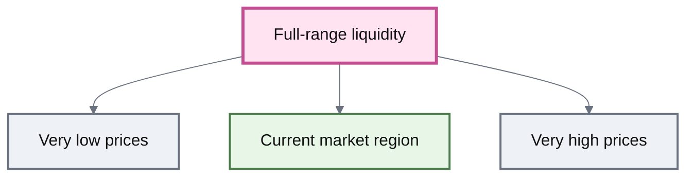
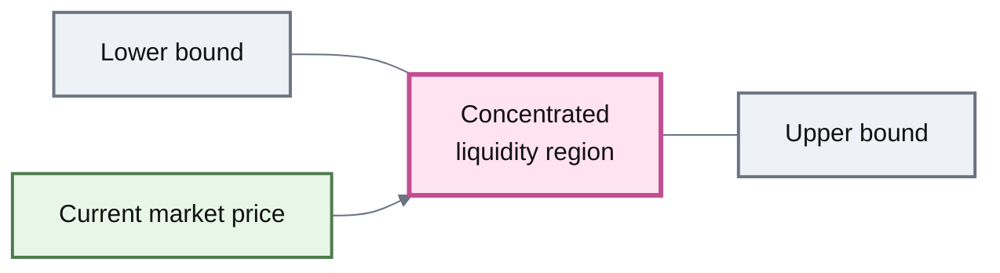
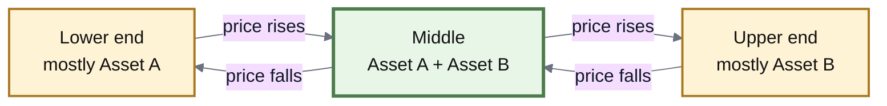
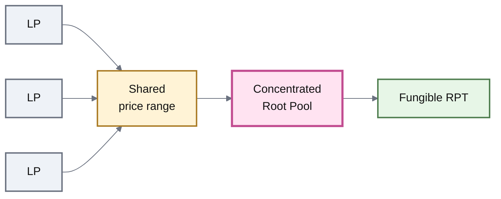
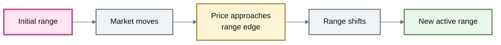

# Concentrated Liquidity

## Concentrated Liquidity

**Concentrated liquidity** focuses a Pool's liquidity inside a selected price range instead of spreading it across every possible price.

When the market is inside that range, more of the Pool's capital is actively supporting trades.

The result can be:

* deeper liquidity around the current price;
* lower price impact for traders;
* more trading activity supported by the same amount of capital;
* greater fee-generating use of LP capital.

The trade-off is simple: **the narrower the useful range, the easier it is for the market to move beyond it.**

***

### Full-range vs concentrated liquidity

A traditional constant-product market can support prices across an extremely wide range.

Conceptually:

That wide coverage is useful, but much of the capital may sit at prices far away from where trading is currently happening.

Concentrated liquidity takes a different approach:

Instead of distributing liquidity across the entire curve, more of it is focused where trading is expected to occur.

***

### Why concentration increases capital efficiency

Suppose two Pools contain the same amount of capital.

One spreads that capital across a very broad price curve.

The other concentrates it around the current market.

Within that smaller region, the concentrated Pool behaves as though it has **deeper liquidity**.

That means a trader can generally move more value before causing the same amount of price impact.

|                              | Full-range liquidity        | Concentrated liquidity          |
| ---------------------------- | --------------------------- | ------------------------------- |
| Capital distribution         | Broad price range           | Selected price region           |
| Liquidity near current price | More dispersed              | More concentrated               |
| Capital efficiency           | Lower                       | Higher while in range           |
| Price impact                 | Higher for the same capital | Lower while liquidity is active |
| Range-management risk        | Low                         | Higher                          |


**Concentration does not create more capital.**

It makes a larger fraction of the existing capital useful around a particular price region.


***

### The price range

A concentrated-liquidity market has a region where its liquidity is intended to operate.

For a two-asset market, imagine a range such as:

**$1,500 ← current price → $2,500**

The lower and upper bounds define where that concentrated liquidity is active.

When the market is inside the range, the Pool is **in range**.

When the market reaches or moves beyond a boundary, the position approaches an **out-of-range** state.

***

### In range vs out of range



The current market price is inside the Pool's active range.

Liquidity is being actively used for swaps.

This is where concentration provides its capital-efficiency advantage and where trading can generate fees for the LP position.



The market has moved toward one edge of the range.

The Pool's inventory becomes increasingly concentrated in one of the two assets as traders move the price across the curve.

The remaining useful range is shrinking.



The market reaches or moves beyond the usable range.

The position may become almost entirely one asset, and that liquidity may stop participating in ordinary trading until the range is restored, moved, or the market returns.

The exact behavior depends on the concentrated-liquidity design.



This is why concentrated liquidity cannot be evaluated only by its efficiency **while the market remains in range**.

The range itself is part of the LP strategy.

***

### What happens to the assets as price moves

Concentrated liquidity still behaves like an AMM.

Trading changes the Pool's inventory.

Suppose a Pool contains Asset A and Asset B.

As the market price moves through the range, arbitrage and ordinary trading gradually exchange one asset for the other.

So concentrated liquidity is not simply “capital sitting inside a price box.”

The assets themselves are transformed as the market travels through that box.

***

### Narrow ranges vs wide ranges

The width of the range determines how aggressively liquidity is concentrated.

#### Narrower range

More capital is focused near the current price.

That can produce:

* greater liquidity depth;
* lower price impact;
* more fee-generating capacity per unit of capital.

But the market has less distance to travel before reaching a boundary.

#### Wider range

Liquidity is spread across more possible prices.

That generally provides:

* less concentration;
* lower capital efficiency;
* more tolerance for large price movements;
* less frequent need for range adjustment.

The central trade-off is:

> **More concentration → more capital efficiency → less room for the market to move.**

There is no universally best range.

The appropriate width depends on the assets, volatility, expected price relationship, and how the range is managed.

***

### Concentrated liquidity is not one Pool design

“Concentrated liquidity” describes a market property.

It does not specify exactly how the Pool implements that property.

Different systems can answer several design questions differently:

| Design question                  | Possible approaches                                |
| -------------------------------- | -------------------------------------------------- |
| Who selects the range?           | LP, Pool creator, algorithm                        |
| Does every LP share one range?   | Shared range or individual ranges                  |
| Can the range move?              | Fixed or adaptive                                  |
| How is concentration created?    | Different invariants or virtual-balance models     |
| How is LP ownership represented? | Fungible Pool token or position-specific ownership |

This matters because two concentrated-liquidity systems can have very different LP experiences even though both concentrate capital.

***

### Fungible concentrated liquidity

One design is for every LP in a Pool to share the same market parameters and price range.

In that model:

Because LPs share the same Pool state, their ownership can remain fungible.

This fits naturally with the broader Root Pool model, where an RPT represents proportional ownership of shared Pool liquidity.

***

### Individual-range liquidity

Another approach lets each LP choose a different range.

For example:

* LP A provides from $1,500–$2,500;
* LP B provides from $1,800–$2,100;
* LP C provides from $1,000–$4,000.

Those positions are economically different.

The tighter position concentrates more aggressively, while the wider position remains active across a larger market movement.

Because each position can have unique parameters, ownership may need to be tracked individually rather than through one interchangeable Pool token.


ROOTSTOCK documentation should keep **concentrated liquidity** separate from any particular position model.

Concentration can be implemented with fungible shared-range Pools or with individualized positions. The concept itself does not require either one.


***

### Fixed-range Pools

A **fixed-range** concentrated Pool chooses its price bounds when the Pool is created.

Those bounds remain part of the market design.

If the market later moves away from that region, the Pool does not automatically follow it.

This gives the market predictable parameters, but it can require LPs or Pool operators to migrate liquidity if the chosen range becomes obsolete.

Fixed-range designs are therefore a straightforward form of concentrated liquidity:

**choose the region → concentrate liquidity → remain there**

***

### Adaptive-range Pools

A concentrated Pool can instead allow its active range to move.

That produces a different model:

**choose an initial region → observe market movement → reposition the range**

ROOTSTOCK's **AutoRange Pools** represent this second category.

Rather than forcing LPs to manually abandon one range and enter another, an AutoRange design can gradually move the Pool's shared liquidity region as market conditions change.

The detailed re-centering mechanism belongs on **AutoRange Pools**.

***

### Concentration changes LP risk

Concentrated liquidity can increase the amount of trading supported by a given quantity of capital.

It can also intensify the consequences of price movement.

A narrower range means the Pool trades through its inventory more quickly as the market moves.

At a range boundary, an LP may end up primarily—or entirely—exposed to one asset.

That means greater capital efficiency does **not** automatically imply greater LP returns.

Returns still depend on:

* trading volume;
* swap fees;
* price path;
* range width;
* how long the Pool remains active;
* asset volatility;
* divergence between the Pool position and simply holding the assets.

Detailed treatment belongs in **LP Risk & Impermanent Loss**.

***

### Concentrated vs Stable liquidity

Stable Pools and concentrated-liquidity Pools can both improve capital efficiency, but they do so differently.

| Stable Pool                                      | Concentrated Liquidity Pool                    |
| ------------------------------------------------ | ---------------------------------------------- |
| Assumes assets remain closely related            | Defines a limited price region                 |
| Uses Stable Math around an expected relationship | Focuses liquidity between price bounds         |
| Efficiency comes from correlation                | Efficiency comes from restricting active range |
| Relationship may move through Rate Providers     | Range may be fixed or adaptive                 |

These approaches can overlap conceptually, but they should not be treated as synonyms.

A concentrated-liquidity design may be intended for tightly correlated assets, volatile assets, or another specific market depending on its invariant and range model.

***

### What concentration does not guarantee

Concentrated liquidity does not guarantee:

* higher LP profit;
* continuous fee income;
* protection from price divergence;
* correct range selection;
* permanent capital efficiency;
* automatic range management.

The advantage only exists while the liquidity is positioned where the market actually needs it.


**A narrow range is a stronger market assumption.**

It says that more capital should be committed to a smaller region of possible prices. If that assumption is wrong, the same concentration that improved efficiency can become a source of inactivity and inventory risk.


***

### The model to remember


#### Concentrated liquidity in one sentence

**Instead of spreading liquidity across the full price curve, concentrated liquidity makes more capital active inside a selected price region—improving efficiency while increasing dependence on where that range is placed.**


The fundamental trade-off is:

**wider range → broader coverage, lower concentration**

**narrower range → deeper liquidity, greater range risk**

Everything else—fixed ranges, adaptive ranges, shared positions, individualized positions—is an implementation choice around that core idea.

***

### Deployment boundary

Concentrated liquidity is part of the inherited v3 design space, including fungible fixed-range and adaptive-range approaches.

This page defines the **concept**, not the currently enabled ROOTSTOCK implementation.

Specific ROOTSTOCK support for:

* concentrated-liquidity Pool families;
* range parameters;
* factories;
* mutable or immutable bounds;
* adaptive range movement;
* supported Routers;
* deployed addresses;

must be verified against the current ROOTSTOCK contracts and deployment registry.

***

### Continue

| Page                           | What it explains                                                    |
| ------------------------------ | ------------------------------------------------------------------- |
| **AutoRange Pools**            | How a concentrated-liquidity range can move automatically           |
| **Weighted Pools**             | General-purpose full-range weighted markets                         |
| **Stable Pools**               | Capital efficiency based on correlated assets                       |
| **Root Pool Tokens**           | Fungible ownership of shared Pool liquidity                         |
| **LP Risk & Impermanent Loss** | How price movement changes LP outcomes                              |
| **Custom Pools**               | How alternative pricing and concentration models can be implemented |
