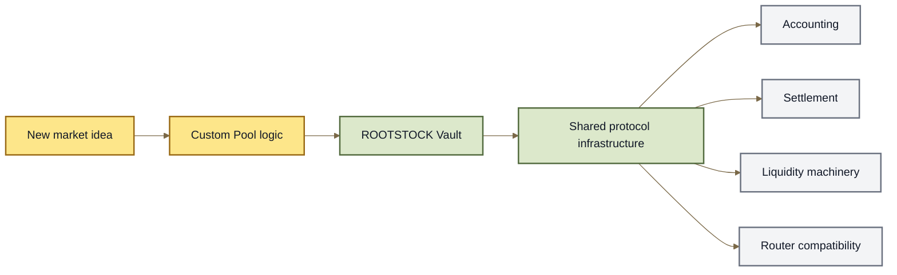

# Custom Pools

A **Custom Pool** lets builders create a market with its own pricing rules while still using ROOTSTOCK's shared infrastructure.

Weighted Pools and Stable Pools already cover many common markets. A Custom Pool is useful when neither one expresses the behavior you want.

> **Custom Pool = custom market math + shared ROOTSTOCK infrastructure.**

***

### Why Custom Pools exist

Different markets can need different rules.

A builder might want a Pool with:

* a new pricing curve;
* unusual asset relationships;
* specialized liquidity behavior;
* market parameters that do not fit Weighted or Stable Pools.

Instead of rebuilding an entire exchange around that idea, the builder can create the market-specific Pool logic and connect it to ROOTSTOCK.



The builder focuses on the part that makes the market different.

ROOTSTOCK handles much of what every Pool has in common.

***

### What the Custom Pool decides

The Custom Pool defines the market-specific calculations.

At a high level, it answers questions such as:

```
If someone swaps these assets,
how much should they receive?

If liquidity changes,
what should the new Pool state be?

What mathematical relationship
should the Pool preserve?
```

That relationship is usually described by an **invariant**.

Weighted Pools already have Weighted Math.

Stable Pools already have Stable Math.

A Custom Pool can provide something different.

\{% hint style="info" %\}\
The exact contract functions and interfaces are developer concerns.

See **Build a Custom Pool** and **Protocol Interfaces** for implementation details.\
\{% endhint %\}

***

### What ROOTSTOCK still handles

Customizing the Pool does **not** mean replacing the entire protocol.

The Vault continues to provide shared infrastructure around the market, including:

* Pool balance accounting;
* settlement;
* token scaling and common accounting rules;
* RPT accounting;
* common liquidity machinery;
* protocol-level checks and constraints.

This creates an important separation:

```
Custom Pool
    → market-specific mathematics

Vault
    → shared accounting + settlement
```

Because Custom Pools use the same surrounding architecture, they can remain compatible with common ROOTSTOCK infrastructure rather than becoming isolated exchanges.

***

### Example

Imagine a developer invents a market whose desired pricing behavior cannot be represented by either:

```
Weighted Math
```

or:

```
Stable Math
```

They could build:

```
Custom pricing rule
        ↓
Custom Pool
        ↓
ROOTSTOCK Vault
        ↓
swaps + liquidity + settlement
```

The new Pool supplies the specialized mathematics.

The rest of the protocol does not need to be rebuilt around it.

***

### Custom Pool vs Hook

Custom Pools and Hooks solve different problems.

#### Use a Custom Pool when the market math changes

```
new invariant
new pricing curve
new balance relationship
        ↓
Custom Pool
```

#### Use a Hook when the existing market math is still useful

```
Weighted or Stable math
        +
extra behavior
        ↓
Hook
```

For example, a Hook could add behavior around swaps or liquidity operations without replacing the Pool's underlying pricing model.

A Custom Pool changes the **market itself**.

A Hook changes or extends **behavior around the market**.

| Need                               | Use             |
| ---------------------------------- | --------------- |
| Different pricing mathematics      | **Custom Pool** |
| New invariant                      | **Custom Pool** |
| Extend an existing Pool            | **Hook**        |
| Dynamic behavior around operations | **Hook**        |

A Custom Pool can also use Hooks, so the two approaches are not mutually exclusive.

See **Hooks**.

***

### Custom Pools still use Pool configuration

A Custom Pool still participates in the wider Root Pool model.

It can have configuration such as:

* registered tokens;
* swap fees;
* role accounts;
* liquidity capabilities;
* Hooks;
* Rate Providers where applicable;
* emergency controls.

The custom invariant does not replace these layers.

```
Custom mathematics
        +
Pool configuration
        +
Vault infrastructure
        =
Custom Root Pool
```

See **Pool Configuration & Roles**.

***

### Custom does not mean unrestricted

A Custom Pool can introduce new mathematics, but it still operates inside protocol boundaries.

For example, ROOTSTOCK may constrain:

* supported token behavior;
* fee ranges;
* liquidity operations;
* invariant changes;
* accounting precision;
* registration configuration.

The Pool controls its specialized market logic—not the entire protocol.

***

### Custom math creates new risk

The Vault can provide common accounting and settlement protections.

It cannot determine whether a new economic model is a good one.

A poorly designed Custom Pool could still have:

* incorrect prices;
* unsafe behavior at extreme balances;
* exploitable rounding;
* broken liquidity calculations;
* unexpected arbitrage;
* manipulation opportunities.

\{% hint style="warning" %\}\
**Shared infrastructure does not make custom mathematics automatically safe.**

A novel Pool still needs its own economic analysis, testing, and security review.\
\{% endhint %\}

Those engineering requirements belong in **Build a Custom Pool** and the **Security Model**.

***

### Deployment and integration

A production Custom Pool also needs to fit into the rest of the protocol ecosystem.

That can include:

```
Custom Pool
    ↓
Factory
    ↓
Registration
    ↓
Initialization
    ↓
Indexing + integrations
```

The exact deployment workflow belongs in **Factories & Deployment** and **Build a Custom Pool**.

***

### The model to remember

```
Weighted Pool
    → Weighted Math

Stable Pool
    → Stable Math

Custom Pool
    → Builder-defined market math
```

All three can still use the same ROOTSTOCK Vault infrastructure around them.

So the important distinction is:

> **A Custom Pool changes the market's mathematics without requiring the builder to rebuild the surrounding AMM protocol.**

***

### Continue

<table><thead><tr><th width="237">Page</th><th>What it explains</th></tr></thead><tbody><tr><td><strong>Build a Custom Pool</strong></td><td>How developers implement and test a new Pool type.</td></tr><tr><td><strong>Hooks</strong></td><td>How existing Pool behavior can be extended without replacing its core math.</td></tr><tr><td><strong>Pool Configuration &#x26; Roles</strong></td><td>The configuration and authority surrounding every Root Pool.</td></tr><tr><td><strong>Vault</strong></td><td>The shared accounting layer used by Pools.</td></tr><tr><td><strong>Accounting &#x26; Settlement</strong></td><td>How balances and token movements are handled.</td></tr><tr><td><strong>Protocol Interfaces</strong></td><td>The exact interfaces Custom Pools implement.</td></tr><tr><td><strong>Factories &#x26; Deployment</strong></td><td>How Pool implementations are deployed and registered.</td></tr><tr><td><strong>Security Model</strong></td><td>The security boundaries around Pools and the Vault.</td></tr></tbody></table>
