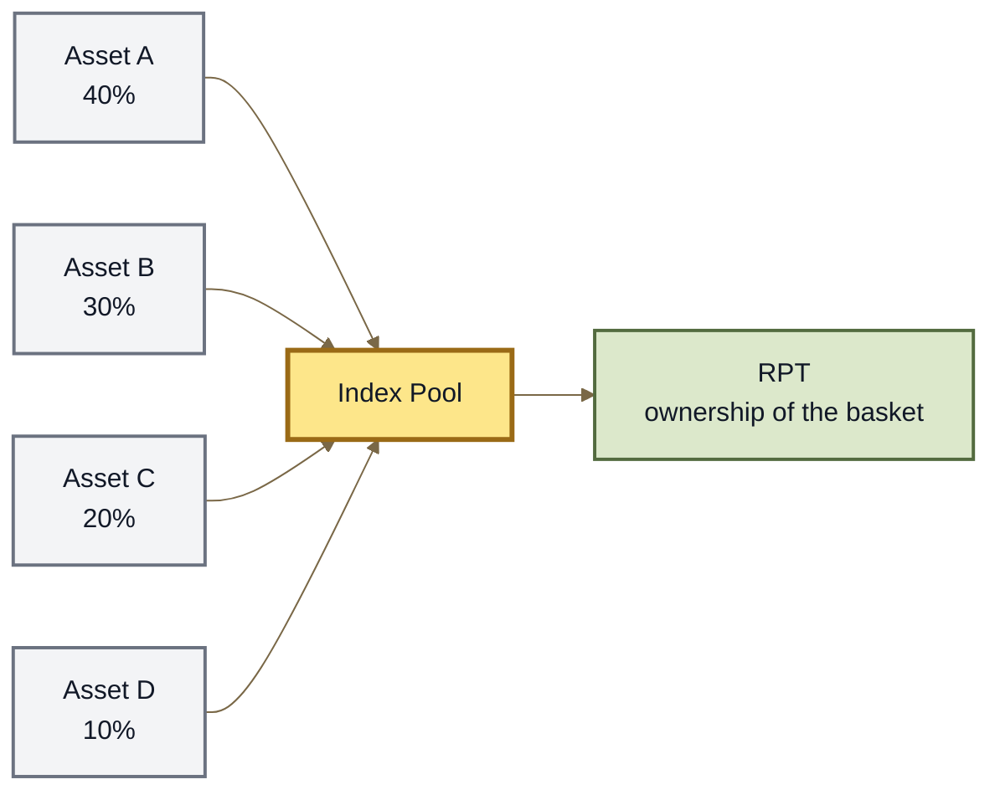

# Index Pools

## Index Pools

An **Index Pool** combines several assets into one Root Pool so an LP can hold exposure to the whole basket through a single RPT.

For example:

```
40% ETH
30% BTC
20% USDC
10% AERO
```

Instead of providing liquidity to several separate markets, the assets participate in one multi-asset Pool.

> **The index mental model:** several assets + chosen weights → one Pool → one RPT representing the basket.

***

### An Index Pool is usually a Weighted Pool

Index Pools do not require a new invariant.

A standard Index Pool can use **Weighted Pool** mathematics with more than two assets.





The weights determine how strongly each asset contributes to the Pool's pricing and LP exposure.

See **Weighted Pools**.

***

### One Pool can represent a basket

Suppose an Index Pool contains:

```
50% ETH
25% BTC
15% USDC
10% AERO
```

An LP does not own four separate positions.

The LP owns RPT representing a proportional share of the entire Pool.

```
RPT
 ↓
share of the Index Pool
 ↓
exposure to every asset inside it
```

As Pool balances change, the assets represented by that RPT change with them.

See **Root Pool Tokens**.

***

### The Pool also acts as a market

An Index Pool is not simply a token vault holding a basket.

Its assets can also trade against each other through the Pool.

That means the same capital can provide:

* portfolio exposure for LPs;
* liquidity for traders;
* swap-fee revenue;
* automatic inventory rebalancing through arbitrage.

This is one of the major differences between an AMM index and a simple basket token.

***

### How rebalancing happens

Imagine an Index Pool with:

```
50% Asset A
30% Asset B
20% Asset C
```

If Asset A becomes more valuable outside the Pool, traders may buy Asset A from the Pool and sell other assets into it.

The Pool's inventory changes as a result.

```
external prices change
        ↓
arbitrage opportunity
        ↓
trades against Index Pool
        ↓
Pool balances change
```

Weighted Pool mathematics provide the pricing rules that drive this process.

\{% hint style="info" %\}\
An Index Pool does not periodically buy and sell assets like a traditional portfolio manager unless additional management logic has been added.

In a standard fixed-weight Pool, rebalancing emerges through trading and arbitrage.\
\{% endhint %\}

***

### Fixed-weight Index Pools

The simplest Index Pool has a fixed set of assets and fixed normalized weights.

For example:

```
25 / 25 / 25 / 25
```

or:

```
50 / 20 / 15 / 10 / 5
```

The weights remain part of the Pool's market design.

This works well when the intended index allocation is known in advance and does not need active management.

```
assets
  +
fixed weights
  ↓
fixed-weight Index Pool
```

A fixed-weight Index Pool is therefore primarily a **multi-asset Weighted Pool used as an index**.

***

### Index does not mean equal-weight

An index can use any supported normalized weighting.

For example:

#### Equal weight

```
25 / 25 / 25 / 25
```

Each asset begins with the same target exposure.

#### Market-specific weight

```
50 / 30 / 15 / 5
```

Some assets have greater importance than others.

#### Rooted index

```
60 / 15 / 10 / 10 / 5
```

One asset holds a majority weight, making the Index Pool both:

* **multi-asset**; and
* **rooted**.

These labels describe different properties of the same Pool.

See **Rooted Pools**.

***

### Dynamic Index Pools

A more advanced index could allow its composition to change over time.

That might include:

```
changing weights
adding an asset
removing an asset
changing strategy parameters
```

For example:

```
40 / 30 / 20 / 10
        ↓
50 / 25 / 15 / 10
```

This turns the Pool from a fixed basket into a **managed strategy**.

That distinction is important.

```
FIXED INDEX
assets + weights remain fixed

DYNAMIC INDEX
strategy can modify composition
```

Dynamic management introduces additional authority and risk because someone—or some automated mechanism—must be allowed to make those changes.

\{% hint style="warning" %\}\
**Index Pool does not automatically mean managed Pool.**

Changing weights, adding assets, or removing assets requires explicit implementation and permissions. Those capabilities should never be inferred merely from the Pool being described as an index.\
\{% endhint %\}

ROOTSTOCK documentation should only describe such capabilities as deployed behavior once the relevant contracts and permissions have been verified.

***

### Index Pools can become composable

An Index Pool does not necessarily need to contain only ordinary tokens.

Where the protocol supports nested Pool assets, an index could also contain RPT representing other Pools.

For example:

```
RPT-A ─┐
ETH   ─┼→ Index Pool → Index RPT
RPT-B ─┤
USDC  ─┘
```

This creates a **composite index** whose constituents can themselves represent other liquidity positions.

That structure belongs to the broader composability model rather than to Index Pool mathematics.

See **Composable & Nested Pools**.

***

### Index Pool vs ordinary Weighted Pool

The contracts may use the same underlying mathematics.

The distinction is primarily about purpose.

| Weighted Pool                       | Index Pool                                                 |
| ----------------------------------- | ---------------------------------------------------------- |
| General-purpose weighted market     | Multi-asset basket designed around a portfolio composition |
| Can contain two or more assets      | Usually emphasizes several constituent assets              |
| Weights define pricing and exposure | Weights also describe the intended index composition       |
| RPT represents Pool ownership       | RPT acts as ownership of the indexed basket                |

So:

```
Weighted Pool
    = mathematical Pool family

Index Pool
    = portfolio composition built with that machinery
```

***

### Index Pool vs tokenized fund

An Index Pool should also not be confused with a traditional managed fund.

A basic Index Pool:

* holds its assets onchain;
* exposes them through an AMM;
* allows its constituents to trade;
* changes inventory as users trade;
* represents ownership through RPT.

It does not automatically have:

* an investment manager;
* discretionary trading;
* performance fees;
* automatic asset selection;
* periodic benchmark reconstitution.

Those features would require additional strategy and permission layers.

***

### Risks

An Index Pool combines the risks of its underlying assets with AMM-specific risks.

LPs should consider:

* the quality of every constituent asset;
* the chosen weights;
* price divergence between constituents;
* rebalancing through arbitrage;
* liquidity and price impact;
* external dependencies such as Rate Providers;
* additional management authority if the index is dynamic.

Adding more assets can diversify exposure, but it also introduces more dependencies.

```
more assets
   ≠
automatically less risk
```

See **LP Risk & Impermanent Loss**.

***

### The model to remember

```
MULTIPLE ASSETS
      +
WEIGHTS
      ↓
INDEX POOL
      ↓
one multi-asset market
      +
one RPT representing the basket
```

For a standard fixed index:

```
Index Pool
    = multi-asset Weighted Pool
      used as an onchain basket
```

For a managed index:

```
Index Pool
    +
authorized strategy logic
    ↓
Dynamic Index Pool
```

Those are different systems and should be documented separately when the dynamic capabilities actually exist.

***

### Deployment boundary

Multi-asset Weighted Pool architecture exists in the inherited v3 design.

The broader **Index Pool** classification is a ROOTSTOCK composition model built on that capability.

This conceptual page does not establish that ROOTSTOCK currently supports:

* dynamically changing weights;
* adding or removing constituents after registration;
* automated index rebalancing strategies;
* management or performance fees;
* arbitrary nested RPT constituents.

Those capabilities must be documented from the specific deployed implementation if and when they exist.

***

### Continue

<table><thead><tr><th width="270">Page</th><th>What it explains</th></tr></thead><tbody><tr><td><strong>Weighted Pools</strong></td><td>The mathematics underlying standard Index Pools.</td></tr><tr><td><strong>Rooted Pools</strong></td><td>Index compositions where one asset has majority weight.</td></tr><tr><td><strong>Root Pool Tokens</strong></td><td>How ownership of the entire basket is represented.</td></tr><tr><td><strong>Composable &#x26; Nested Pools</strong></td><td>How RPT and other Pool positions can become constituents of larger structures.</td></tr><tr><td><strong>Pool Configuration &#x26; Roles</strong></td><td>Which Pool parameters and authorities surround the market.</td></tr><tr><td><strong>LP Risk &#x26; Impermanent Loss</strong></td><td>How multi-asset AMMs affect LP exposure.</td></tr><tr><td><strong>Custom Pools</strong></td><td>How specialized index or strategy mathematics can be implemented.</td></tr></tbody></table>
