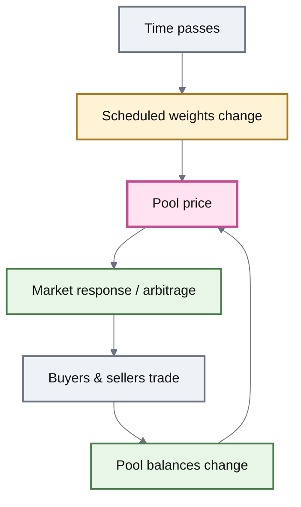
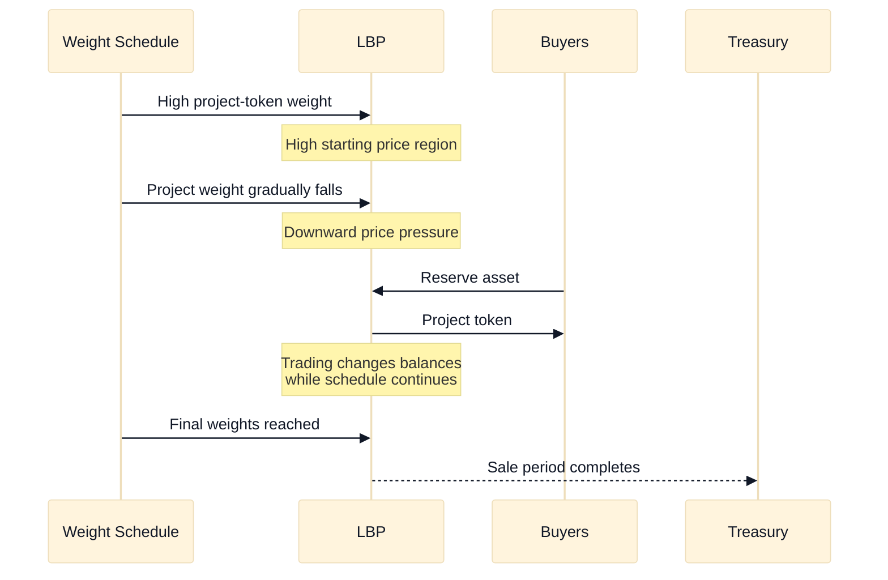

# Liquidity Bootstrapping Pools

## Liquidity Bootstrapping Pools

A **Liquidity Bootstrapping Pool (LBP)** is a temporary two-asset market designed to distribute or accumulate tokens according to a predefined market schedule.

The primary LBP design begins as a Weighted Pool, but its token weights are **not fixed**. Instead, they move from predetermined starting weights to predetermined ending weights over a defined period.

Changing the weights changes the Pool's quoted price even if its token balances do not change.

> **An LBP uses time-dependent market parameters to create directional price pressure, then lets trading determine how the market responds.**

This makes LBPs useful for price discovery, gradual distribution, treasury operations, and token accumulation.

***

### A Weighted Pool that changes with time

A normal Weighted Pool might remain:

**80% Asset A / 20% Asset B**

for its entire lifetime.

A weight-shifting LBP might instead follow a schedule such as:

**90 / 10 → 80 / 20 → 60 / 40 → 40 / 60 → 20 / 80**

The Pool still uses **Weighted Math**.

What changes is the weight input to that math.

```mermaid
%%{init: {"theme":"base","themeVariables":{
  "fontFamily":"Inter, ui-sans-serif, system-ui, sans-serif",
  "primaryTextColor":"#111827",
  "lineColor":"#6B7280"
}}}%%
flowchart LR
    START["Start<br/>90% Project<br/>10% Reserve"]
    MID1["Early<br/>75 / 25"]
    MID2["Middle<br/>55 / 45"]
    MID3["Late<br/>35 / 65"]
    END["End<br/>20% Project<br/>80% Reserve"]

    START --> MID1 --> MID2 --> MID3 --> END

    classDef start fill:#F6C453,stroke:#6B4B16,stroke-width:3px,color:#111;
    classDef schedule fill:#FFF3D6,stroke:#A97922,stroke-width:2px,color:#111;
    classDef end fill:#E7F6E7,stroke:#4D7C4D,stroke-width:3px,color:#111;

    class START start;
    class MID1,MID2,MID3 schedule;
    class END end;
```

The transition occurs gradually throughout the configured LBP period.

There is no series of discrete Pool replacements. It is one market whose weights evolve with time.

***

### Why changing weights changes price

In a Weighted Pool, price depends on both:

* the Pool's token balances; and
* the tokens' weights.

This gives an LBP **two forces acting on price**.

| Force               | What changes it |
| ------------------- | --------------- |
| **Weight schedule** | Time            |
| **Pool balances**   | Trading         |

The schedule can continuously move the Pool's quote in one direction.

Trading can push against that movement, reinforce it, or keep the Pool aligned with external markets.



This distinction is fundamental.


**The LBP does not directly prescribe the token's sale price at every moment.**

It prescribes a **weight schedule**. The actual Pool price emerges from the interaction between that schedule and trading.


***

### Price discovery

For a token distribution, an LBP can start with a large project-token weight and a small reserve-token weight.

For the same starting balances, this can establish an intentionally high initial Pool price.

The project-token weight then falls over time.

If nobody trades, that scheduled weight movement pushes the quoted project-token price downward.

But buyers can intervene at any point.



The weight schedule continues moving.

With little or no buying pressure, the Pool's quoted project-token price continues declining along the direction created by the schedule.



Buyers exchange reserve assets for project tokens.

That changes Pool balances and pushes back against the schedule's downward pressure.

The observed market price therefore reflects both the programmed weight transition and actual demand.



If the same token trades elsewhere, differences between the LBP and external markets can create arbitrage opportunities.

Those trades can pull the LBP toward prices available elsewhere while the weight schedule continues progressing.



The schedule therefore creates a **directional price process**, while the market discovers where participants are willing to trade.

***

### Why start high?

For token distribution, starting above the expected market-clearing price changes the incentives around launch.

In a conventional fixed-price or immediately liquid market, buyers may be strongly incentivized to arrive first if they believe the initial price is too low.

That can create:

**early access → cheap inventory → later buyers pay more**

An LBP can invert that incentive.

If buyers expect the scheduled price pressure to move downward, buying immediately is no longer automatically advantageous.

Participants can instead wait for a price they are willing to accept.


#### The launch mechanism changes the race

The purpose of a high starting price is not to assert that the token is worth that amount.

It creates room for the scheduled weight shift to perform price discovery.


This can reduce incentives for immediate launch-time buying, but it does **not** guarantee equal allocation, prevent large buyers, or guarantee a particular final distribution.

***

### A token-launch LBP

Consider a Pool containing:

**PROJECT + USDC**

with the following schedule:

| State    | PROJECT weight | USDC weight |
| -------- | -------------: | ----------: |
| Start    |            90% |         10% |
| Midpoint |            55% |         45% |
| End      |            20% |         80% |

The project begins as the dominant weight.

As the schedule progresses, that dominance declines.



By the end of the process, some project-token inventory has been distributed and reserve assets have accumulated in the Pool.

***

### The schedule and the market pull in different directions

An LBP is easier to understand as a tension between two processes.

**The schedule creates pressure.**

**The market responds.**

For a typical token sale:

* falling project-token weight pushes its Pool price downward;
* purchases remove project tokens and add reserve tokens;
* that trading pushes the price upward relative to where the schedule alone would have taken it.

The resulting price is where those effects meet.

This is why an LBP should not be described as simply “a token whose price automatically falls.”

The schedule tends to push the Pool in that direction, but trading remains part of price formation.

***

### The weight schedule is known in advance

A weight-shifting LBP is configured around:

* a project token;
* a reserve token;
* starting weights;
* ending weights;
* a start time;
* an end time.

Between the two timestamps, the weights move gradually from the starting configuration toward the ending configuration.

This makes the mechanism transparent in a useful sense:

> The market can know **how the Pool's weights will evolve** before deciding when to trade.

It cannot know in advance exactly what prices or balances the market will produce, because those depend on participation.

***

### LBPs are temporary markets

An LBP is not intended to behave like a perpetual ordinary Weighted Pool.

Its lifecycle has a defined market period.

Conceptually:

**configure → initialize → wait for start → scheduled market period → end → settle/remove proceeds**

The schedule therefore forms part of the Pool's lifecycle rather than merely being another mutable weight setting.

In the inherited v3 design, liquidity provision and removal are also restricted around this sale lifecycle so that ordinary LP activity cannot arbitrarily change the intended distribution process.

The exact permissions belong in **Pool Configuration & Roles** and the integration reference.

***

### Seedless launches

Some LBP configurations can begin without requiring the project to contribute the normal paired amount of reserve liquidity.

Instead, buyers introduce reserve assets as they purchase project tokens.

This is useful when the objective is to distribute a new token while raising reserve assets.

Conceptually:

**project inventory → LBP**

then participants supply:

**reserve asset → LBP → project token**

This reduces the reserve capital a project may need before beginning distribution.


Seedless initialization is an implementation capability, not the definition of an LBP.

The defining property of a weight-shifting LBP remains its scheduled change in market weights.


***

### Selling can be one-way

For some token launches, allowing participants to immediately sell project tokens back into the LBP would work against the intended distribution mechanism.

The inherited LBP design can therefore restrict **project-token swaps into the Pool**.

That creates a sale-oriented market:

**reserve → project token**

while blocking:

**project token → reserve**

This restriction is configuration-dependent.

It is not appropriate for every LBP use case.

For example, a token **buyback** requires project tokens to flow into the Pool, so that direction must be allowed.

***

## Beyond token launches

The same weight-shifting mechanism can create other forms of scheduled market pressure.

The Pool itself does not know whether the organization operating it calls the process a launch, divestment, accumulation strategy, or treasury operation.

What changes is the direction of the weight schedule and the intended flow of assets.

***

### Treasury diversification

A treasury holding a large quantity of one asset may not want to sell the entire position into an ordinary market at once.

An LBP can spread that process across time.

Instead of one large transaction:

**large inventory → immediate market impact**

the treasury can create a schedule that gradually encourages the market to exchange that inventory for another asset.

This can be used for:

* gradual divestment;
* reserve diversification;
* staged position entry.

The LBP does not eliminate market impact. It gives the treasury a programmable mechanism for distributing that interaction across a period.

***

### Token accumulation and buybacks

The same mechanism can be reversed.

Suppose a treasury wants to **acquire** a project token using a reserve asset.

Instead of beginning project-heavy and moving toward reserve-heavy weights, the schedule can begin reserve-heavy and progressively shift toward the project token.

For example:

**90% reserve / 10% project**

becomes:

**30% reserve / 70% project**

This produces the opposite directional pressure.

Rather than offering project tokens to buyers, the Pool increasingly encourages sellers to exchange project tokens for treasury reserves.



**Objective:** project token leaves the Pool.

Typical schedule begins with a high project-token weight and moves toward a lower project-token weight.

The mechanism creates downward price pressure over time.



**Objective:** project token enters the Pool.

The weight direction is reversed.

The mechanism can create progressively stronger bidding pressure for the project token.



So an LBP is better understood as a **scheduled market primitive** than as a token-launch primitive.

***

### Fixed Price LBP

Not every LBP variant performs price discovery through changing weights.

The inherited v3 architecture also defines a **Fixed Price LBP**.

A Fixed Price LBP keeps a constant exchange rate throughout the sale.

It has:

* no weight schedule;
* no descending or ascending price process;
* a predetermined exchange rate;
* one-way project-token distribution;
* seedless initialization with project tokens.

For example:

**1 PROJECT = 10 USDC**

remains:

**1 PROJECT = 10 USDC**

for the duration of the sale.

#### Weight-shifting vs Fixed Price

|                                            | Weight-shifting LBP                          | Fixed Price LBP                |
| ------------------------------------------ | -------------------------------------------- | ------------------------------ |
| **Primary purpose**                        | Price discovery or scheduled market pressure | Constant-rate distribution     |
| **Price mechanism**                        | Weighted Math + changing weights + trades    | Fixed exchange rate            |
| **Weights change?**                        | Yes                                          | No                             |
| **Market can discover a different price?** | Yes, through trading against the schedule    | Sale rate itself remains fixed |
| **Typical directionality**                 | Configurable                                 | Buy-only                       |
| **Seedless configuration**                 | Supported in relevant launch configurations  | Native sale model              |


#### These are related products, not the same mathematics

A Fixed Price LBP should not be explained as a Weight-Shifting LBP whose weights happen not to move.

Its pricing mechanism is different.


The detailed Fixed Price invariant belongs in Developer Reference if ROOTSTOCK ships that variant.

***

### LBP vs ordinary Weighted Pool

| Weighted Pool                                           | Weight-shifting LBP                                    |
| ------------------------------------------------------- | ------------------------------------------------------ |
| Weights normally describe a persistent market           | Weights describe a scheduled transition                |
| Designed for ongoing liquidity                          | Designed around a bounded market period                |
| Price changes primarily through trading                 | Price can change through trading **and time**          |
| Arbitrage restores the configured weighted relationship | Arbitrage responds to a relationship that itself moves |
| LP market                                               | Distribution / accumulation / transition market        |

This is the conceptual difference that matters most.

An LBP borrows Weighted Math but gives **time** an explicit role in market state.

***

### LBP vs bonding curve

LBPs are also different from token bonding curves.

A bonding curve generally defines token price as a direct function of issuance or supply state.

A weight-shifting LBP is still an AMM:

* it contains inventory;
* users swap between assets;
* Pool balances affect price;
* scheduled weights also affect price.

The LBP therefore creates **market pressure**, not a single predetermined price path.

Actual demand remains part of the process.

***

### LBP vs AutoRange

Both Pool types change market parameters over time, but for almost opposite reasons.

| AutoRange Pool                                           | LBP                                   |
| -------------------------------------------------------- | ------------------------------------- |
| Reacts to Pool state                                     | Follows a predefined schedule         |
| Attempts to keep liquidity useful around a moving market | Intentionally moves market parameters |
| Adaptive                                                 | Scheduled                             |
| Range movement is endogenous                             | Weight movement is time-dependent     |
| Intended for continuing liquidity                        | Intended for a bounded transition     |

AutoRange asks:

> **Where has the market moved?**

An LBP asks:

> **Where should the market parameters be at this point in the schedule?**

***

### What an LBP does not guarantee

An LBP can structure price discovery.

It cannot guarantee its outcome.

It does not guarantee:

* a particular clearing price;
* a particular amount raised;
* broad token ownership;
* protection from large buyers;
* protection from external market manipulation;
* a successful token launch;
* a particular post-LBP market price.

The weight schedule is deterministic.

**Market response is not.**


A schedule can change incentives, but it cannot manufacture demand.

The final state depends on actual buyers, sellers, arbitrage, external markets, configuration, and available liquidity.


***

### The model to remember


#### Weight-shifting LBP in one sentence

**A Liquidity Bootstrapping Pool is a temporary Weighted market whose weights change on a predefined schedule, creating directional price pressure while trading performs the actual price discovery.**


The causal model is:

**time → weights change → Pool quote moves**

while simultaneously:

**trading → balances change → Pool quote moves**

The resulting market price comes from both.

For a token launch:

**high project weight → declining project weight → downward scheduled pressure → buyers determine where demand emerges**

For accumulation:

**reverse the schedule → reverse the pressure**

And for a Fixed Price LBP:

**remove the price-discovery schedule entirely → distribute at a constant rate**

***

### Deployment boundary

The current upstream v3 architecture contains both **weight-shifting `LBPool`** and **`FixedPriceLBPool`** implementations and their respective factories.

For ROOTSTOCK, that upstream availability does not establish deployment.

Before documenting either variant as live ROOTSTOCK functionality, the implementation layer must verify:

* which LBP variants are included;
* factories and deployment addresses;
* supported initialization modes;
* swap-direction restrictions;
* weight and duration bounds;
* liquidity permissions;
* sale lifecycle controls;
* trusted Router requirements;
* parameter and administrative authority.

Until then, this page defines the LBP design inherited from the source architecture rather than claiming a specific ROOTSTOCK deployment.

***

### Continue

| Page                           | What it explains                                                     |
| ------------------------------ | -------------------------------------------------------------------- |
| **Weighted Pools**             | The underlying mathematics used by weight-shifting LBPs              |
| **Pool Lifecycle**             | How initialization, active operation, and termination are structured |
| **Pool Configuration & Roles** | Who controls LBP configuration and lifecycle permissions             |
| **Index Pools**                | Persistent weighted baskets rather than scheduled weight transitions |
| **AutoRange Pools**            | Adaptive rather than scheduled market movement                       |
| **Swaps**                      | How trades change Pool balances and prices                           |
| **Price Impact & Slippage**    | How execution differs from the displayed market price                |
| **Custom Pools**               | Other specialized market mechanisms                                  |
