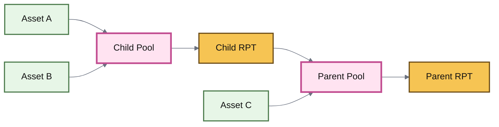
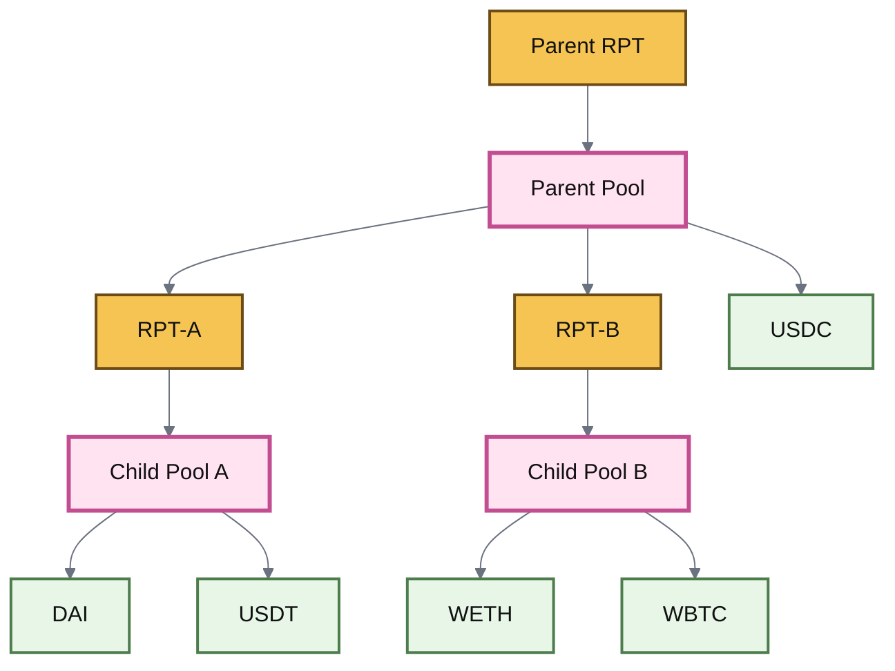
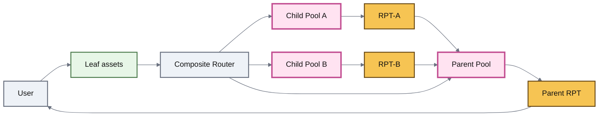

# Nested Pools

## Nested Pools

A **Nested Pool** is a Root Pool that contains the RPT of another Root Pool as one of its assets.

The inner Pool continues operating as its own market. Its RPT represents ownership of that liquidity and can then participate in a second Pool like another token.

This creates a hierarchy:

**assets → Pool → RPT → another Pool → another RPT**

> **Nesting turns a liquidity position into a building block for another liquidity position.**

***

### From Pool to building block

Every Root Pool can produce an RPT representing proportional ownership of its liquidity.

Normally, an LP simply holds that RPT.

With nesting, the RPT can instead become an asset in another Pool.

The Parent Pool does not need to recreate the Child Pool's internal liquidity.

It holds the **representation of that liquidity**.

***

### Parent, child, and leaf assets

Nested structures introduce a few useful terms.

| Term            | Meaning                                                                    |
| --------------- | -------------------------------------------------------------------------- |
| **Child Pool**  | A Pool whose RPT is held by another Pool                                   |
| **Child RPT**   | The Pool token representing ownership of the Child Pool                    |
| **Parent Pool** | The Pool containing one or more Child RPTs                                 |
| **Parent RPT**  | The RPT representing ownership of the complete nested structure            |
| **Leaf asset**  | An underlying asset at the bottom of the hierarchy rather than another RPT |

For example, consider:

* Child Pool A containing DAI and USDT;
* Child Pool B containing WETH and WBTC;
* a Parent Pool containing RPT-A, RPT-B, and USDC.

The resulting structure is:

The Parent RPT now represents exposure to a structure whose economic leaves ultimately include all five underlying assets.

***

### The Child Pool does not disappear

Nesting does not merge two Pools into one invariant.

Each Pool remains its own market.

Suppose the Child Pool is a Stable Pool while the Parent Pool is Weighted.

The hierarchy can be understood as:

| Layer        | Market logic                  |
| ------------ | ----------------------------- |
| DAI / USDT   | Stable Pool                   |
| RPT-A        | Ownership of that Stable Pool |
| RPT-A / WETH | Weighted Parent Pool          |

The Stable Pool still determines how DAI and USDT interact.

The Parent Weighted Pool determines how its own constituent assets interact.

The Parent sees **RPT-A as an asset**. It does not replace the Stable Pool's mathematics.


#### Composition preserves boundaries

A Parent Pool can build on a Child Pool without inheriting or replacing the Child Pool's invariant.

Each Pool remains responsible for its own market.


***

### Why nesting matters

Without nesting, a protocol that wants exposure to several existing liquidity groups may need to reproduce those assets directly.

Imagine a useful stablecoin market already exists:

**DAI / USDC / USDT**

Now another market wants exposure to that stablecoin liquidity plus WETH.

One approach is to create a completely separate Pool containing:

**DAI / USDC / USDT / WETH**

That duplicates the stablecoin composition into another market.

With nesting, the existing stablecoin Pool can become the building block:

**Stable RPT / WETH**

The second Pool references the first Pool's liquidity instead of reconstructing it from its individual assets.

This allows liquidity structures to be composed from other liquidity structures.

***

### RPT is what makes nesting possible

An RPT is more than a receipt.

It is a transferable representation of proportional ownership in a Root Pool.

Because the Pool position has a token representation, another Pool can treat that position as an asset.

The transformation is:

**many assets → one Pool position → one RPT**

Nesting then applies the same idea again:

**RPT + other assets → new Pool position → new RPT**

This makes RPTs a compositional layer between Pools.

See **Root Pool Tokens**.

***

### Entering a nested structure

The internal hierarchy may contain several Pools, but users do not necessarily need to manually acquire every intermediate RPT themselves.

A composite Router can traverse the structure.

Conceptually:

The Router can conceptually:

1. use leaf assets to enter Child Pools;
2. receive their RPTs;
3. provide those RPTs to the Parent Pool;
4. return the Parent RPT.

Removing liquidity reverses that traversal.

The exact calls and token ordering belong in **Router Types** and the integration guides.

***

### The Router does not create the nesting

This distinction is important.

The nested relationship exists because:

**the Parent Pool contains a Child Pool's RPT.**

The Router exists to make interacting with that hierarchy easier.

So:

**RPT composition creates the structure.**

**Routing traverses the structure.**

A nested Pool remains nested even if a user chooses to interact with each layer manually.

***

### Nested liquidity can be recursive

A Parent RPT can itself become an asset in another Pool.

Conceptually:

**assets → Child Pool → RPT-A**

then:

**RPT-A + assets → Parent Pool → RPT-B**

and again:

**RPT-B + assets → Higher Pool → RPT-C**

This produces a liquidity graph rather than a flat list of markets.


Recursive composition is conceptually straightforward, but deeper structures create more routing, valuation, dependency, and integration complexity.

Practical depth and supported combinations depend on the deployed contracts and Routers.


***

### Nested Pools can combine different Pool types

A nested structure does not require every layer to use the same Pool design.

For example:



A Stable Pool can group closely related assets.

Its RPT can then participate in a Weighted Pool against another asset.

This lets the outer market treat a correlated liquidity group as one constituent.



A multi-asset Index Pool can issue an RPT representing one basket.

That RPT can become a constituent in a larger Index Pool.

This creates hierarchical portfolio structures rather than requiring every index to list every underlying asset directly.



A Pool containing yield-bearing assets can issue its own RPT.

That RPT can then become an asset in another Pool.

The inner Pool remains Boosted; the outer Pool is nested because it holds the inner RPT.



This is why **Pool type** and **composition pattern** should remain separate concepts.

A Pool can simultaneously be:

* Weighted;
* an Index Pool;
* Boosted;
* and part of a nested structure.

Each label describes a different property.

***

### Nested vs Boosted

Nested Pools and Boosted Pools are easy to confuse because both introduce another layer beneath the visible Pool.

But the underlying relationship is different.

| Nested Pool                                | Boosted Pool                                 |
| ------------------------------------------ | -------------------------------------------- |
| Contains another Pool's RPT                | Contains yield-bearing assets                |
| Inner object is a Pool position            | Inner object is usually a vault position     |
| Composition is Pool → RPT → Pool           | Composition is asset → vault share → Pool    |
| Child Pool has its own AMM logic           | External vault has its own yield strategy    |
| Traversal may enter or exit multiple Pools | Traversal may wrap or unwrap ERC-4626 assets |

A structure can use **both**.

For example, a Child Pool may itself be Boosted, while its RPT is nested into a Parent Pool.

***

### Nested vs multi-asset

A Pool containing several ordinary tokens is not automatically nested.

For example:

**ETH / BTC / USDC / AERO**

is simply a multi-asset Pool.

But:

**ETH / BTC / Stable-Pool-RPT**

is nested because one constituent represents another Pool.

The distinction is:

> **More assets make a Pool multi-asset. Pool tokens as assets make it nested.**

***

### Nested vs Index

An Index Pool describes the **portfolio role** of a Pool.

Nesting describes its **composition topology**.

A fixed index might directly contain:

**ETH / BTC / USDC / AERO**

A nested index might instead contain:

**ETH / BTC / Stable-RPT**

where Stable-RPT itself represents several stablecoins.

The second structure can therefore represent more underlying assets than appear directly in the Parent Pool's token list.

***

### Swaps still occur through Pools

Nesting does not create a magical direct market between every leaf asset.

Actual execution must still traverse available Pool relationships and routing paths.

For example, a route may move through:

**leaf asset → Child Pool → Child RPT → Parent Pool → another asset**

or use another available path if it produces better execution.

The hierarchy expands what can be composed, while **Routers** determine how a particular user action traverses that composition.

See **Batch & Multihop Swaps** and **Routing & Routers**.

***

### The value of a Parent RPT is recursive

An ordinary Pool's RPT derives its economic value from the Pool it represents.

A Parent RPT derives value from assets that may themselves include other RPTs.

So valuation can become recursive:

**Parent RPT**

→ Parent Pool assets

→ Child RPT

→ Child Pool assets

→ leaf assets

This matters when an RPT is used outside ROOTSTOCK—for example as collateral or as an externally priced asset.


#### Composition is not an oracle

An RPT representing a nested structure does not automatically provide a manipulation-resistant market price for that structure.

Safe external valuation is a separate problem.

See **RPT Valuation & Oracles**.


***

### Risk also composes

Nesting combines economic exposure, but it also combines dependencies.

If a Parent Pool contains a Child RPT, the Parent is exposed to the Child Pool.

That includes risks associated with:

* the Child Pool's assets;
* its invariant;
* its liquidity;
* external dependencies;
* Hooks or Rate Providers;
* the RPT itself;
* routing through the hierarchy.

A deeper structure can therefore be easier to compose while being harder to reason about as a single economic object.

> **Nested exposure inherits the risks below it.**

This does not make nesting inherently unsafe. It means the hierarchy matters when assessing the Parent position.

***

### Historical composability vs current nesting

Earlier Balancer designs used concepts such as **Composable Stable Pools**, preminted BPT, Phantom BPT, and nested Linear Pools to achieve particular forms of composition.

Those historical mechanisms are useful for understanding how the architecture evolved, but they should not define the ROOTSTOCK mental model.

The cleaner current abstraction is:

**an RPT is a composable Pool asset**

and:

**a Pool containing another Pool's RPT is nested.**

The current upstream v3 architecture also provides Composite Router support for traversing nested Pool structures.

***

### The model to remember


#### Nested Pools in one sentence

**A Nested Pool uses another Pool's RPT as an asset, allowing complete liquidity positions to become building blocks inside larger liquidity structures.**


The hierarchy is:

**leaf assets → Child Pool → Child RPT → Parent Pool → Parent RPT**

And the conceptual separation is:

**Pool mathematics define each market.**

**RPTs connect those markets compositionally.**

**Routers traverse the resulting structure.**

***

### Deployment boundary

Nested Pool functionality exists in the inherited v3 architecture, including current upstream Composite Liquidity Router support for entering and exiting nested Pool hierarchies.

This page does not establish which nested configurations are currently enabled in ROOTSTOCK.

ROOTSTOCK-specific documentation must separately verify:

* supported Parent and Child Pool types;
* supported nesting depth;
* Router deployment;
* token-overlap restrictions;
* ERC-4626 behavior inside nested structures;
* supported add and remove liquidity paths;
* deployment addresses;
* indexing and API support.

Those properties belong in the integration and Developer Reference layers once verified against ROOTSTOCK contracts.

***

### Continue

| Page                           | What it explains                                                     |
| ------------------------------ | -------------------------------------------------------------------- |
| **Root Pool Tokens**           | Why a Pool position can become a composable asset                    |
| **Index Pools**                | How nested positions can become constituents of portfolio structures |
| **Boosted Pools**              | Composition using yield-bearing assets rather than Child RPTs        |
| **Routers**                    | How users traverse multi-layer Pool structures                       |
| **Batch & Multihop Swaps**     | How execution can cross multiple markets                             |
| **RPT Valuation & Oracles**    | How nested Pool positions can be valued safely                       |
| **LP Risk & Impermanent Loss** | How risks propagate through Pool exposure                            |
