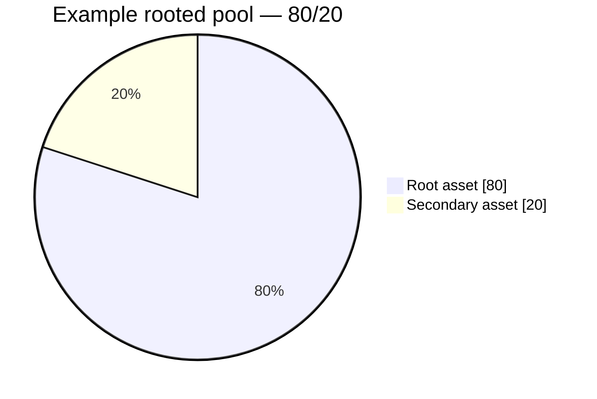

# Rooted Pools

## Rooted Pools

A **rooted pool** is a Weighted Pool where one asset has more than half of the Pool's total weight.

That majority-weight asset is the **root**.

For example:

```
80% Root asset
20% Secondary asset
```




A **Root Pool** is any market in ROOTSTOCK.

A **rooted pool** is one particular way of organizing a Weighted Pool.

They are not the same thing.


***

### Why root a Pool?

Rooting keeps more of the Pool's exposure in one chosen asset.

Compare:

```
50 / 50
```

with:

```
80 / 20
```

In the 80/20 Pool, the LP starts with much more exposure to the 80% asset.

This can be useful when one asset is intended to remain the main asset while still having liquidity against another.

```
root asset
    ↓
majority of Pool weight
    ↓
secondary assets provide liquidity around it
```

***

### Example: 80/20

Suppose a Pool contains:

```
80% NUT
20% WETH
```

NUT is the **root asset** because it holds the majority weight.

Compared with a 50/50 NUT/WETH Pool, the rooted version:

* keeps more exposure in NUT;
* requires less WETH for the same total Pool value;
* behaves differently as prices move;
* creates a clear primary/secondary relationship between the assets.

The Pool still uses normal Weighted Pool math.

***

### Rooted Pools can have more than two assets

A rooted Pool does not need to be an 80/20 pair.

For example:

```
70% Root
20% Asset B
10% Asset C
```

or:

```
60% Root
20% Asset B
10% Asset C
10% Asset D
```

As long as one asset has more than 50% of the normalized weight, the composition is rooted.

***

### Rooted vs unrooted

The distinction is simple:

```
Rooted
    → one asset has more than 50%

Unrooted
    → no asset has more than 50%
```

Examples:

| Composition       | Classification |
| ----------------- | -------------- |
| 80 / 20           | Rooted         |
| 70 / 20 / 10      | Rooted         |
| 60 / 20 / 10 / 10 | Rooted         |
| 50 / 50           | Unrooted       |
| 40 / 30 / 30      | Unrooted       |
| 25 / 25 / 25 / 25 | Unrooted       |


**Rooted does not describe a new invariant.**

It describes how the weights inside a Weighted Pool are organized.


***

### What rooting changes for LPs

Weights determine how much exposure an LP has to each asset.

A rooted Pool therefore starts with more exposure to the root asset than an equal-weight Pool containing the same assets.

As trading changes balances, the Pool still rebalances according to Weighted Pool math.

That means a rooted Pool and an unrooted Pool can hold the same assets but represent very different LP positions.

See **Weighted Pools** and **LP Risk & Impermanent Loss**.

***

### Rooted Pools can combine with other features

"Rooted" only describes the weight structure.

A rooted Pool may also be:

* multi-asset;
* connected to a Hook;
* used as an index-like basket;
* represented by an RPT;
* used through custom Router workflows.

These are separate properties.

```
rooted
    = weight structure

Hook
    = extension behavior

RPT
    = Pool ownership

Router
    = interaction path
```

One label should not imply the others.

***

### The model to remember

```
Weighted Pool
      ↓
Does one asset have >50% weight?

      ├─ Yes → Rooted
      └─ No  → Unrooted
```

A rooted Pool is simply a **Weighted Pool with a majority asset**.

That majority asset acts as the root around which the rest of the Pool is organized.

***

### Continue

| Page                           | What it explains                                       |
| ------------------------------ | ------------------------------------------------------ |
| **Weighted Pools**             | How weights affect pricing, exposure, and rebalancing. |
| **Root Pools**                 | The general ROOTSTOCK Pool model.                      |
| **Root Pool Tokens**           | How ownership of a Pool is represented.                |
| **LP Risk & Impermanent Loss** | How Pool weights affect LP exposure and risk.          |
