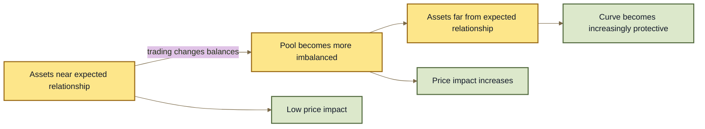

# Stable Pools

## Stable Pools

A **Stable Pool** is designed for assets that are expected to stay close in value.

Examples include:

* two stablecoins that track the same currency;
* different versions of the same underlying asset;
* wrapped or yield-bearing assets with a known exchange-rate relationship.

Stable Pools use a different pricing curve from general-purpose Weighted Pools. This lets them provide deeper liquidity and lower price impact when the assets remain close to their expected relationship.

\{% hint style="info" %\}\
**"Stable" describes the relationship between the assets, not necessarily the assets themselves.**

A Stable Pool can contain assets whose values change over time, as long as their relationship is expected to remain predictable.\
\{% endhint %\}

***

### Why Stable Pools exist

Imagine a Pool containing two assets that should both be worth about $1.

A general-purpose 50/50 Pool must remain useful across a very wide range of possible prices:

```
$0.50 ←──────── $1.00 ────────→ $2.00
```

But if the assets normally trade close to each other, most of that range is not very useful.

A Stable Pool concentrates more of its pricing power around the expected relationship:

```
Asset A ≈ Asset B
      ↓
deep liquidity
      ↓
smaller price impact
```

This means a larger trade can often happen near the expected price before the Pool price moves significantly.

***

### Stable math changes as the Pool moves out of balance

Stable Pools do not assume that two assets will remain equal forever.

Instead, the pricing curve behaves differently depending on how far the Pool moves from its expected balance.





Near the expected relationship, Stable Pools behave almost like a market with a very stable exchange rate.

As the assets move farther apart, the Pool increasingly raises the price of taking more of the scarce asset.

This helps prevent the Pool from treating a broken relationship as if nothing had changed.

***

### Amplification

Stable Pools have an important parameter called **amplification**.

Amplification controls how strongly the Pool concentrates liquidity around the expected relationship.

A simple way to think about it is:

```
higher amplification
        ↓
flatter pricing near the expected relationship
        ↓
more liquidity concentrated there
```

Lower amplification makes the Pool respond more strongly to changes in its balances.

#### Higher is not automatically better

A high amplification value can make trading very efficient when the assets really are closely related.

But it also relies more heavily on that relationship continuing to hold.

```
stronger correlation assumption
        ↓
higher useful amplification
        ↓
greater efficiency near the expected price
```

Amplification is therefore a **market-design choice**, not free liquidity.

***

### What happens when the relationship breaks?

A Stable Pool does not guarantee that its assets remain stable.

Suppose a Pool contains:

```
Token A ≈ $1
Token B ≈ $1
```

and Token B suddenly becomes worth only $0.80 elsewhere.

Traders can buy the stronger asset from the Pool while selling the weaker asset into it.

The Pool can therefore move toward:

```
less strong asset
more weak asset
```

This is one of the major risks for Stable Pool LPs.

\{% hint style="warning" %\}\
**A Stable Pool cannot protect an asset's peg.**

If an asset loses its backing, redemption mechanism, or economic relationship with the other Pool assets, the Pool's mathematics cannot restore it.\
\{% endhint %\}

LPs should therefore care about **why the assets are correlated**, not simply whether their historical price charts look similar.

See **LP Risk & Impermanent Loss**.

***

### Stable Pools can support changing exchange rates

Closely related assets do not always trade exactly 1:1.

For example, a yield-bearing token may gradually become redeemable for more of its underlying asset.

Conceptually:

```
1 wrapped token
    ↓
1.00 underlying

later

1 wrapped token
    ↓
1.08 underlying
```

The Pool may use a **Rate Provider** so the Vault can account for that changing relationship.

This allows Stable Pool math to operate on the economic value of the assets rather than assuming their raw token amounts should always remain equal.

See **Rate Providers** and **Token Types**.

Wrapped-token infrastructure such as **ERC-4626 Buffers** is a separate Vault capability and is covered on its own page.

***

### Stable vs Weighted

Both are Root Pools, but they are designed for different kinds of markets.

| Weighted Pools                                | Stable Pools                                 |
| --------------------------------------------- | -------------------------------------------- |
| General-purpose markets                       | Closely related assets                       |
| Designed to tolerate large price differences  | Optimized around an expected relationship    |
| Weights shape asset exposure and pricing      | Amplification shapes liquidity concentration |
| Useful for assets that can move independently | Most efficient while correlation holds       |

For example:

```
ETH / USDC
    ↓
typically Weighted

USDC / USDT
    ↓
typically Stable
```

The distinction is about the expected relationship between the assets.

***

### Stable does not mean risk-free

Stable Pools can offer very low price impact when their assets behave as expected.

That efficiency comes with assumptions.

Users and LPs should consider:

* what keeps the assets correlated;
* whether either asset depends on an external protocol;
* whether a Rate Provider is used;
* what happens if redemption fails;
* what happens if one asset loses its expected value.

A Pool containing two assets that have historically traded near each other is not automatically a safe Stable Pool.

***

### The model to remember

```
closely related assets
        +
Stable Pool
        ↓
liquidity concentrated near their expected relationship
        ↓
low price impact while that relationship holds
```

But:

```
relationship breaks
        ↓
Pool becomes imbalanced
        ↓
price impact rises
        ↓
LP exposure can shift toward the weaker asset
```

Stable Pools trade **capital efficiency for a stronger assumption about how their assets relate to one another**.

***

### Deployment status

Stable Pool architecture exists in the inherited v3 design.

Whether a particular Stable Pool implementation or factory is available in a ROOTSTOCK deployment must be verified from the current ROOTSTOCK contracts and deployment registry rather than inferred from this conceptual page.

***

### Continue

| Page                           | What it explains                                                     |
| ------------------------------ | -------------------------------------------------------------------- |
| **Root Pools**                 | How ROOTSTOCK Pools fit into the wider protocol.                     |
| **Weighted Pools**             | General-purpose Pools based on weighted asset relationships.         |
| **Rate Providers**             | How changing token exchange rates enter Vault accounting.            |
| **Token Types**                | How Pool assets are classified by the Vault.                         |
| **LP Risk & Impermanent Loss** | How Pool behavior changes LP exposure and risk.                      |
| **ERC-4626 Buffers**           | How the Vault can interact with standardized yield-bearing wrappers. |
