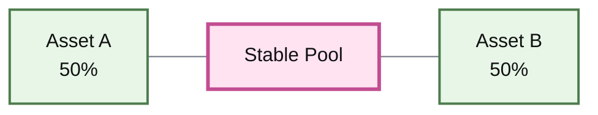
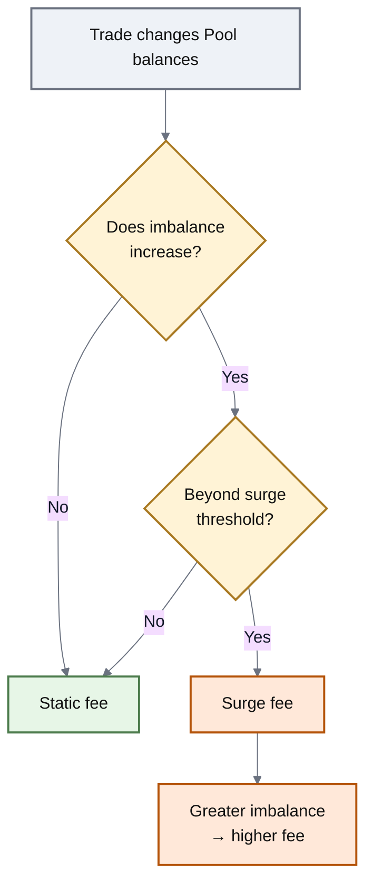
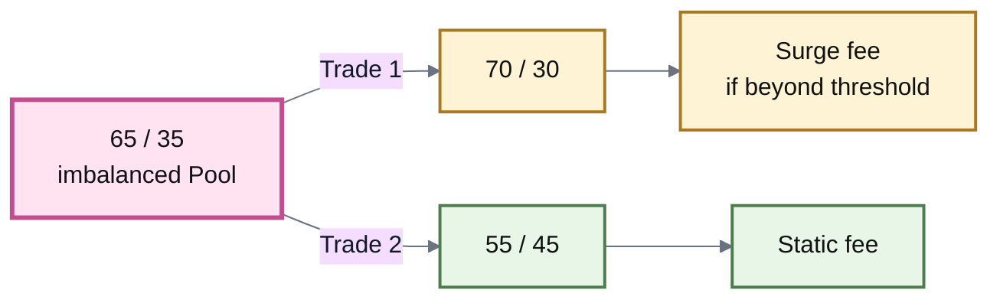
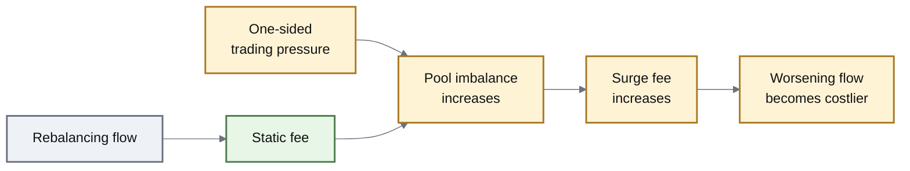
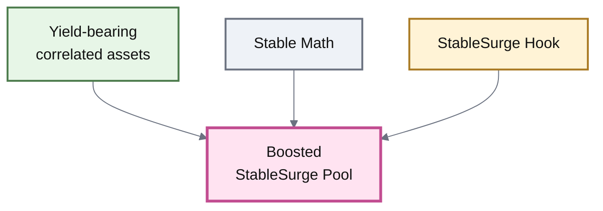

# Stablesurge Pools

## StableSurge Pools

A **StableSurge Pool** is a Stable Pool that raises its swap fee when a trade pushes the Pool too far **away from balance**.

Trades that keep the Pool within its normal range—or move an imbalanced Pool back toward balance—continue to pay the normal swap fee.

This gives a Stable Pool an adaptive response to one-sided trading pressure without changing its underlying Stable Math.


**StableSurge changes the fee, not the invariant.**

The Pool remains a Stable Pool. StableSurge is additional behavior provided by a Hook.


***

### Why Stable Pools need another line of defense

Stable Pools are most efficient when their assets maintain the economic relationship the Pool was designed around.

For a pair of closely related assets, liquidity might begin roughly balanced:





Now suppose traders continuously sell Asset B into the Pool and remove Asset A.

The Pool can move from:

**50 / 50 → 55 / 45 → 65 / 35 → 75 / 25**

That matters because the LP is increasingly holding the asset being sold while losing inventory of the asset traders prefer.

A normal static fee does not respond to that changing condition. StableSurge does.

***

### The central idea

StableSurge distinguishes between two kinds of flow:



A trade pushes the Pool farther away from balance.

If the resulting imbalance is beyond the configured **surge threshold**, the fee rises.

The farther the Pool moves beyond that threshold, the larger the fee can become.



A trade moves the Pool back toward balance.

The trader pays the normal **static swap fee**, even if the Pool was already beyond the surge threshold.

StableSurge therefore does not penalize the flow that helps restore the Pool.



This directionality is the defining behavior of StableSurge.

***

### How the surge works

There are three fee regions to understand.

| Pool condition          | Trade direction      | Fee behavior |
| ----------------------- | -------------------- | ------------ |
| Within the normal range | Either direction     | Static fee   |
| Beyond the threshold    | Toward balance       | Static fee   |
| Beyond the threshold    | Farther from balance | Surge fee    |

The mechanism can be read as a simple decision:





Two conditions therefore have to be true before the fee surges:

1. the trade would leave the Pool beyond the configured threshold; and
2. the trade would make the Pool **more imbalanced than before**.

Merely being imbalanced is not enough.

***

### Threshold and maximum fee

StableSurge adds two important controls around the Pool's normal swap fee.

| Parameter             | Purpose                                                                   |
| --------------------- | ------------------------------------------------------------------------- |
| **Static swap fee**   | Normal fee when StableSurge is not active                                 |
| **Surge threshold**   | Amount of imbalance tolerated before worsening flow can trigger the surge |
| **Maximum surge fee** | Upper limit on how high the dynamic fee can rise                          |

The threshold defines **when** the defensive pricing begins.

The maximum surge fee defines **how strongly** the Pool can respond.

Between those points, the surge fee increases progressively with imbalance rather than jumping immediately from the static fee to the maximum.

#### Fee shape

For a worsening trade beyond the threshold, the inherited v3 design increases the fee linearly toward the configured maximum:

$$
f_{\text{surge}}
=
f_{\text{static}}
+
(f_{\max}-f_{\text{static}})
\frac{I-T}{1-T}
$$

where (I) is the resulting Pool imbalance and (T) is the surge threshold.

For trades that do not satisfy the surge conditions:

$$
f = f_{\text{static}}
$$


The exact imbalance calculation, rounding behavior, parameter bounds, and Hook interfaces belong in **Dynamic Fees** and **Hooks API**. The important concept here is the shape of the response: **worsening imbalance above the threshold becomes progressively more expensive**.


***

### A simple example

Consider a two-asset StableSurge Pool.

The Pool has already moved to:

**65% Asset A / 35% Asset B**

Now compare two trades.





Both trades interact with the same Pool.

The difference is what they do to its state.

The first consumes more of the scarce side and worsens the imbalance. The second supplies the scarce side and moves the Pool back toward balance.

StableSurge prices those two actions differently.

***

### Why this changes market behavior

The fee creates a feedback mechanism.

As one-sided pressure grows, continuing in the harmful direction becomes increasingly expensive. At the same time, the opposite direction remains available at the normal fee.





The mechanism does not force the Pool back to balance. It changes the economics around moving farther away from it.

That distinction is important.

***

### What StableSurge is protecting against

Consider a stablecoin pair where one asset comes under sudden selling pressure.

Without a responsive fee, traders may continue selling the stressed asset into the Pool while withdrawing the stronger asset at the same static fee.

The LP position can therefore become increasingly concentrated in the stressed asset.

StableSurge responds to that condition by making additional imbalance-worsening trades more expensive.

This can:

* increase the cost of aggressively draining the scarce side;
* generate higher fees from trades that worsen severe imbalance;
* preserve the normal fee for traders moving the Pool back toward balance.

It does **not** remove the underlying economic risk.


#### StableSurge cannot defend a broken relationship

If an asset genuinely loses its backing, redemption value, or economic relationship with the other Pool assets, a dynamic fee cannot restore it.

StableSurge changes trading incentives. It does not guarantee a peg.


***

### More than two assets

The 50/50 examples are useful for intuition, but StableSurge is not conceptually limited to a two-token comparison.

For a multi-asset Stable Pool, the Hook evaluates the Pool's overall imbalance rather than asking whether a single pair is exactly 50/50.

The inherited v3 implementation measures how far the collection of balances deviates from a balanced state and applies the same principle:

**Did this operation make the overall imbalance worse, and is that imbalance beyond the threshold?**

The user-facing behavior remains the same even though the underlying calculation is more general.

***

### StableSurge and Stable Math

StableSurge sits on top of the existing Stable Pool model.

| Layer                | Responsibility                                                                 |
| -------------------- | ------------------------------------------------------------------------------ |
| **Stable Math**      | Prices swaps between closely related assets                                    |
| **Amplification**    | Controls how concentrated Stable liquidity is around the expected relationship |
| **Static swap fee**  | Defines normal trading cost                                                    |
| **StableSurge Hook** | Raises the fee when qualifying trades worsen imbalance                         |
| **Vault**            | Handles shared accounting and settlement                                       |

This is why StableSurge should not be thought of as another invariant family.

A useful decomposition is:

**Stable Pool + StableSurge Hook = StableSurge Pool**

***

### StableSurge and Boosted Pools

StableSurge can also be combined with yield-bearing assets.

A Pool might therefore be both:

**StableSurge** — because its fee reacts to harmful imbalance;

and

**Boosted** — because its assets are yield-bearing.





These labels describe different layers of the same market:

**Stable** describes the pricing model. **StableSurge** describes fee behavior. **Boosted** describes the assets held by the Pool.

***

### Stable Pool vs StableSurge Pool

|                                  | Stable Pool            | StableSurge Pool                  |
| -------------------------------- | ---------------------- | --------------------------------- |
| **Invariant**                    | Stable Math            | Stable Math                       |
| **Designed for**                 | Closely related assets | Closely related assets            |
| **Normal fee**                   | Static swap fee        | Static swap fee                   |
| **Response to severe imbalance** | Pricing curve only     | Pricing curve + dynamic surge fee |
| **Rebalancing trade**            | Static fee             | Static fee                        |
| **Imbalance-worsening trade**    | Static fee             | Can receive higher dynamic fee    |
| **Hook required**                | No                     | StableSurge Hook                  |

The difference is narrow but meaningful: **StableSurge gives the Pool a fee response to the direction and severity of imbalance.**

***

### Configuration and trust

The surge threshold and maximum surge fee are configurable parameters in the inherited design.

Those parameters materially affect the market:

* a lower threshold causes surge pricing to begin sooner;
* a higher threshold tolerates more imbalance before responding;
* a higher maximum fee allows a stronger response under severe conditions.

Who can change those parameters therefore belongs to the Pool's trust model.

ROOTSTOCK-specific authority, mutability, parameter bounds, and deployed values belong in **Pool Configuration & Roles**, **Dynamic Fees**, and the contract reference rather than being assumed on this page.

***

### The model to remember


#### StableSurge in one sentence

**Normal flow pays the normal fee; once imbalance becomes severe, trades that make it worse become progressively more expensive while trades that restore balance retain the normal fee.**


StableSurge therefore adds an adaptive economic response without replacing the Stable Pool underneath it.

***

### Continue

| Page                           | What it explains                                               |
| ------------------------------ | -------------------------------------------------------------- |
| **Stable Pools**               | The underlying invariant and correlated-asset model            |
| **Dynamic Fees**               | How dynamic swap fees are computed and constrained             |
| **Hooks**                      | How behavior can extend a Pool without replacing its invariant |
| **Boosted Pools**              | How yield-bearing assets can be combined with StableSurge      |
| **Pool Configuration & Roles** | Authority over configurable Pool parameters                    |
| **LP Risk & Impermanent Loss** | LP exposure when correlated assets diverge                     |
