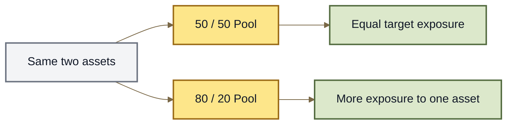

# Weighted Pools

## Weighted Pools

A **Weighted Pool** is a Root Pool where each asset is assigned a percentage of the pool.

For example:

* 50/50
* 80/20
* 70/20/10
* 25/25/25/25

These **weights** are part of the Pool's pricing rules. They determine how much exposure the Pool tends to keep in each asset and how prices change as people trade.

***

### 50/50 is only one option

The simplest two-token AMM uses a 50/50 balance.

That is the familiar constant-product market:

```
50% Token A
50% Token B
```

Weighted Pools generalize this idea.

A Pool could instead be:

```
80% Token A
20% Token B
```

or even:

```
50% Token A
25% Token B
25% Token C
```

The weights always describe the relative importance of each asset in the Pool's pricing model.

***

### What the weights do

Weights influence two things:

1. **how the Pool prices assets;**
2. **how much exposure LPs tend to keep in each asset.**

An 80/20 Pool behaves differently from a 50/50 Pool even when both contain the same two tokens.





The weights are not simply a statement that one side must always contain exactly four times as many dollars as another.

Trades constantly change Pool balances.

The AMM's pricing rules and outside arbitrage push the market toward a balance consistent with the Pool's weights and external prices.

***

### 80/20 Pools

An **80/20 Pool** keeps more exposure to the 80% asset while still providing liquidity against the 20% asset.

For example:

```
80% NUT
20% WETH
```

Compared with a 50/50 Pool, the LP remains more exposed to NUT and less exposed to WETH.

This can be useful when one asset is intended to remain the dominant asset in the Pool.

In ROOTSTOCK, a composition with one majority-weight asset can also be described as a **rooted composition**.

See **Rooted Pools**.

***

### Weighted Pools can contain more than two assets

Weighted Pools are not limited to pairs.

A single Pool can contain several assets:

```
50% A
25% B
25% C
```

or:

```
40% A
30% B
20% C
10% D
```

All of those assets participate in the same Pool and pricing system.

This lets one Root Pool act as both:

* a trading market; and
* a multi-asset liquidity basket.

***

### Weighted Pools continuously rebalance

Weighted Pools naturally change their inventory as people trade.

Imagine a Pool containing Token A and Token B.

If Token A becomes more valuable elsewhere, arbitrageurs may buy Token A from the Pool and sell Token B into it.

The Pool therefore ends up with:

```
less Token A
more Token B
```

That process moves the Pool price back toward the wider market.

From an LP's perspective, the Pool is continuously exchanging assets according to its pricing rules.

***

### What this means for LPs

Different weights create different LP positions.

A:

```
50 / 50
```

Pool and an:

```
80 / 20
```

Pool containing the same assets will have different:

* asset exposure;
* rebalancing behavior;
* price sensitivity;
* impermanent-loss characteristics.

The weight choice is therefore an economic decision, not just a display setting.

See **LP Risk & Impermanent Loss**.

***

### The math underneath

Weighted Pools use a **weighted-product invariant**.

Conceptually:

```
V = ∏ Bᵢ ^ wᵢ
```

where:

* `Bᵢ` is an asset balance;
* `wᵢ` is that asset's normalized weight;
* all weights add up to `1`.

For a normal user, the important idea is simpler:

> **Balances and weights together determine the Pool's prices.**

The exact calculations matter mainly when building, integrating, or analyzing Weighted Pools programmatically.

***

### The model to remember

```
assets
   +
weights
   ↓
Weighted Pool
   ↓
pricing + trading + continuous rebalancing
```

Different weights create different markets even when the assets are identical.

***

### Continue

<table><thead><tr><th width="255">Page</th><th>What it explains</th></tr></thead><tbody><tr><td><strong>Rooted Pools</strong></td><td>How ROOTSTOCK describes majority-weight compositions.</td></tr><tr><td><strong>LP Risk &#x26; Impermanent Loss</strong></td><td>How Pool composition affects LP exposure and risk.</td></tr><tr><td><strong>AMM Basics</strong></td><td>The basic mechanics behind automated markets.</td></tr><tr><td><strong>Build a Weighted Pool</strong></td><td>How developers create and configure a Weighted Pool.</td></tr></tbody></table>
