```mermaid
%%{init: {"theme":"base","themeVariables":{
  "primaryColor":"#E7E0C3",
  "primaryTextColor":"#243018",
  "primaryBorderColor":"#6F7B48",
  "lineColor":"#7A6847",
  "secondaryColor":"#DCE8CB",
  "tertiaryColor":"#F3EBD8",
  "fontFamily":"Inter, ui-sans-serif, system-ui, sans-serif"
}}}%%
flowchart LR
    SPOT["Pre-trade pool state<br/>marginal price"]
    QUOTE["Trade-sized quote<br/>price impact included"]
    LIMIT["Execution limit<br/>slippage tolerance"]
    EXEC["Onchain execution<br/>current state"]

    SPOT -->|"trade size moves along invariant"| QUOTE
    QUOTE -->|"caller chooses acceptable range"| LIMIT
    LIMIT -->|"state may change"| EXEC

    classDef state fill:#F5F0E3,stroke:#8B7754,stroke-width:2px,color:#2E281D;
    classDef market fill:#E8D9B9,stroke:#7A5C34,stroke-width:3px,color:#2B2516;
    classDef protection fill:#DCE8CB,stroke:#536B3F,stroke-width:2px,color:#1D2816;

    class SPOT,EXEC state;
    class QUOTE market;
    class LIMIT protection;
```

# Price Impact & Slippage

**Price impact** and **slippage** can both make a trade look worse than a simple spot price suggests, but they happen for different reasons.

* **Price impact** comes from the trade changing the pool.
* **Slippage** is the difference between an expected result and the result available when the transaction actually executes.
* **Slippage tolerance** defines how much adverse change the caller is willing to accept.


**Price impact happens because of your trade. Slippage happens because execution state can differ from quoted state.**


***

### The timeline

A useful way to separate the concepts is to follow a trade from observation to execution.





This distinction matters because a quote for a particular trade size should already reflect that trade's effect on the pool.

Slippage tolerance protects what can happen **after that quote is formed**.

***

### Price impact

A Root Pool does not offer one fixed price for unlimited size.

Its price depends on its balances and invariant. When a swap changes those balances, it moves the pool to a new point on its pricing curve.

Consider:

```
before
A: 100
B: 100
```

A trader adds A and removes B:

```
swap
A: +20
B: - calculated amount
```

The trade changes the pool's inventory while it executes. Later units of the trade therefore encounter a different pool state than earlier units.

That difference is **price impact**.

***

### Trade size matters

A small trade relative to relevant liquidity may execute close to the pool's pre-trade marginal price.

A larger trade moves farther along the invariant.

```
trade size relative to usable liquidity ↑
                    ↓
       movement along pricing curve ↑
                    ↓
           price impact tends to ↑
```

For example, suppose the pre-trade pool state implies roughly:

```
1 A ≈ 1 B
```

That does **not** mean:

```
100 A = 100 B
```

A quote for the full `100 A` trade must account for how the pool changes while processing that amount.


The marginal price describes the pool around its current state. A trade quote describes execution across a finite movement of that state.


***

### What determines price impact?

Price impact depends primarily on the market structure the trade moves through.

Relevant factors can include:

* trade size;
* available liquidity;
* current pool balances;
* the pool invariant;
* token weights or amplification parameters;
* token rates where applicable;
* the route and pools used.

Fees also affect the final execution rate paid by the trader, although they are conceptually distinct from the invariant-driven movement of the pool.

Different Root Pool types can therefore show very different execution behavior for the same nominal trade size.

***

### The quote already contains price impact

Suppose a pool's current marginal price looks approximately like:

```
1 A ≈ 1 B
```

A size-aware query might nevertheless return:

```
100 A → 97 B
```

The difference between the simple marginal-price expectation and the trade-sized result is not necessarily slippage.

The quote was calculated for `100 A`, so the effects of moving through the pool's pricing curve are already represented in that `97 B` result.

```
pre-trade marginal state
        ↓
apply 100 A trade
        ↓
pool moves along invariant
        ↓
quote = 97 B
```

**Slippage tolerance starts from the quote, not from the pre-trade spot price.**

***

### Slippage

Between quoting and execution, the relevant state can change.

For example:

* another user swaps through the pool;
* liquidity is added or removed;
* an asset rate changes;
* a dynamic fee changes;
* Hook behavior changes the result;
* another transaction executes earlier in the block.

A quote therefore describes an observed state, not a guaranteed future result.

If the trade ultimately executes at a different result, that quote-to-execution difference is commonly called **slippage**.

***

### Slippage tolerance

A caller cannot require the blockchain to preserve the state used for an earlier quote.

Instead, the transaction defines an **execution limit**.

That limit answers:

> How much worse may the result become before I would rather revert than trade?

The allowed range is the caller's **slippage tolerance**.


Slippage tolerance does not improve the price and does not reduce price impact. It defines the boundary between an acceptable changed result and a reverted transaction.


***

### Exact In protection

With Exact In, the amount being spent is already fixed.

Suppose the quote is:

```
100 A → 97 B
```

The caller might set:

```
minimum amount out: 96 B
```

Then:

```
97 B → execute
96 B → execute
95 B → revert
```

The important relationship is:

```
actual output ≥ minimum output
```

The minimum protects the calculated side of the trade.

***

### Exact Out protection

With Exact Out, the amount being received is already fixed.

Suppose the quote is:

```
receive 100 B
estimated input: 103 A
```

The caller might set:

```
maximum amount in: 105 A
```

Then:

```
103 A required → execute
105 A required → execute
106 A required → revert
```

The relevant relationship is:

```
actual input ≤ maximum input
```

See Exact In & Exact Out.

***

### Price impact and slippage side by side

|                                       | Price impact                 | Slippage                                  |
| ------------------------------------- | ---------------------------- | ----------------------------------------- |
| **Cause**                             | The trade changes pool state | State changes between quote and execution |
| **Present in a size-aware quote?**    | Yes                          | Not yet                                   |
| **Depends on trade size?**            | Strongly                     | Not necessarily                           |
| **Controlled by slippage tolerance?** | No                           | Bounded by it                             |
| **Exact In protection**               | Reflected in quoted output   | `minAmountOut`                            |
| **Exact Out protection**              | Reflected in quoted input    | `maxAmountIn`                             |

This separation is useful when diagnosing a poor execution result.

A trade can have:

```
high price impact + almost no slippage
```

or:

```
low price impact + substantial adverse slippage
```

They are different effects.

***

### Price impact is a property of execution

Price impact is not inherently an error.

AMMs change price as inventory changes. That behavior is part of how their markets function.

The useful question is how much market movement a particular trade creates relative to available alternatives.

For example:

```
same trade
   ↓
shallow route → larger pool movement
deep route    → smaller pool movement
```

A routing system may therefore compare several pools or split a trade across paths to reduce the cost of moving through any one market.

See Batch & Multihop Swaps.

***

### Be careful interpreting unusually small impact

A low displayed price-impact number does not by itself prove that a trade is correctly priced.

The calculation can depend on inputs such as:

* token rates;
* wrapper conversion rates;
* pool configuration;
* route composition;
* current pool state.

If one of those assumptions is stale or incorrect, an apparently attractive quote can still be misleading.

Price impact should therefore be interpreted as a property of the **quoted model and observed state**, not as an independent price oracle.

***

### Transaction ordering

A transaction can spend time pending before execution, and other transactions may change the relevant state first.

This is ordinary transaction-ordering risk.

It can also be intentional. For example, adversarial ordering can attempt to move a pool before a user's trade and trade again afterward.

The execution limit determines how much adverse movement can occur while the swap still remains valid.

```
tighter limit
    ↓
smaller acceptable execution range
    ↓
more protection from adverse movement
    +
greater chance of reverting after normal state changes
```

```
wider limit
    ↓
larger acceptable execution range
    ↓
less chance of reverting
    +
more room for an unfavorable execution
```

There is therefore a tradeoff between execution tolerance and price protection.


A wide slippage tolerance is not free flexibility. It authorizes the transaction to succeed across a wider range of unfavorable states.


***

### Quote first, limit second

A robust transaction flow separates simulation from protection:

```
1. Observe current state
2. Query the intended trade
3. Receive an expected result
4. Choose an acceptable execution bound
5. Submit the transaction
6. Revert if execution crosses that bound
```

Do not calculate the protection from state that has already been manipulated inside the same execution path.

A query is useful because it estimates the operation against observed onchain state. The independent limit is what protects the submitted transaction.

See Queries & Simulation.

***

### Continue

<table data-full-width="true"><thead><tr><th width="235.5">Page</th><th>What it explains</th></tr></thead><tbody><tr><td><strong>Swaps</strong></td><td>Why changing pool inventory changes the price implied by the market.</td></tr><tr><td><strong>Exact In &#x26; Exact Out</strong></td><td>How minimum-output and maximum-input limits protect each swap mode.</td></tr><tr><td><strong>Batch &#x26; Multihop Swaps</strong></td><td>How routing across several pools changes execution characteristics.</td></tr><tr><td><strong>Queries &#x26; Simulation</strong></td><td>How applications estimate results before constructing execution limits.</td></tr><tr><td><strong>Swap Guide</strong></td><td>How to construct and submit a protected swap transaction.</td></tr><tr><td><strong>Security Model</strong></td><td>The broader trust and transaction-execution assumptions surrounding protocol interactions.</td></tr></tbody></table>
