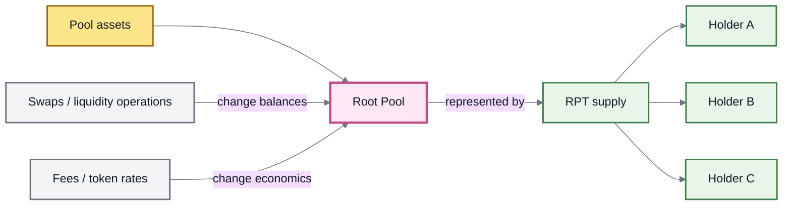
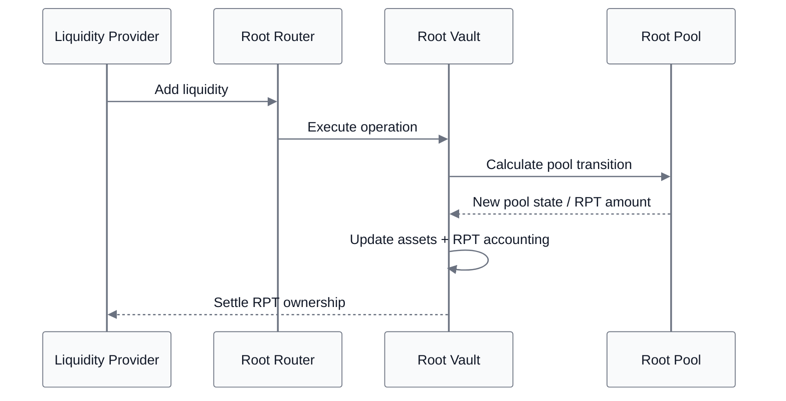
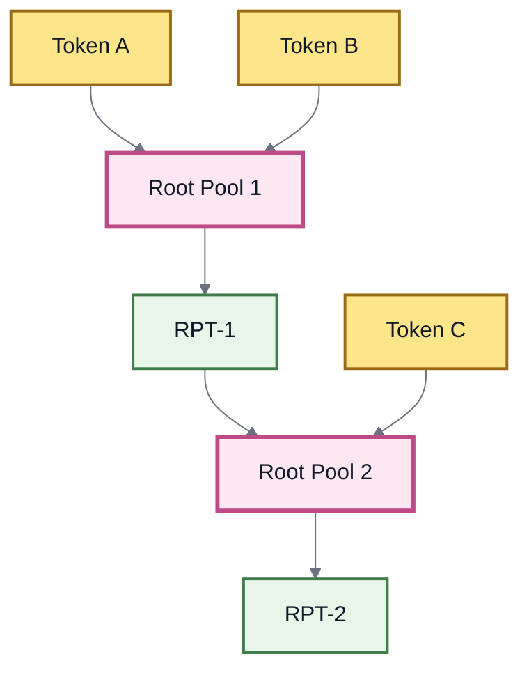
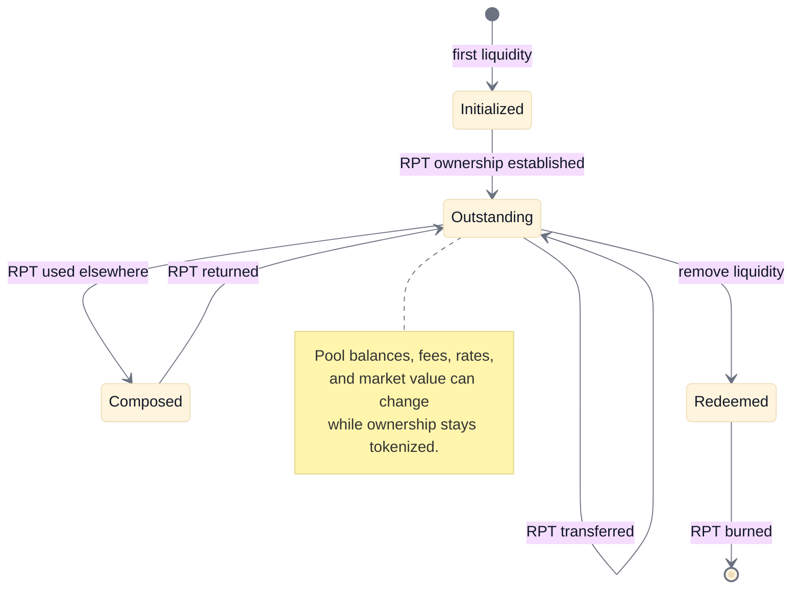

# 🔄 Root Pool Tokens

## Root Pool Tokens

A **Root Pool Token (RPT)** represents proportional ownership of a **Root Pool**.

The assets stay inside the pool and can change as swaps, liquidity operations, token rates, fees, and market activity change the pool's state. RPT provides a fungible unit for expressing who owns what fraction of that changing pool.


**The RPT mental model:** the assets live in the Root Pool. RPT is the portable representation of ownership.

RPT is a claim on **current pool state**, not a receipt for the exact token quantities originally deposited.


### One pool, many owners

Liquidity providers combine assets inside a shared Root Pool. RPT divides ownership of that pool among holders.





For an ordinary share-based Root Pool, the basic relationship is:

```
ownership fraction = RPT held / total RPT supply
```

The pool's minimum locked supply and normal operation-specific rounding remain part of the accounting, but the mental model is proportional ownership.

### The pool can change underneath the RPT

Suppose an LP owns 10% of a pool:

| Pool state  | Token A | Token B | 10% ownership represents |
| ----------- | ------: | ------: | ------------------------ |
| **Initial** |     100 |     100 | 10 A + 10 B              |
| **Later**   |     125 |      82 | 12.5 A + 8.2 B           |

The LP did not separately buy Token A or sell Token B.

**The pool inventory changed underneath the ownership token.**

The ownership fraction can remain the same while the assets represented by that fraction change.

Exact withdrawal amounts can still depend on the removal method, fees, rounding, Hooks, and pool-specific behavior.

### Ownership, supply, and value are different quantities



RPT answers:

> **What fraction of this Root Pool belongs to this holder?**

For a standard share-based pool, that fraction is derived from the holder's RPT balance relative to total RPT supply.



RPT supply tracks the number of ownership units outstanding.

Share-issuing liquidity operations mint RPT. Liquidity removal burns RPT. Transfers move existing RPT between holders without changing total supply.

Supply alone does not tell you what one RPT is worth.



Economic value depends on what the pool currently represents.

That can depend on:

* current pool balances;
* external asset prices;
* accumulated fees;
* supported token rates;
* pool configuration;
* Hooks or custom behavior.

A market price for RPT, if one exists externally, is another quantity again.



RPT gives the system a stable ownership unit while these other variables change.

### Issuing RPT is not automatically dilution

When correctly priced liquidity enters a pool, both pool assets and RPT supply can increase.

Consider a simplified proportional example:

| State                                            | Pool value units | RPT supply | Value represented per RPT |
| ------------------------------------------------ | ---------------: | ---------: | ------------------------: |
| Before                                           |            1,000 |        100 |                        10 |
| New LP contributes 100 units and receives 10 RPT |            1,100 |        110 |                        10 |
| Pool later grows while supply stays unchanged    |            1,210 |        110 |                        11 |

The new LP receives new ownership because new value entered the pool.

Existing holders own a smaller percentage of a larger pool, but correctly priced issuance does not itself transfer value away from them.


**More RPT does not automatically mean dilution.**

Dilution depends on whether newly issued ownership correctly corresponds to the assets or value entering the pool.


The inverse occurs during removal: RPT is surrendered and burned as ownership leaves the pool.

Not every liquidity operation must issue RPT. The inherited v3 architecture also supports specialized modes such as **donation** and **custom liquidity operations**. See Adding & Removing Liquidity.

### Initialization creates the ownership system

A newly registered Root Pool does not yet have an established LP ownership state.

**Initialization** is the first liquidity operation. It establishes:

1. the first funded pool state; and
2. the initial RPT supply.

After initialization, later additions and removals operate relative to an existing pool state and existing ownership supply.

The inherited Balancer v3 design makes initialization a distinct one-time operation in Vault metadata, preventing a pool from being initialized again later.

It also reserves a very small **minimum pool-token supply** during initialization. That minimum prevents one LP from owning the entire supply and prevents the pool from ever being completely drained through ordinary liquidity removal.


Balancer v3 sets this guardrail to `1e6` pool-token base units and uses 18-decimal pool tokens. The exact ROOTSTOCK deployment constant should be treated as implementation truth and documented in Developer Reference once verified against ROOTSTOCK contracts.


Conceptually:

```
Initialization
    ↓
first pool state + initial ownership supply

Later liquidity operations
    ↓
modify an existing ownership system
```

### RPT accounting lives with the Root Vault

ROOTSTOCK follows the inherited v3 pattern in which the pool-share token behaves externally like an ERC-20 asset while the Vault coordinates its accounting.

That accounting includes:

* balances;
* allowances;
* total supply;
* transfers;
* approvals;
* minting;
* burning.

Centralizing pool-asset accounting and pool-share accounting allows both sides of a liquidity operation to update as one coordinated state transition.





The reverse occurs during liquidity removal: pool balances change and corresponding RPT ownership is burned within the same settled operation.

#### Inherited token interface

The Balancer v3 pool-token implementation exposes more than the minimum ERC-20 surface. The inherited design includes:

| Surface                     | Purpose                                         |
| --------------------------- | ----------------------------------------------- |
| `IERC20` / `IERC20Metadata` | Standard fungible-token behavior and metadata   |
| `IERC20Permit`              | Signature-based approvals                       |
| `EIP712` + `Nonces`         | Typed-signature and replay-protection machinery |
| `IRateProvider`             | Exposes a pool-rate interface where appropriate |
| `ERC165`                    | Interface detection                             |
| `VaultGuard`                | Restricts Vault-only pool-token operations      |

The token contract itself delegates core state such as `totalSupply`, `balanceOf`, transfers, allowances, approvals, minting, and burning to the Vault's multi-token accounting layer. ERC-20 `Transfer` and `Approval` events are still emitted through the pool-token interface.

In the inherited v3 implementation, the shared multi-token ledger keeps its state-changing functions internal and exposes the public mutation surface through Vault extension code, guarded so those operations execute through the Vault context.


**Naming:** ROOTSTOCK documentation uses **RPT** as the public term. Inherited code may still contain upstream identifiers such as `BPT`, `BalancerPoolToken`, or related interface names until those identifiers are explicitly renamed.


See Vault and Accounting & Settlement.

### RPT makes ownership portable

Because RPT is ERC-20-compatible, pool ownership can move independently of the assets held by the pool.

Where supported, RPT can be:

* held in a wallet;
* transferred to another account;
* used as an asset in another Root Pool;
* deposited into a compatible vault or strategy;
* integrated into lending or collateral systems;
* valued by external analytics or oracle infrastructure.

When RPT moves, the underlying pool assets do **not** move with it.

What moves is the ownership claim.

### Nested liquidity

One Root Pool can potentially hold the RPT of another.





This does not duplicate liquidity.

`RPT-1` represents ownership of Root Pool 1. Root Pool 2 can then own that representation.

The trade-off is dependency: anything holding `RPT-1` inherits exposure to the pool underneath it.


**Historical v2 distinction:** some Balancer v2 composable pools used **preminted BPT** and a **virtual supply** model so pool shares could participate directly in swaps. That is a v2-specific mechanism and should not be assumed to describe ordinary v3-derived RPT accounting unless a ROOTSTOCK pool explicitly implements it.


### RPT supply and RPT price are not the same thing

Several questions are often collapsed into the word **value**:

| Question                                      | What determines it                          |
| --------------------------------------------- | ------------------------------------------- |
| **What fraction of the pool do I own?**       | RPT balance relative to total RPT supply    |
| **What assets does that fraction represent?** | Current Root Pool state                     |
| **What are those assets worth externally?**   | External asset prices and valuation method  |
| **Does the pool expose an accounting rate?**  | Pool invariant, supply, and implementation  |
| **What will a market pay for RPT?**           | External market liquidity and supply/demand |

These quantities can be related without being interchangeable.

#### `getRate()` is not automatically a safe price

In the inherited v3 model, a pool can expose a natural pool-token rate based on:

```
pool-token rate = invariant / total supply
```

That accounting rate is **not automatically a manipulation-resistant market price**.

Balancer v3 explicitly treats some pool-token rates as unsafe. In particular, its Weighted Pool implementation does not expose `getRate()` as a usable valuation surface because invariant approximation and rounding properties can make that rate unsuitable.

### Oracle safety is a separate problem

The fact that RPT represents valuable assets does not make every RPT-related rate safe for lending, collateral, liquidation, or other onchain financial decisions.

Balancer v3 therefore separates **ownership accounting** from **LP-token oracle pricing**.

Its v3 oracle architecture includes dedicated oracle implementations for supported pool families, including:

* `WeightedLPOracle`;
* `StableLPOracle`;
* `EclpLPOracle`.

Where the required external token price feeds exist, these oracles can calculate pool value and expose a Chainlink-compatible `latestRoundData()` interface. The pricing logic is separated from the market-price source, so the same architecture can be adapted to other compatible feed systems.

A primary use case is making pool-share tokens usable as collateral in lending systems without trusting manipulable spot pool balances.


#### Transient RPT is an integration boundary

During an unlocked Vault transaction, transient accounting can temporarily create extremely large pool-token balances before final settlement.

An external protocol that treats such an intermediate balance as ordinary collateral can be manipulated.

Balancer v3 addresses this with safeguards such as:

* lending-protocol deposit limits;
* an oracle deployment flag that makes TVL-related calls revert while the Vault is unlocked;
* a wrapped pool-token form that can only be minted while the Vault is locked.

The wrapped form is an additional defense rather than a universal requirement where protocol deposit limits or the oracle's Vault-unlocked guard already enforce the needed boundary. It also does not prevent pool tokens from being flash-borrowed from an external source.

ROOTSTOCK integrations should preserve equivalent safety assumptions wherever the inherited transient-accounting model remains in use.


Oracle mathematics, feed requirements, collateral integration, and manipulation resistance belong in RPT Valuation & Oracles.

### Redeeming RPT

Removing liquidity converts pool ownership back into assets.

A holder surrenders RPT and receives assets from the pool's **current state**.

A proportional removal expresses the ownership model most directly: the holder receives their share across the current pool balances.

Where supported, a holder can instead remove liquidity into a different composition, such as a single pool token. Because non-proportional removal changes relative inventory, it can have swap-like economics such as price impact and swap-fee treatment.

> **RPT determines how much of the pool you own. The removal method determines how that ownership is converted into assets.**

See Adding & Removing Liquidity.

### RPT is not the source of returns

An RPT can increase or decrease in economic value, but the ownership token itself does not manufacture returns.

The economics underneath an RPT position can change because of:

* swap fees retained by LP liquidity;
* rate-bearing or yield-bearing assets;
* changes in underlying asset prices;
* external incentives;
* inventory changes and divergence loss;
* Hooks or other pool-specific behavior.

RPT performs the narrower accounting job:

> **it records which fraction of the resulting pool state belongs to the holder.**

See Fees & LP Returns and LP Risk & Impermanent Loss.

### What RPT is not

A Root Pool Token is **not**:

* an IOU for the exact quantities originally deposited;
* a fixed basket whose token quantities never change;
* a fixed-value token;
* a stablecoin;
* a guaranteed-yield instrument;
* duplicated liquidity;
* a second copy of the pool's assets;
* automatically a safe oracle;
* a guarantee that external market price equals underlying value.

It is a **fungible representation of proportional ownership in a changing Root Pool**.

### The RPT lifecycle





The complete model is:

```
Root Pool
    ↓
changing assets and economics
    ↓
RPT
    ↓
portable proportional ownership
    ↓
redeem against current pool state
```

The pool can change without rebuilding its ownership system.

**RPT is the layer that makes that possible.**

### Continue

<table><thead><tr><th width="262">Page</th><th>What it explains</th></tr></thead><tbody><tr><td>Liquidity Providers</td><td>What owning a Root Pool share means economically for an LP</td></tr><tr><td>Adding &#x26; Removing Liquidity</td><td>How RPT is issued and redeemed through liquidity operations</td></tr><tr><td>Fees &#x26; LP Returns</td><td>What changes the economics represented by an RPT</td></tr><tr><td>LP Risk &#x26; Impermanent Loss</td><td>How changing inventory and prices affect RPT holders</td></tr><tr><td>Vault</td><td>The accounting layer coordinating pool assets and RPT</td></tr><tr><td>Accounting &#x26; Settlement</td><td>How asset and ownership changes settle atomically</td></tr><tr><td>RPT Valuation &#x26; Oracles</td><td>Valuation, oracle safety, and manipulation resistance</td></tr></tbody></table>

