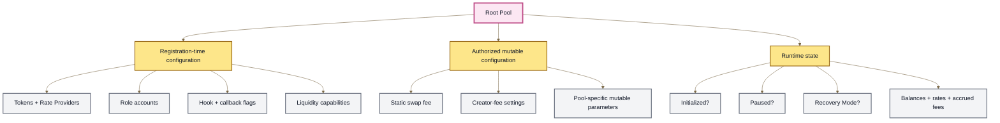
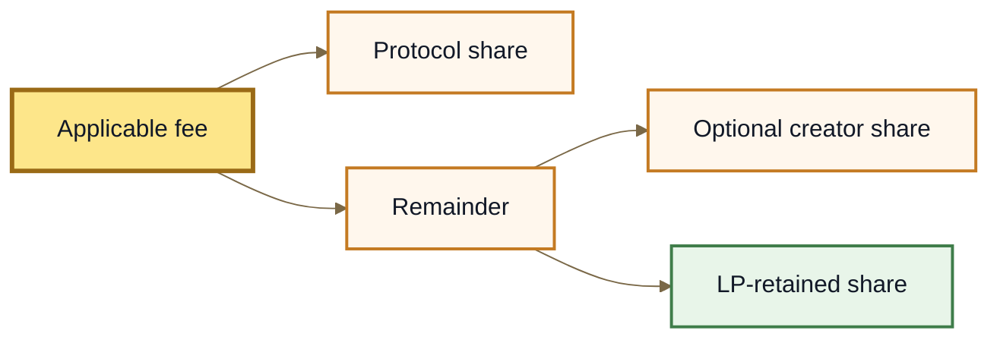

# Pool Configuration & Roles

## Pool Configuration & Roles

A **Root Pool** is defined by more than its invariant.

The Pool's mathematics determine how the market prices assets. Its configuration determines which assets participate, how they are interpreted, which operations are allowed, which extensions can run, and who can change specific settings.

Two Pools can therefore use the same Weighted math while having very different capabilities and trust assumptions.

> **The configuration mental model:** Pool math defines the market curve. Pool configuration defines the operating envelope around that curve.

To understand a Root Pool, inspect both.

***

### Configuration has three layers

Not every Pool property behaves the same way.

A useful distinction is between:

1. **registration-time configuration** — choices established when the Pool joins the Vault;
2. **authorized mutable configuration** — values that can later change through specific permissioned paths;
3. **runtime state** — facts describing what the Pool is doing now.



This separation matters.

A fixed role address is not the same kind of property as a mutable swap fee. A mutable swap fee is not the same kind of property as a changing token balance.

Calling all of them "Pool settings" hides important differences.

***

### What registration establishes

Registration connects a deployed Pool to the Vault and establishes much of its operating envelope.

Among other inputs, the inherited v3 model registers:

| Configuration               | What it establishes                                                |
| --------------------------- | ------------------------------------------------------------------ |
| **Tokens**                  | Which assets belong to the Pool and how the Vault interprets them. |
| **Initial static swap fee** | The Pool's starting static trading fee.                            |
| **Pause configuration**     | The time boundary around emergency pausing.                        |
| **Role accounts**           | Which addresses receive specific Pool-level authorities.           |
| **Hook**                    | Which extension contract, if any, is attached to the Pool.         |
| **Liquidity management**    | Which classes of liquidity operation are supported.                |

Some of these establish long-lived Pool identity. Others establish values that authorized actors may later modify.

See **Pool Lifecycle** for where registration sits between deployment and initialization.

***

### Pool role accounts

A **role** is permission to perform a specific class of action.

The inherited v3 architecture defines three Pool-specific role accounts:

| Role             | Authority                                                    |
| ---------------- | ------------------------------------------------------------ |
| `pauseManager`   | Pause or unpause the Pool under the emergency-control rules. |
| `swapFeeManager` | Change the Pool's static swap fee within its allowed bounds. |
| `poolCreator`    | Configure and receive the optional Pool-creator fee share.   |

These addresses are established at registration and are not ordinary transferable ownership positions.


**A Root Pool does not have one generic owner.**

Different actions have different authorities, and some actions may remain under protocol-level control rather than a Pool-specific role.


#### The role address can be fixed while its setting changes

This distinction is important.

For example:

```
swapFeeManager
    ↓
fixed role assignment

static swap fee
    ↓
mutable value within permitted bounds
```

The authority and the parameter it controls are different things.

The same principle applies to the Pool creator: the registered creator identity can be fixed even though its configured fee percentages can later change.

***

### Zero-address delegation

In the inherited v3 role model, a zero address means that the corresponding Pool-specific authority falls back to the protocol's default governance authority.

Conceptually:

```
specific role address
    → designated Pool-level authority

zero address
    → protocol-level authority
```

There is an important asymmetry.

The upstream architecture retains protocol-level pause authority even when a separate `pauseManager` exists. The same fallback does not mean that protocol governance automatically shares every Pool-specific role once a non-zero manager or creator has been assigned.

For ROOTSTOCK, the important concept is the **permission structure**, not Balancer's organizational identity or governance addresses.

Exact ROOTSTOCK authorities must come from the deployed ROOTSTOCK permission system.

See **Permissions**.

***

### Pause manager

The `pauseManager` is an emergency-control role.

Its purpose is narrow: stop or restore ordinary Pool operation under the protocol's pause rules.

```
pauseManager
      ↓
pause / unpause Pool
      ↓
normal state-changing operations affected
```

Pause authority is constrained by the Pool's emergency-control rules and pause window. It is not indefinite ownership over the market or its assets.

When a Pool is paused, the inherited architecture also allows Recovery Mode to be enabled permissionlessly if it has not already been enabled. This separates the ability to stop normal execution from the availability of the emergency LP exit path.

The exact pause window, Recovery Mode behavior, and emergency permissions belong in **Emergency Controls**.

***

### Swap-fee manager

The `swapFeeManager` controls the Pool's **static swap fee**.

That authority is constrained. The fee must remain within the minimum and maximum bounds defined by the Pool implementation.

```
authorized manager
        +
Pool fee bounds
        ↓
valid static swap fee
```

A role therefore does not imply unlimited discretion.

#### Static and dynamic fees are different

A Pool can also use a Hook to compute a dynamic fee for an individual swap.

That creates two separate concepts:

* **static swap fee** — stored Pool configuration;
* **dynamic swap fee** — optionally calculated during execution by a configured Hook.

The `swapFeeManager` controls the former. A Hook can affect the latter only when the Pool's registered Hook configuration enables that capability.

See **Dynamic Fees**.

***

### Pool creator

The `poolCreator` role is specifically associated with the optional **Pool-creator fee**.

It is not a general-purpose administrator.

In the inherited model, a Pool can register a creator while its creator-fee percentages remain zero. The existence of the role therefore does not mean that a creator fee is currently being charged.

Conceptually:

```
registered poolCreator
        ≠
non-zero creator fee
```

When enabled, creator fees can apply to eligible swap-fee and yield-fee economics.

The protocol fee is accounted for first, and the creator share applies to the remaining fee allocation. Increasing the creator share therefore reduces the remainder retained for LP liquidity.



The exact fee-controller functions, fee percentages, and collection mechanics belong in **Protocol Fee Controller** and **Fees & LP Returns**.

***

### Protocol fees are a separate authority layer

Three questions should not be collapsed into one:

1. **What fee does the Pool charge?**
2. **Who may change that Pool fee?**
3. **How is the resulting fee divided?**

For swaps:

```
static or dynamic swap fee
        ↓
gross fee charged
        ↓
protocol / creator allocation
        ↓
LP-retained remainder
```

The `swapFeeManager` does not control the protocol's fee share.

Likewise, the `poolCreator` role does not control the Pool's gross static swap fee merely because creator revenue can depend on it.

These are intentionally separate control surfaces.

***

### Token configuration

Every registered Pool token has configuration beyond its token address.

The inherited model distinguishes:

* `STANDARD`
* `WITH_RATE`

#### Standard tokens

A `STANDARD` token does not use an external Rate Provider for Vault accounting.

Conceptually:

```
token type     = STANDARD
Rate Provider  = none
yield fee flag = false
```

The Vault still handles decimal scaling before values are used by Pool mathematics.

#### Tokens with rates

A `WITH_RATE` token uses a **Rate Provider** so the Vault can incorporate an external exchange-rate relationship into its live-balance accounting.

```
token
  +
Rate Provider
  ↓
rate-adjusted live balance
```

Using a Rate Provider and paying a rate-based protocol yield fee are separate properties.

A Rate Provider also creates an external dependency. Incorrect or unavailable rate information can affect Pool operation, so token configuration is part of the Pool's trust surface—not merely display metadata.

See **Token Types**, **Token Scaling**, and **Rate Providers**.

***

### Liquidity-management configuration

Registration also tells the Vault which liquidity capabilities the Pool exposes.

The inherited `LiquidityManagement` model contains four flags:

| Capability                    | Meaning                                                                                        |
| ----------------------------- | ---------------------------------------------------------------------------------------------- |
| `disableUnbalancedLiquidity`  | Restricts the generic liquidity surface to proportional liquidity.                             |
| `enableAddLiquidityCustom`    | Declares support for Pool-defined custom add-liquidity behavior.                               |
| `enableRemoveLiquidityCustom` | Declares support for Pool-defined custom remove-liquidity behavior.                            |
| `enableDonation`              | Allows assets to enter through the donation liquidity path without corresponding RPT issuance. |

These flags matter because mathematical possibility and protocol-supported operation are not the same thing.

> **The Pool configuration is the capability boundary.**

An integration should not assume that a liquidity operation is available simply because the invariant could mathematically support it.

#### Custom means Pool-specific

`CUSTOM` does not describe one universal liquidity operation.

It means the Pool implementation supplies custom behavior for that path. Applications therefore need Pool-specific knowledge before exposing it to users.

#### Donation is not ordinary liquidity provision

Donation transfers assets into the Pool without issuing corresponding RPT ownership.

That can affect the value represented by existing RPT and should therefore be surfaced explicitly rather than treated as an ordinary deposit.

See **Adding & Removing Liquidity**.

***

### Hook configuration

A **Hook** is an extension contract linked to a Pool during registration.

The registered Hook configuration tells the Vault both:

* which Hook contract is attached;
* which callbacks it should execute.

The inherited callback surface includes hooks around:

* initialization;
* swaps;
* adding liquidity;
* removing liquidity;
* dynamic swap-fee calculation.

It also records whether **Hook-adjusted amounts** are enabled.

#### Hook configuration becomes part of Pool identity

The Hook address and enabled callback flags are stored at registration and do not change through normal Pool configuration.

That makes the Hook surface part of the Pool's long-term trust model.

```
Pool
  +
Hook address
  +
enabled callbacks
  =
extension surface
```

A Hook address alone is therefore not enough information. Users and integrations should also know which callbacks are enabled and whether the Hook can adjust calculated operation amounts.

See **Hooks**.

#### Hook capabilities interact with liquidity capabilities

Configuration fields cannot always be evaluated independently.

For example, the inherited Hook-adjusted-amount mechanism can modify the calculated side of proportional liquidity operations, but it is not compatible with the generic unbalanced, single-token, or custom liquidity paths.

That creates a configuration dependency:

```
Hook capabilities
        ×
liquidity-management flags
        ↓
actual legal operation surface
```

This is one reason Pool configuration must be considered as a system rather than a list of unrelated fields.

***

### Configuration is different from runtime state

A Pool's configuration answers questions such as:

* Which tokens belong to it?
* Which roles exist?
* Which Hook is attached?
* Which liquidity capabilities are enabled?
* What fee authority exists?

Runtime state answers different questions:

* Has the Pool been initialized?
* Is it paused?
* Is Recovery Mode enabled?
* What are its current balances?
* What are its current rates?
* What fees have accrued?

```
configuration
    → what the Pool is allowed and designed to do

runtime state
    → what is true about the Pool now
```

Both matter.

A correctly configured Pool can currently be paused. A Pool with a registered creator can currently charge no creator fee. A Pool with a Rate Provider can have a rate that changes continuously.

See **Pool Lifecycle** and **Pool Data**.

***

### Pool-specific parameters form another layer

The generic Vault configuration does not describe every parameter of every Pool family.

Individual Pool implementations can introduce their own configuration.

Examples include:

* normalized weights in a Weighted Pool;
* amplification parameters in a Stable Pool;
* invariant-specific parameters in a Custom Pool;
* Pool-specific mutable controls.

The existence of a generic Pool role does not automatically grant authority over every parameter a Pool implementation might expose.

Each Pool family therefore needs to establish:

```
parameter
    ↓
fixed or mutable?
    ↓
if mutable, who controls it?
    ↓
what bounds constrain it?
```

See **Weighted Pools**, **Stable Pools**, and **Custom Pools**.

***

### Provenance is different from configuration

The factory and implementation behind a Pool are also important, but they answer a different question.

```
factory + implementation
    → where did this Pool come from?

registration configuration
    → how is this Pool configured?

runtime state
    → what is true about it now?
```

Keeping these layers separate makes Pool discovery, indexing, and security analysis much clearer.

See **Factories & Deployment**.

***

### Configuration is a trust model

Consider two Pools with the same tokens and the same Weighted invariant:

|                          | Pool A                   | Pool B                     |
| ------------------------ | ------------------------ | -------------------------- |
| **Math**                 | Weighted                 | Weighted                   |
| **Hook**                 | None                     | Custom Hook                |
| **Static fee authority** | Protocol-level authority | Dedicated `swapFeeManager` |
| **Pool creator**         | None                     | Registered                 |
| **Unbalanced liquidity** | Enabled                  | Disabled                   |

Their mathematical family is the same.

Their operational and administrative assumptions are not.

This is why Pool configuration belongs in Pool analysis rather than being treated as secondary metadata.


**Same invariant does not mean same Pool.**

Configuration determines the capabilities, external dependencies, and authorities surrounding the invariant.


***

### What applications should inspect

A useful Pool record should make four questions easy to answer.

#### What market is this?

* Pool address;
* Pool family;
* registered tokens;
* Pool-specific parameters;
* factory and implementation provenance.

#### What does it depend on?

* token types;
* Rate Providers;
* Hook contract;
* enabled Hook callbacks;
* other relevant external dependencies.

#### Who can affect it?

* `pauseManager`;
* `swapFeeManager`;
* `poolCreator`;
* applicable protocol-level authorities.

#### What can it do right now?

* supported liquidity modes;
* current static fee;
* dynamic-fee capability;
* initialized state;
* pause state;
* Recovery Mode state;
* current balances and rates required by the application.

Together, these answer:

> **What is this market? What can it do? Who can affect it? What state is it in now?**

***

### ROOTSTOCK deployment boundary

This page describes the **inherited v3 configuration architecture** used as the ROOTSTOCK design basis.

Architecture tells us what the system can represent. It does not prove what a particular ROOTSTOCK deployment currently contains.

Production documentation for a specific deployment should verify its actual:

* role addresses;
* protocol-level authorities;
* token configuration and Rate Providers;
* static and dynamic fee configuration;
* creator-fee configuration;
* Hook address and callback flags;
* liquidity-management flags;
* pause configuration;
* Pool-specific mutable parameters;
* factory and implementation provenance.


Do not copy Balancer governance addresses, production fee values, or organizational assumptions into ROOTSTOCK documentation merely because ROOTSTOCK inherits the architecture.


***

### What configuration and roles are not

Pool configuration is not:

* merely UI metadata;
* the same thing as the Pool invariant;
* one generic owner address;
* proof that every registered authority is currently exercising its power;
* proof that a registered creator is charging creator fees;
* proof that every Pool supports every liquidity operation;
* proof that a Hook implements every possible callback;
* the same thing as runtime state;
* the same thing as factory or implementation provenance.

It is the collection of **capability, authority, accounting, and control choices surrounding the Pool's mathematics**.

***

### The model to remember

```
POOL MATHEMATICS
      ↓
defines the market curve

REGISTRATION CONFIGURATION
      ↓
defines assets + roles + Hook + capabilities

AUTHORIZED CONFIGURATION
      ↓
changes permitted values within bounds

RUNTIME STATE
      ↓
describes what is true now
```

For integrations:

```
Pool family alone
    is not enough

token list alone
    is not enough

role addresses alone
    are not enough

configuration
+ authority
+ provenance
+ runtime state
    =
the operating market
```

***

### Continue

<table><thead><tr><th width="274">Page</th><th>What it explains</th></tr></thead><tbody><tr><td><strong>Pool Lifecycle</strong></td><td>How a Pool moves from deployment through registration, initialization, and operation.</td></tr><tr><td><strong>Token Types</strong></td><td>How registered tokens are classified.</td></tr><tr><td><strong>Rate Providers</strong></td><td>How external token rates enter Vault accounting.</td></tr><tr><td><strong>Adding &#x26; Removing Liquidity</strong></td><td>How the configured liquidity paths operate.</td></tr><tr><td><strong>Hooks</strong></td><td>How Pool extensions and callbacks work.</td></tr><tr><td><strong>Dynamic Fees</strong></td><td>How Hooks can determine swap fees during execution.</td></tr><tr><td><strong>Fees &#x26; LP Returns</strong></td><td>How Pool economics affect liquidity providers.</td></tr><tr><td><strong>Permissions</strong></td><td>How protocol and Pool-level authorities are enforced.</td></tr><tr><td><strong>Emergency Controls</strong></td><td>How Pause and Recovery Mode protect the Pool lifecycle.</td></tr><tr><td><strong>Protocol Fee Controller</strong></td><td>How protocol and Pool-creator fee allocations are managed.</td></tr><tr><td><strong>Factories &#x26; Deployment</strong></td><td>How Pool provenance and deployment paths are established.</td></tr></tbody></table>
