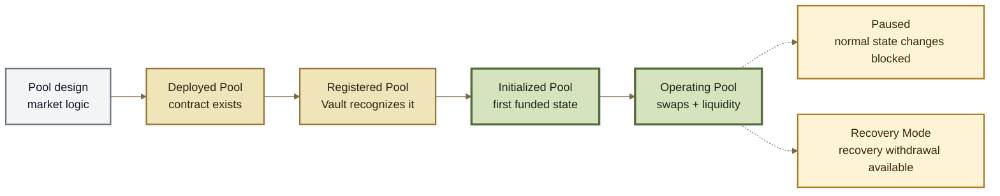
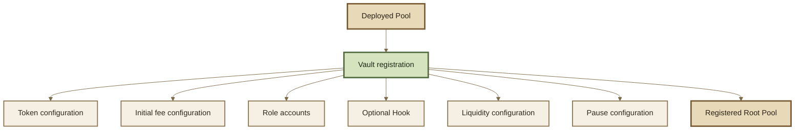

# Pool Lifecycle

## Pool Lifecycle

A **Root Pool** does not become a usable market the moment its contract is deployed. It moves through several distinct states: the Pool instance is deployed, registered with the Vault, initialized with its first liquidity, and then operated as a changing market.

> **The lifecycle mental model:** deployment creates the Pool, registration gives it protocol identity, and initialization creates its first funded market state.


A Pool can exist without being registered. A registered Pool can exist without being initialized. An initialized Pool can later be paused or placed in Recovery Mode.


***

### Lifecycle at a glance





The important distinction is:

```
contract exists
    ≠
Pool registered
    ≠
Pool initialized
    ≠
Pool available for a particular operation
```

These are different facts about the same Pool.

***

### Know which object you are looking at

Several related objects appear during Pool creation.

<table><thead><tr><th width="246">Object</th><th>Meaning</th></tr></thead><tbody><tr><td><strong>Pool implementation</strong></td><td>Reusable market logic, such as Weighted, Stable, or custom Pool logic.</td></tr><tr><td><strong>Factory</strong></td><td>A contract that can create Pool instances using a known deployment pattern.</td></tr><tr><td><strong>Pool instance</strong></td><td>One deployed Pool contract at one address.</td></tr><tr><td><strong>Registered Root Pool</strong></td><td>A Pool instance recognized and configured by the Vault.</td></tr><tr><td><strong>RPT</strong></td><td>The tokenized representation of ownership in an initialized Pool.</td></tr></tbody></table>

One implementation can produce many Pool instances. A factory can create many Pools of the same family. Neither relationship means that a newly deployed contract is already a usable market.

***

### 1. Deployment creates the Pool instance

Deployment creates the Pool contract and its market-specific logic at an address.

At this point, the contract exists, but the Vault does not necessarily recognize it as a ROOTSTOCK Pool. The Pool may already contain implementation-level parameters, while other protocol configuration is established later during registration.

```
Pool implementation
       ↓
    deploy
       ↓
Pool instance
```

Factories provide a repeatable way to perform this deployment and can coordinate deployment with registration. Exact creation paths, factory behavior, and deployment mechanics belong in **Factories & Deployment**.


**Deployment creates the instance. Registration gives the instance protocol identity.**


***

### 2. Registration connects the Pool to the Vault

A deployed Pool becomes a protocol-recognized Root Pool when it is **registered with the Vault**.

Registration is important because the Pool contract contains the market logic, while the Vault needs the configuration required to account for and operate that market.

Registration establishes information such as:

* which tokens belong to the Pool;
* how those tokens are configured for Vault accounting;
* the Pool's starting swap-fee configuration;
* role accounts that may control permitted settings;
* whether a Hook is attached and which Hook callbacks are enabled;
* which liquidity-operation modes are supported;
* the Pool's pause-window configuration.



Registration does **not** mean that every configured value is permanent. Some properties form part of the Pool's registered identity, while others can later change through specifically authorized paths.

See **Pool Configuration & Roles**, **Hooks**, and **Permissions** for the configuration and authority model.

#### Registered does not mean initialized

Registration creates a recognized market configuration. It does not create the Pool's first funded state.

```
registered = yes
initialized = no
```

is a valid Pool state.

This distinction matters to interfaces, Routers, aggregators, and indexers. Discovering a registered Pool does not by itself mean that it is ready for swaps or ordinary liquidity operations.

***

### 3. Initialization creates the first funded market state

**Initialization is the Pool's first liquidity operation.** It is a separate, one-time lifecycle transition.

Initialization supplies the Pool's starting liquidity and creates the first live market state. Depending on the Pool design, that establishes:

* the initial token balances;
* the first live invariant or pricing state;
* the initial RPT supply representing ownership of the funded Pool.

```
registered Pool
      +
initial liquidity
      ↓
initialized Pool
```

After initialization, later deposits are ordinary liquidity additions rather than another initialization.


Initialization is deliberately one-time. A Pool cannot be repeatedly returned to its uninitialized state and initialized again as if it were new.


#### The starting state matters

The first funded balances interact with the Pool's parameters to establish its starting market state.

For a Weighted Pool, for example, the starting balances and normalized weights determine the initial price relationship. Other Pool families can impose different initialization rules or starting-state calculations.

This makes initialization economically important: a poorly chosen initial state can begin the market at a price relationship that differs from the intended external market.

Pool-specific initialization requirements belong with the relevant Pool family. RPT minting and ownership accounting belong in **Root Pool Tokens**.

***

### 4. The Pool enters normal operation

Once initialized, the Pool can participate in the operations allowed by its configuration.

These can include:

* swaps;
* adding liquidity;
* removing liquidity;
* proportional, unbalanced, or custom liquidity operations where supported;
* Hook callbacks;
* dynamic fees;
* queries and simulations;
* routing as part of larger transactions.

The high-level execution path remains:

```
user intent
    ↓
Router
    ↓
Vault
    ↓
Pool mathematics
    ↓
Vault accounting + settlement
```

The Pool determines the market-specific calculation. The Vault manages the shared accounting and settlement around it.

See **Vault**, **Accounting & Settlement**, **Swaps**, and **Routing & Routers** for those execution layers.

#### An initialized Pool keeps changing

Initialization creates the starting state; it does not freeze the market.

During normal operation:

* balances change through swaps and liquidity operations;
* RPT supply changes as liquidity enters or leaves;
* token rates can change when Rate Providers are used;
* dynamic fees can change when a Hook supplies them;
* authorized configuration can change where the Pool permits it;
* Pool-specific mutable parameters can evolve.

Other properties may be fixed by deployment or registration.

This is why a Pool should not be modeled as having one generic "owner." Different settings can have different authorities, bounds, or no mutable authority at all.

See **Pool Configuration & Roles** and **Permissions**.

***

### 5. Pause and Recovery Mode are lifecycle states, not lifecycle steps

After initialization, a Pool can also have emergency-state flags.

**Pause** and **Recovery Mode** are related, but they are not the same thing and should not be modeled as a sequence such as:

```
Active → Paused → Recovery → Active
```

Instead, they are separate facts about the Pool's current state.

#### Pause

A paused Pool blocks normal state-changing operations. Pausing is intended to stop ordinary execution when continuing to operate may be unsafe.

#### Recovery Mode

Recovery Mode makes a simple proportional withdrawal path available so LPs can exit without depending on the Pool's ordinary withdrawal logic.

Recovery Mode does **not** itself mean that the Pool is paused, and it does not repair an unhealthy Pool or one of its external dependencies.

When the Pool or Vault is paused, enabling Recovery Mode becomes permissionless so the emergency exit path cannot be withheld by the same authority that stopped normal execution.

| Paused | Recovery Mode | High-level meaning                                                                           |
| ------ | ------------- | -------------------------------------------------------------------------------------------- |
| No     | No            | Normal operation, subject to the Pool's configuration.                                       |
| Yes    | No            | Normal state-changing operations are blocked; Recovery Mode can be enabled permissionlessly. |
| No     | Yes           | Recovery withdrawal is available; Recovery Mode alone does not pause ordinary operations.    |
| Yes    | Yes           | Normal state changes are blocked while the recovery withdrawal path remains available.       |

Exact pause authority, pause windows, Recovery Mode calls, and recovery-withdrawal mechanics belong in **Emergency Controls**.


Recovery Mode is an **exit mechanism**, not a repair mechanism. It cannot make a broken token, compromised Rate Provider, failed wrapper, or damaged external protocol safe.


***

### 6. Lifecycle state determines what a Pool can do now

A contract address alone is not enough to determine whether a Pool is usable.

An integration may need to know:

| Question                                  | What it tells you                                                               |
| ----------------------------------------- | ------------------------------------------------------------------------------- |
| **Is the Pool registered?**               | Whether the Vault recognizes it as a Pool.                                      |
| **Is it initialized?**                    | Whether its first funded market state exists.                                   |
| **Is it paused?**                         | Whether normal state-changing operations are blocked.                           |
| **Is Recovery Mode enabled?**             | Whether the recovery withdrawal path is available.                              |
| **Which liquidity modes are configured?** | Which kinds of liquidity operations the Pool supports.                          |
| **Which dependencies does it use?**       | Whether Hooks, Rate Providers, buffers, or external assets affect its behavior. |

A deployed address is therefore not proof that a Pool is tradeable, and an initialized Pool is not automatically proof that every operation is currently available or safe.

Lifecycle state should be read from protocol state rather than inferred from the existence of a contract or a historical deployment event.

For offchain observation, see **Events & Indexing**, **Pool Data**, and **API & Analytics**.

***

### The model to remember

```
POOL DESIGN
    ↓
DEPLOYMENT
contract exists
    ↓
REGISTRATION
Vault recognizes + configures Pool
    ↓
INITIALIZATION
first funded market state + initial RPT
    ↓
OPERATION
swaps + liquidity + changing state
```

After initialization, what the Pool can do at any moment depends on more than one flag:

```
market state
+ configuration
+ pause state
+ recovery state
+ dependencies
= current Pool behavior
```

For integrations:

```
exists
  ≠ registered
  ≠ initialized
  ≠ available for every operation
  ≠ healthy
```

That distinction is the core of the Root Pool lifecycle.

***

### Continue

<table><thead><tr><th width="299">Page</th><th>What it explains</th></tr></thead><tbody><tr><td><strong>Pool Configuration &#x26; Roles</strong></td><td>Which Pool settings exist, which can change, and which authorities control them.</td></tr><tr><td><strong>Root Pool Tokens</strong></td><td>How Pool ownership is represented and redeemed.</td></tr><tr><td><strong>Adding &#x26; Removing Liquidity</strong></td><td>How ordinary liquidity operations work after initialization.</td></tr><tr><td><strong>Hooks</strong></td><td>How Hooks attach programmable behavior to Pools.</td></tr><tr><td><strong>Factories &#x26; Deployment</strong></td><td>How Pool implementations are deployed and registered consistently.</td></tr><tr><td><strong>Emergency Controls</strong></td><td>How Pause and Recovery Mode work in detail.</td></tr><tr><td><strong>Events &#x26; Indexing</strong></td><td>How lifecycle transitions and Pool state are observed offchain.</td></tr></tbody></table>
