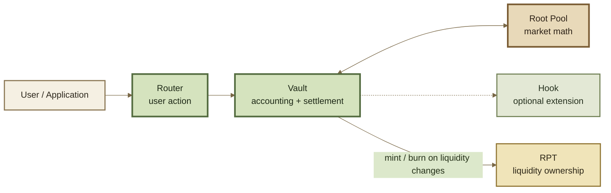
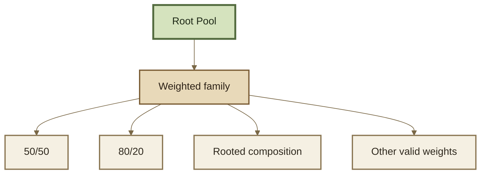

```mermaid
%%{init: {"theme":"base","themeVariables":{
  "primaryColor":"#E7E0C3",
  "primaryTextColor":"#243018",
  "primaryBorderColor":"#6F7B48",
  "lineColor":"#7A6847",
  "secondaryColor":"#DCE8CB",
  "tertiaryColor":"#F3EBD8",
  "fontFamily":"Inter, ui-sans-serif, system-ui, sans-serif"
}}}%%
flowchart LR
    RAW["Raw token balance"]
    DEC["Decimal scaling"]
    RATE["Rate scaling<br/>when configured"]
    FEE["Yield-fee adjustment<br/>when applicable"]
    LIVE["Live scaled balance"]
    POOL["Root Pool math"]

    RAW --> DEC --> RATE --> FEE --> LIVE --> POOL

    classDef asset fill:#F0E4B9,stroke:#917634,stroke-width:2px,color:#2B2516;
    classDef action fill:#EEF2E7,stroke:#75845A,stroke-width:2px,color:#25301E;
    classDef market fill:#E8D9B9,stroke:#7A5C34,stroke-width:3px,color:#2C2116;

    class RAW asset;
    class DEC,RATE,FEE,LIVE action;
    class POOL market;
```

# Rootstock Pools

## Root Pools

A **Root Pool**, or **ROOTSTOCK Pool**, is an AMM market created through ROOTSTOCK.

The Pool defines the market-specific rules: how assets are priced against one another, how its invariant behaves, and how balances should change during swaps and liquidity operations. The shared **Vault** handles the accounting and settlement around those calculations.


**The mental model:** the Pool defines the market. The Vault runs the shared accounting system around it.



**Root Pool** is the protocol-level name for a ROOTSTOCK market. It does **not** mean the pool must use a rooted asset composition. A Root Pool can be Weighted, Stable, rooted, unrooted, Hook-extended, or custom depending on its design.


***

### The Pool is the market-specific layer

A Pool contract is one part of a functioning Root Pool market. It plugs into shared protocol infrastructure instead of rebuilding an exchange around itself.





Each layer has a different responsibility:

<table><thead><tr><th width="125">Layer</th><th>Main responsibility</th></tr></thead><tbody><tr><td><strong>Router</strong></td><td>Turns a user action into protocol operations.</td></tr><tr><td><strong>Vault</strong></td><td>Tracks balances, accounting, configuration, and settlement.</td></tr><tr><td><strong>Root Pool</strong></td><td>Calculates the market-specific result.</td></tr><tr><td><strong>Hook</strong></td><td>Optionally extends behavior around supported operations.</td></tr><tr><td><strong>RPT</strong></td><td>Represents proportional ownership of pool liquidity.</td></tr></tbody></table>

This separation is what allows different AMMs to share the same execution infrastructure.

***

### Pool vs Vault

The most important boundary is between **market mathematics** and **shared accounting**.



The Pool answers questions such as:

* What should this swap return?
* What invariant describes this market?
* How should balances relate as liquidity changes?
* What mathematical bounds keep the market valid?

The Pool defines **how this particular market behaves**.



The Vault handles shared concerns such as:

* registered tokens and pool configuration;
* token accounting and settlement;
* balance scaling and rate handling;
* swap and liquidity execution around the Pool;
* common protocol safeguards and state.

The Vault provides **the infrastructure the market runs inside**.



> **Different Pool math can run inside the same Vault architecture.**

That is the key extensibility property inherited from Balancer v3: a builder can create new AMM behavior without rebuilding custody, accounting, settlement, routing, and liquidity infrastructure from scratch.

***

### The invariant is the mathematical center

An **invariant** is the mathematical relationship used to describe the Pool as its balances change.

Different invariants create different markets because they produce different price curves, inventory behavior, and responses to trades.

```
shared Vault infrastructure
        ↓
different Pool mathematics
        ↓
different price curves
        ↓
different market behavior
```

For standard constant-invariant AMMs, two properties are especially important:

1. **A swap should not reduce the invariant through the pricing calculation.** Swap fees may increase it by adding value to the Pool, but the pricing logic should not create a value-draining round trip.
2. **Proportional balance growth should produce proportional invariant growth.** This keeps fungible pool-share accounting coherent when liquidity grows proportionally.

The inherited architecture also lets the Vault derive standard liquidity behavior from a compatible Pool's invariant and balance relationships, so a custom market does not need to reimplement every common liquidity path. The exact equations, function signatures, and mathematical bounds belong on the pool-family, Build, and Developer Reference pages.


A custom invariant does not require a custom exchange stack. Compatible custom Pools can still reuse ROOTSTOCK's Vault, Routers, RPT ownership model, settlement, and Hook framework.


See **Weighted Pools**, **Stable Pools**, and **Custom Pools**.

***

### Pools receive normalized accounting state

Tokens do not all use the same decimals, and some tokens represent assets whose exchange rate changes over time. The Pool should not have to solve those accounting differences itself.

In the inherited v3 architecture, the Vault normalizes balances before Pool math uses them.





Pool calculations therefore work from a consistent representation rather than repeatedly handling token-specific decimal and rate mechanics.

See **Token Scaling** and **Rate Providers**.

***

### A Root Pool has several dimensions

A Pool should not be described by one label alone. Several independent choices determine what market it actually is.

<table data-full-width="true"><thead><tr><th>Dimension</th><th>Question</th><th>Examples</th></tr></thead><tbody><tr><td><strong>Family</strong></td><td>What AMM mathematics does it use?</td><td>Weighted · Stable · Custom</td></tr><tr><td><strong>Composition</strong></td><td>How are assets arranged inside that family?</td><td>50/50 · 80/20 · rooted · multi-asset</td></tr><tr><td><strong>Assets</strong></td><td>What tokens and rate relationships make up the market?</td><td>Standard · rate-bearing · correlated</td></tr><tr><td><strong>Extension</strong></td><td>Does extra behavior run around operations?</td><td>No Hook · dynamic fees · custom Hook</td></tr><tr><td><strong>Configuration</strong></td><td>How is the market registered to behave?</td><td>Fees · roles · liquidity settings</td></tr></tbody></table>

These dimensions overlap. A single market might be:

```
Weighted + multi-asset + rooted + rate-bearing + Hook-extended
```

That is one Root Pool described precisely—not five separate pool types.

***

### Pool family, composition, and extension are different

These three ideas are easy to collapse into one.



The **pool family** defines the base market mathematics.

Examples:

* **Weighted** — constant weighted-product math;
* **Stable** — math designed for assets expected to trade near a known relationship;
* **Custom** — another compatible invariant or market model.



The **composition** describes how assets are arranged inside the family.

For a Weighted Pool, examples include:

* 50/50;
* 80/20;
* 60/20/20;
* a rooted majority-weight composition.

Composition changes exposure without automatically creating a new mathematical family.



A **Hook** adds behavior around supported Pool operations without necessarily replacing the Pool's base invariant.

Examples include:

* dynamic fee logic;
* pre- or post-swap behavior;
* additional logic around liquidity changes.



```
Pool family  = base market mathematics
Composition  = asset arrangement inside that market
Hook         = additional behavior around that market
```

This distinction keeps the taxonomy composable instead of inventing a new "pool type" for every combination of features.

***

### Standard Pool families



**Weighted Pools** use a constant weighted-product invariant.

They can represent equal or unequal asset weights and are well suited to general assets that do not need to remain near parity. The same mathematical family can support simple pairs, asymmetric exposure, or multi-asset portfolio-style markets.

See **Weighted Pools**.



**Stable Pools** use Stable Math for assets expected to trade near parity or maintain a known relative exchange rate.

Their curve concentrates more useful liquidity around that expected relationship than a general-purpose Weighted Pool.

See **Stable Pools**.



**Custom Pools** introduce market mathematics beyond the standard families while conforming to the interface expected by the Vault.

A Custom Pool can define a novel invariant or specialized swap behavior while still reusing shared ROOTSTOCK accounting, settlement, routing, RPT, and Hook infrastructure.

See **Custom Pools**.




The pool families described here are part of the inherited design model. **Deployments** remains the source of truth for which factories and implementations are actually available in a particular ROOTSTOCK release.


***

### Rooted describes composition—not the protocol

A **rooted pool** is a composition pattern inside the Weighted family in which one designated asset holds a majority normalized weight.

For example:

```
70 / 30
70 / 20 / 10
```

The underlying mathematics are still Weighted. **Rooted** describes which asset anchors the Pool's inventory exposure.






**Root Pool ≠ rooted pool.** Every ROOTSTOCK market is a Root Pool. Only Pools matching the rooted-composition definition are rooted pools.


See **Rooted Pools**.

***

### Hooks extend a Pool without becoming the Pool

A Hook is a separate contract associated with a Pool during registration. It can participate at configured lifecycle points around initialization, swaps, liquidity changes, or fee calculation.

For example:

```
Stable Pool
    +
dynamic-fee Hook
    =
Stable mathematics with extended fee behavior
```

The base invariant is still Stable Math. The Hook changes behavior around it.

That is different from a **Custom Pool**, where the underlying market mathematics themselves change.

See **Hooks** and **Dynamic Fees**.

***

### Registration gives the market its protocol configuration

Deploying a Pool contract creates the market logic. **Registering** it connects that Pool to the Vault and establishes the configuration around it.

Registration can associate the Pool with information such as:

* its asset set and token configuration;
* its initial swap-fee configuration;
* its role accounts and controls;
* an optional Hook;
* its supported liquidity-management behavior.

This means two Pools using the same invariant do not necessarily represent identical markets. Their assets, parameters, permissions, extensions, and configuration can differ. Applications should inspect the actual Pool configuration instead of inferring behavior from a family name or contract address alone.

Factories can package deployment and registration into a repeatable path for a Pool family; the exact factory mechanics and addresses belong in **Factories & Deployment** and **Deployments**.

See **Pool Configuration & Roles**.

#### Registered is not initialized

A Pool can be registered before it has its first funded state.



#### 1. Deploy

The Pool contract and its market mathematics exist.



#### 2. Register

The Vault recognizes the Pool and its protocol configuration.



#### 3. Initialize

Initial liquidity establishes the Pool's first funded state and initial RPT ownership.



After initialization, ordinary swaps and liquidity operations can occur subject to the Pool's configuration and protocol controls.

See **Pool Lifecycle**.

***

### Pool ownership is separate from Pool math

Liquidity ownership is represented by **Root Pool Tokens (RPTs)**.

```
Pool invariant
    → determines market behavior

RPT
    → represents ownership of current Pool state
```

A Weighted Pool and a Stable Pool can use different pricing equations while both exposing fungible liquidity ownership through RPTs.

Likewise, transferring an RPT changes who owns the liquidity position; it does not change the Pool's invariant.

See **Root Pool Tokens**.

***

### What a Root Pool is not

A Root Pool is not:

* a separate Vault with its own isolated accounting stack;
* necessarily a two-token pair;
* necessarily a Weighted Pool;
* necessarily rooted;
* defined only by its token list;
* defined only by its invariant;
* automatically identical to another Pool using the same mathematical family;
* the same thing as a Hook;
* the same thing as its RPT.

A Root Pool is a **registered AMM market whose market-specific mathematics operate inside ROOTSTOCK's shared execution and accounting architecture**.

***

### The model to remember

```
Root Pool market
    =
Pool mathematics
    +
registered assets and configuration
    +
RPT ownership
    +
optional Hook behavior
```

During an operation:

```
user intent
    ↓
Router
    ↓
Vault
    ↓
Root Pool math
    ↓
calculated market transition
    ↓
Vault accounting + settlement
    ↓
updated Pool state
```

> **The Pool decides how the market should move. The Vault makes that movement account correctly.**

***

### Continue

<table data-full-width="true"><thead><tr><th>Page</th><th>What it explains</th></tr></thead><tbody><tr><td><strong>Pool Lifecycle</strong></td><td>How Pools move from deployment and registration through initialization and normal operation.</td></tr><tr><td><strong>Pool Configuration &#x26; Roles</strong></td><td>How tokens, fees, permissions, Hooks, and liquidity settings define a Pool's operating envelope.</td></tr><tr><td><strong>Weighted Pools</strong></td><td>How weighted-product markets work and how asset weights shape exposure.</td></tr><tr><td><strong>Stable Pools</strong></td><td>How Stable Math behaves for assets expected to trade near a known relationship.</td></tr><tr><td><strong>Custom Pools</strong></td><td>How new market mathematics can reuse ROOTSTOCK's shared infrastructure.</td></tr><tr><td><strong>Root Pool Tokens</strong></td><td>How liquidity ownership is represented and composed.</td></tr></tbody></table>
