```mermaid
%%{init: {"theme":"base","themeVariables":{
  "primaryColor":"#E7E0C3",
  "primaryTextColor":"#243018",
  "primaryBorderColor":"#6F7B48",
  "lineColor":"#7A6847",
  "secondaryColor":"#DCE8CB",
  "tertiaryColor":"#F3EBD8",
  "fontFamily":"Inter, ui-sans-serif, system-ui, sans-serif"
}}}%%
flowchart LR
    S["Current onchain state"]
    Q["Query operation"]
    R["Expected result"]
    L["Apply slippage limits"]
    E["Execute transaction"]

    S --> Q --> R --> L --> E

    classDef state fill:#F5F0E3,stroke:#8B7754,stroke-width:2px,color:#2E281D;
    classDef query fill:#D5E3BE,stroke:#536B3F,stroke-width:3px,color:#1D2816;
    classDef limit fill:#E7E0C3,stroke:#6F7B48,stroke-width:2px,color:#243018;
    classDef execution fill:#E8D9B9,stroke:#7A5C34,stroke-width:2px,color:#2C2116;

    class S state;
    class Q,R query;
    class L limit;
    class E execution;
```

# Queries & Simulation

A **query** simulates an operation against current onchain state and returns its expected result **without executing the persistent transaction**.

Queries are useful for answering questions such as:

* how many Root Pool Tokens would this liquidity addition mint?
* how many tokens would this removal return?
* what output would an Exact In swap receive?
* how much input would an Exact Out swap require?
* what result would a batch or multihop swap produce?

The query result can then be used to construct the limits for the real transaction.

***

### Query before execution

A query follows the same intended operation without committing its state changes.





For example, an Exact In swap query can estimate the amount out. The application can then apply its slippage policy and use the resulting minimum amount out when constructing the actual swap.

The same pattern applies to liquidity operations and Exact Out swaps.

***

### A query is not execution

A query describes the result against the state being simulated.

It does **not**:

* reserve liquidity;
* lock a price;
* execute token transfers;
* guarantee that the same state will exist when the transaction is mined.

State can change between simulation and execution.

That is why querying does not replace transaction limits.

```
query result
     ↓
expected outcome
     ↓
slippage policy
     ↓
min / max execution limit
```

If the real transaction exceeds those limits, it should revert.

See Price Impact & Slippage.

***

### Router queries

The inherited Balancer v3 Router architecture exposes query variants for common swap and liquidity operations.

These include query paths for:

* adding liquidity;
* removing liquidity;
* single swaps;
* batch and multihop swaps;
* supported buffer and composite-liquidity workflows.

The concept is the same across them:

```
state-changing operation  → executes
query operation           → simulates
```

Exact query functions and return values belong in Router APIs.

***

### Complex queries

The upstream v3 architecture also supports querying workflows composed from lower-level Vault operations.

#### `quote`

A Router can enter the Vault's **quote context** and simulate a sequence of operations.

The Vault requires this query path to execute in a static-call context, so the simulated workflow does not become a persistent protocol transaction.

This allows more complex Router workflows to be simulated without requiring every possible composition to become a separate Vault interface.

#### `quoteAndRevert`

Some simulations need multiple alternatives to begin from the **same initial state**.

For those cases, upstream v3 provides `quoteAndRevert`.

The simulated operation deliberately reverts and returns its result through revert data. Because the simulation is reverted, another alternative can be evaluated from the original state rather than from state modified by the previous simulation.


`quote` and `quoteAndRevert` describe the inherited v3 simulation architecture. Exact ROOTSTOCK interfaces belong in the Developer Reference and should follow deployed contract truth.


***

### Queries are offchain tools

The inherited v3 query model is designed for **offchain simulation**, typically through a static RPC call.

The intended pattern is:

```
offchain query
      ↓
expected result
      ↓
calculate transaction limits
      ↓
submit transaction
```

A query should **not** be called from inside the same transaction to calculate that transaction's own safety limits.

```
transaction starts
      ↓
query current state
      ↓
derive limits
      ↓
execute
```

That does not provide the intended protection because the transaction is deriving its acceptable bounds from the state it is already executing against.


**Query first. Set limits second. Execute third.**

Simulation estimates the operation. Transaction limits protect the execution.


***

### Related pages

* Routers
* Router Types
* Exact In & Exact Out
* Batch & Multihop Swaps
* Price Impact & Slippage
* Query & Simulate
* Router APIs
