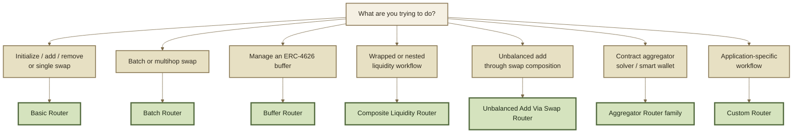

# Router Types

ROOTSTOCK inherits a **specialized Router architecture** from Balancer v3.

Instead of forcing swaps, liquidity operations, wrapper interactions, and aggregator execution through one large interface, different Routers are designed around different workflows.


**Router type and Router deployment are different questions.**

This page describes the inherited architecture and intended role of each Router family. Which Router contracts are actually available in a ROOTSTOCK deployment should be verified through the current deployment and contract-registry references.


***

### Choose by workflow



The Router is selected for the **workflow**, not for the pool's pricing model. A Weighted Pool, Stable Pool, or custom Root Pool can use the same surrounding Router architecture where the operation is supported.

***

### Basic Router

The **Basic Router** handles the most common direct interactions with a Root Pool.

Typical operations include:

* initializing a pool;
* adding liquidity;
* removing liquidity;
* executing a single swap.

For most ordinary pool interactions, this is the simplest Router model.

```
one common action
      ↓
 Basic Router
      ↓
     Vault
      ↓
  Root Pool
```

The Basic Router does not determine swap prices or liquidity mathematics. It translates the requested operation into the appropriate Vault interaction.

***

### Batch Router

The **Batch Router** is designed for swaps that require more than one step or path.

A route might move through several pools:

```
Token A → Pool 1 → Token B → Pool 2 → Token C
```

Rather than externally transferring each intermediate asset after every hop, the Vault can account for the intermediate credits and debts and settle the final net result.

That makes the Batch Router appropriate for:

* multihop swaps;
* multipath swaps;
* routes involving several pools;
* more complex swap composition.

See Batch & Multihop Swaps.

***

### Buffer Router

The **Buffer Router** handles operations specific to ERC-4626 buffers.

Buffers maintain liquidity between an ERC-4626 wrapped token and its underlying asset so wrapping and unwrapping can participate efficiently in protocol workflows.

The Buffer Router can coordinate operations such as:

* initializing a buffer;
* adding buffer liquidity;
* querying buffer operations.


A buffer is not a normal Root Pool. It is a Vault-level mechanism for efficiently moving between an ERC-4626 share token and its underlying asset.


See ERC-4626 Buffers.

***

### Composite Liquidity Router

The **Composite Liquidity Router** coordinates liquidity operations that span more than one asset layer.

Its inherited v3 role includes liquidity workflows involving:

* Root Pools containing ERC-4626 tokens;
* wrapped and underlying assets;
* nested pools containing another pool's share token, where supported.

For example, a user may hold an underlying asset while the Root Pool itself contains its ERC-4626 wrapped form. The Composite Liquidity Router can coordinate the surrounding conversions together with the pool liquidity operation.

```mermaid
%%{init: {"theme":"base","themeVariables":{
  "primaryColor":"#E7E0C3",
  "primaryTextColor":"#243018",
  "primaryBorderColor":"#6F7B48",
  "lineColor":"#7A6847",
  "secondaryColor":"#DCE8CB",
  "tertiaryColor":"#F3EBD8",
  "fontFamily":"Inter, ui-sans-serif, system-ui, sans-serif"
}}}%%
flowchart LR
    U["Underlying asset"]
    C["Composite<br/>Liquidity Router"]
    W["Wrapped asset"]
    P["Root Pool"]
    T["Root Pool Token"]

    U --> C
    C -->|"wrap / coordinate"| W
    W -->|"add liquidity"| P
    P --> T

    classDef asset fill:#F5F0E3,stroke:#8B7754,stroke-width:2px,color:#2E281D;
    classDef router fill:#D5E3BE,stroke:#536B3F,stroke-width:3px,color:#1D2816;
    classDef pool fill:#E8D9B9,stroke:#7A5C34,stroke-width:2px,color:#2C2116;
    classDef token fill:#E3E8D5,stroke:#75845A,stroke-width:2px,color:#25301E;

    class U,W asset;
    class C router;
    class P pool;
    class T token;
```



The important idea is **composition**: several operations can be presented to the user as one liquidity workflow.

***

### Unbalanced Add Via Swap Router

Some pool designs do not expose a native unbalanced-liquidity operation.

The **Unbalanced Add Via Swap Router** provides another route: for supported two-token pools, it can construct the desired position by combining a **proportional liquidity addition** with a **swap**.

Conceptually:

```
unbalanced user input
        ↓
proportional liquidity
      + swap
        ↓
desired pool position
```


This demonstrates why workflow logic is separated from pool mathematics.

A new way to enter a position can be built at the Router layer without changing the Root Pool's invariant.


Whether a particular pool supports this workflow depends on its design and the deployed Router implementation.

***

### Aggregator Routers

**Aggregator Routers** are designed for contract-controlled execution rather than the normal retail token-approval flow.

Typical callers include:

* DEX aggregators;
* solvers;
* smart wallets;
* other contracts coordinating swaps.

The inherited architecture distinguishes two swap-oriented variants:

| Router                      | Role                                 |
| --------------------------- | ------------------------------------ |
| **Aggregator Router**       | Single-swap contract flows           |
| **Aggregator Batch Router** | Multihop or multipath contract flows |

Instead of authorizing a retail Router to pull the input token through Permit2, the calling contract can transfer the required input to the Vault within the same transaction.

```
Contract caller
      ↓
prepay input to Vault
      ↓
Aggregator Router
      ↓
swap execution
      ↓
Vault settlement
```

This removes the retail Permit2 step from that execution path.

The Vault still enforces settlement. Prepayment changes **how the input is supplied**, not the accounting rules of the protocol.

***

### Custom Routers

The standard Router families cover common workflows, but they do not define the limit of the architecture.

Builders can create **Custom Routers** that compose Vault primitives into application-specific interfaces.

Examples include:

* protocol integrations;
* specialized liquidity flows;
* solver execution;
* interactions with external protocols;
* new combinations of existing ROOTSTOCK operations.

A Custom Router changes **how an operation is orchestrated**. It does not inherently change the Root Pool's invariant or bypass Vault settlement.

See Build a Custom Router.

***

### Router selection

| Workflow                                                    | Router family                      |
| ----------------------------------------------------------- | ---------------------------------- |
| Initialize a pool                                           | **Basic Router**                   |
| Standard add or remove liquidity                            | **Basic Router**                   |
| Single swap                                                 | **Basic Router**                   |
| Batch or multihop swap                                      | **Batch Router**                   |
| ERC-4626 buffer management                                  | **Buffer Router**                  |
| Wrapped or nested liquidity workflow                        | **Composite Liquidity Router**     |
| Supported two-token unbalanced add through swap composition | **Unbalanced Add Via Swap Router** |
| Contract-based single swap                                  | **Aggregator Router**              |
| Contract-based multihop swap                                | **Aggregator Batch Router**        |
| Specialized application workflow                            | **Custom Router**                  |


This table describes **Router responsibilities**, not a guarantee that every inherited Router family is deployed in every ROOTSTOCK environment.


***

### Related pages

* Routers — why the Router layer exists
* Batch & Multihop Swaps — multi-step swap execution
* ERC-4626 Buffers — underlying and wrapped-asset buffers
* Queries & Simulation — simulate Router operations before execution
* Build a Custom Router — implement a specialized workflow
* Router APIs — exact contract interfaces
