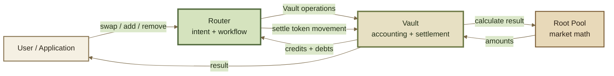

# Routers

**Routers are the normal entry point for users and applications.**

A Router takes an action—such as swapping tokens or adding liquidity—and turns it into the Vault operations required to complete it.

The simplest mental model is:

```
Router    = intent and workflow
Vault     = accounting and settlement
Root Pool = market math
```

Routers are intentionally separate from both the Vault and Root Pools. This keeps the user-facing execution layer flexible while the protocol's core accounting and market logic remain focused on narrower responsibilities.


**A Router decides how an operation is carried out. It does not decide the market price or own the pool's liquidity.**


***

### How a Router fits into ROOTSTOCK



A user normally interacts with the Router rather than assembling low-level Vault calls directly.

During execution, the Router can invoke one or more Vault primitives. The Vault tracks the resulting credits and debts, calls Root Pools when market calculations are required, and verifies that everything is settled before the transaction completes.

See Accounting & Settlement for the underlying accounting model.

***

### Why Routers exist

A single user action can require several protocol operations.

For example, a Router can provide a simple interface for:

* initializing a pool;
* adding liquidity;
* removing liquidity;
* executing a single swap;
* executing batch or multihop swaps;
* wrapping or unwrapping assets through ERC-4626 buffers;
* combining several Vault operations atomically.

Without the Router layer, applications would need to reproduce this sequencing themselves or the Vault would need to expose increasingly specialized user-facing functions.

Separating the two lets the **Vault remain focused on protocol accounting** while Routers provide interfaces designed around actual user workflows.

***

### Routers can compose operations

A Router is not limited to one Vault action.

Several operations can be combined inside the same transaction. Intermediate results can create temporary credits and debts inside the Vault, while settlement is based on the final net result.

Conceptually:

```
user intent
    ↓
Router workflow
    ↓
one or more Vault operations
    ↓
net credits and debts
    ↓
settlement
```

If the required settlement is incomplete, the transaction reverts.

This makes Routers useful for workflows that would otherwise require several separate transactions.

***

### Stateless execution layer

Routers are designed **not to retain pool liquidity as persistent state**.

Pool assets remain under the protocol's Vault accounting rather than being migrated into each Router. As a result, improved or specialized Router implementations can be introduced without moving the underlying pool liquidity.

This separation also lets different interfaces coexist around the same Vault and Root Pools.


**Stateless does not mean risk-free.**

A Router can be authorized to move tokens and can execute several operations on a user's behalf. Applications should use the intended Router implementation and verify approvals, limits, and transaction parameters.


***

### Different workflows, different Routers

Not every operation needs the same interface.

ROOTSTOCK's Router architecture can support different Router families for different workflows, including:

| Router role                      | Typical use                                                               |
| -------------------------------- | ------------------------------------------------------------------------- |
| **General-purpose**              | Pool initialization, standard swaps, adding liquidity, removing liquidity |
| **Batch**                        | Multihop or multipath swap execution                                      |
| **Buffer / composite liquidity** | ERC-4626 wrappers, buffers, or composed liquidity structures              |
| **Aggregator**                   | Contract callers such as aggregators or solvers                           |
| **Custom**                       | Application-specific or protocol-specific workflows                       |

The exact functions and responsibilities belong on Router Types.

***

### Queries

Routers can expose **query functions** alongside state-changing operations.

A query simulates an operation against the current onchain state without transferring tokens or changing protocol state. Applications can use the result to:

* preview an expected swap;
* estimate liquidity amounts;
* calculate minimum outputs or maximum inputs;
* configure slippage protection;
* validate parameters before submitting a transaction.

```
query    → simulate the operation
execute  → perform the operation
```


A query is a **simulation, not a guarantee**. Pool state can change between the query and the transaction that follows it.


Queries are intended to be performed offchain. They should not be used inside the same state-changing transaction to calculate its own safety limits.

See Queries & Simulation.

***

### Token authorization

A state-changing Router must be able to complete the token movements required by its workflow.

The authorization model depends on the Router and operation.

For user-facing Router flows, input tokens may use **Permit2**, while removing liquidity can require approval of the user's Root Pool Tokens. Query functions do not move tokens and therefore do not require these approvals.

Contract-oriented aggregator flows can instead use a **prepaid** model: the caller transfers the required input to the Vault as part of its transaction and the Router accounts for that payment during execution.

These are **execution and integration mechanics**. They do not change the economics or mathematics of the Root Pool itself.

See Integration Guides for transaction-level usage.

***

### Custom Routers

The Router layer is extensible.

A custom Router can build a specialized workflow from the Vault primitives available to it while still relying on the Vault for accounting and settlement.

This can support:

* protocol integrations;
* solver and aggregator execution;
* specialized pool initialization;
* atomic interactions with external protocols;
* application-specific transaction flows;
* new combinations of existing protocol operations.

Because the Router is separate from the Vault and Root Pools, adding a new workflow does not require changing the market mathematics or migrating existing pool liquidity.


A custom Router extends **how users interact with the protocol**. It does not bypass Vault accounting, settlement requirements, or Root Pool invariants.


See Build a Custom Router.

***

### Related pages

* Router Types — the different Router families and their responsibilities
* Queries & Simulation — preview operations before execution
* Accounting & Settlement — how the Vault tracks and settles token deltas
* Integration Guides — how applications interact with ROOTSTOCK
* Build a Custom Router — creating specialized execution workflows
