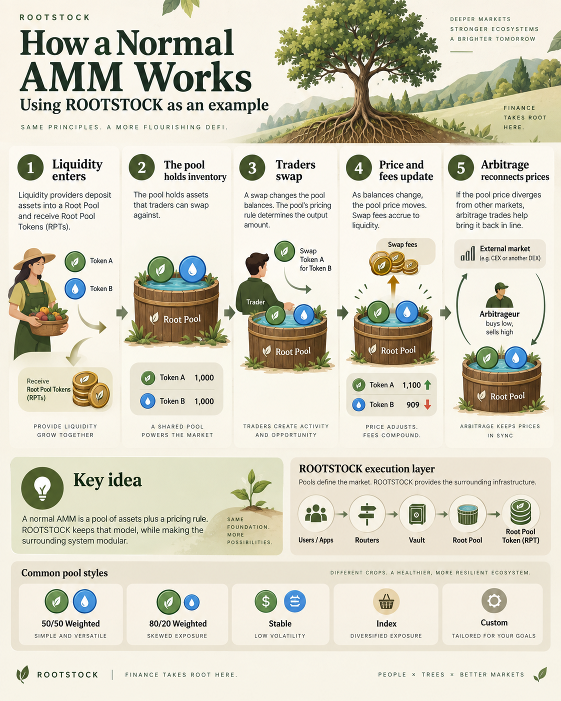
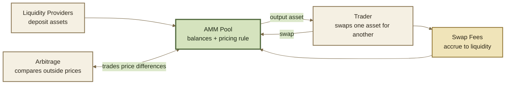
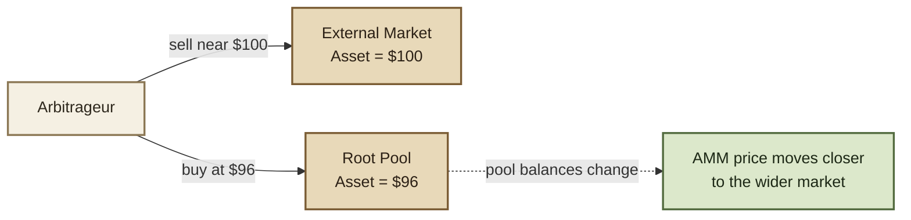

# 🧑‍🌾 AMM Basics

## AMM Basics

An **automated market maker (AMM)** is an onchain market that uses pooled assets and a mathematical pricing rule instead of a traditional order book.

Liquidity providers supply assets to a pool. Traders swap against those assets. The pool adjusts its internal price as its balances change, while fees compensate liquidity providers for making the market available.


**A pool is both liquidity and a pricing system.**

The assets provide inventory; the invariant determines how that inventory is exchanged.


<figure><figcaption></figcaption></figure>

***


### The basic market cycle





A swap changes the pool's balances. Those new balances imply a new price. Arbitrageurs compare that price with other markets and trade when a meaningful difference exists.

That continuous interaction is what keeps an AMM market moving.

***


### Pools hold inventory

A pool contains two or more assets available for trading.

A simple two-token market might begin with:

```
Token A: 100
Token B: 100
```

A trader who buys Token B sends Token A into the pool and removes Token B.

After the trade, the balances might look more like:

```
Token A: 110
Token B: 91
```

The pool now owns more Token A and less Token B. Its pricing rule makes additional Token B progressively more expensive.

This is how an AMM responds to demand without waiting for another trader to place an opposing order.

***


### The invariant is the pricing rule

An **invariant** is the mathematical relationship a pool attempts to preserve while trades change its balances.

Different invariant designs produce different market behavior.



Weighted Pools use a **constant weighted product** invariant.

The familiar two-token 50/50 form can be simplified to:

```
x × y = k
```

ROOTSTOCK can also use unequal weights such as 80/20 or multi-asset weightings.

Changing the weights changes how the pool holds inventory and how its price responds to trades.



Stable Pools use a different invariant designed for assets expected to remain close in price.

That allows more liquidity to be useful near the expected trading range than a general-purpose weighted market.



A custom pool can define different market mathematics when neither standard Weighted nor Stable behavior fits the use case.

The pool supplies the pricing logic while the surrounding ROOTSTOCK infrastructure handles execution and settlement.



The invariant determines the market curve. **It does not determine the assets, the users, or the purpose of the pool.**

***

### Swaps move the price

Every swap changes the ratio of assets inside a pool.

Suppose a 50/50 pool contains two equally valued assets. If traders repeatedly buy one side, that asset becomes scarcer inside the pool. The AMM responds by increasing its relative price.

```
more demand
    ↓
less of the asset remains in the pool
    ↓
the next unit becomes more expensive
```

This creates an automatic price response without an order-book operator.

#### Price impact

**Price impact** is the change in the pool's quoted price caused by the trade itself.

Small trades relative to the pool usually have small price impact. Large trades consume more of the available inventory and move farther along the curve.


**Deeper liquidity generally means lower price impact for the same trade size.**


***

### Liquidity providers make the market

Liquidity providers, or **LPs**, deposit assets into pools so traders have inventory available to swap against.

In return, LPs receive **Root Pool Tokens (RPTs)** representing their proportional share of the pool.

```
assets deposited
      ↓
   Root Pool
      ↓
Root Pool Tokens
```

When an LP exits, the RPT position is redeemed for the corresponding share of the pool's assets.

Because pool balances change through trading, the assets withdrawn later may not have the same proportions as the assets originally deposited.

***

### Swap fees compensate liquidity

Pools can charge a fee when swaps occur.

A simple example:

```
Trade size: 1,000
Swap fee:   0.30%
Fee:        3
```

The fee remains economically associated with the pool and its liquidity providers according to the pool's fee configuration.

Fees create one source of LP return, but they do not remove market risk. Pool composition and asset prices can change while liquidity is deposited.

***

### Arbitrage connects AMMs to other markets

An AMM does not know the "correct" external price of an asset.

It only knows its own balances and pricing rule.

If its price diverges from another market, arbitrageurs may profit by buying where the asset is cheaper and selling where it is more expensive.





Arbitrage is therefore part of normal AMM price discovery. It links the pool's internal price to prices available elsewhere.

***

### Pool design changes the market

The AMM model stays the same, but the pool can be designed for very different purposes.

<table data-full-width="true"><thead><tr><th>Design</th><th>What changes</th><th>Example use</th></tr></thead><tbody><tr><td><strong>50/50 Weighted</strong></td><td>Equal exposure to two assets.</td><td>General two-asset market.</td></tr><tr><td><strong>80/20 Weighted</strong></td><td>One asset carries more pool weight.</td><td>Asymmetric exposure or a rooted composition.</td></tr><tr><td><strong>Multi-asset Weighted</strong></td><td>Several assets share one invariant.</td><td>Basket and index-style markets.</td></tr><tr><td><strong>Stable</strong></td><td>Pricing is optimized around closely related values.</td><td>Stablecoins and correlated assets.</td></tr><tr><td><strong>Custom</strong></td><td>The pool defines different pricing or state logic.</td><td>Specialized market designs.</td></tr></tbody></table>

ROOTSTOCK separates these market-specific choices from the shared exchange infrastructure. Pools can therefore behave differently while remaining accessible through common Routers, Vault accounting, hooks, and settlement.

***

### One AMM, many possible markets

The basic loop remains simple:



#### 1. Liquidity enters

LPs deposit assets into a pool and receive Root Pool Tokens.



#### 2. Traders swap

The pool exchanges assets according to its invariant and current balances.



#### 3. Balances change

The trade moves the pool along its pricing curve and may generate fees.



#### 4. Arbitrage reconnects prices

When meaningful price differences appear, arbitrage can trade against them and move the pool toward the wider market.



ROOTSTOCK builds programmable liquidity around this ordinary AMM cycle rather than replacing it.

***

### Continue

<table data-full-width="true"><thead><tr><th width="245.5">Page</th><th>What it explains</th></tr></thead><tbody><tr><td><strong>Protocol Components</strong></td><td>How Pools, Routers, Vaults, Hooks, and Root Pool Tokens divide responsibility.</td></tr><tr><td><strong>Architecture</strong></td><td>How those components interact during execution.</td></tr><tr><td><strong>Swaps</strong></td><td>How exact-in, exact-out, routing, and settlement work in more detail.</td></tr></tbody></table>
