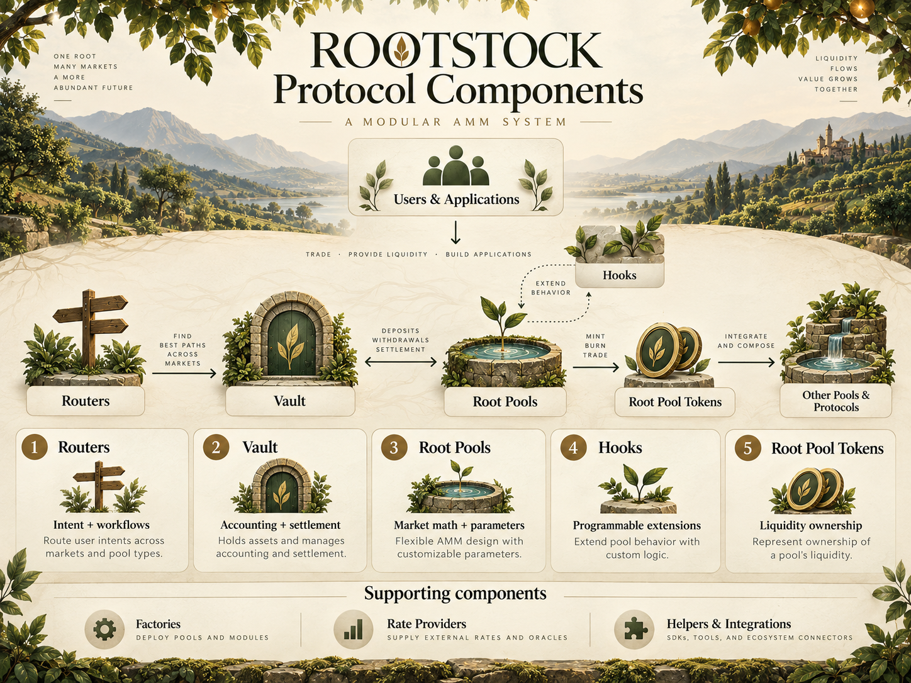
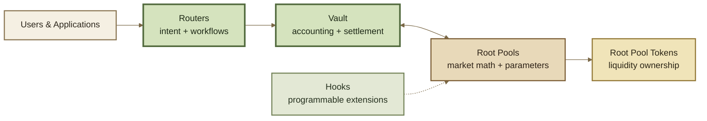

# 🔩 Protocol Components

## Protocol Components

ROOTSTOCK separates an AMM into components with different responsibilities.

Instead of putting pricing, accounting, routing, extensions, and liquidity ownership into one contract, each part of the system has a narrower job.


**The simplest model:**&#x20;

* Routers express intent.
* The Vault settles.
* Root Pools price.
* Hooks extend.
* Root Pool Tokens represent liquidity ownership.


<figure><figcaption></figcaption></figure>

***

### The five core components





Each component can evolve without forcing every other part of the protocol to be redesigned.

***

### Routers

**Routers are the normal entry point for users and applications.**

A Router turns a user action into the operations needed to complete it. That action may be a swap, adding liquidity, removing liquidity, or a more complex sequence involving several pools.

<table data-full-width="true"><thead><tr><th width="220.5">Routers handle</th><th>Examples</th></tr></thead><tbody><tr><td><strong>User intent</strong></td><td>Swap this asset, add this liquidity, remove this position.</td></tr><tr><td><strong>Execution paths</strong></td><td>Choose how an operation reaches one or more pools.</td></tr><tr><td><strong>Composition</strong></td><td>Combine several protocol operations into one workflow.</td></tr><tr><td><strong>Specialized interfaces</strong></td><td>Custom Routers can expose different workflows for different applications.</td></tr></tbody></table>

Routers do not define the price of a market and do not need to own its liquidity. Their job is to organize **how an operation is executed**.

***

### The Vault

The **Vault is the shared accounting and settlement layer**.

It coordinates token balances and liquidity operations across Root Pools so every pool does not need to build its own custody and settlement system.



The Vault keeps track of the assets associated with pools and the credits or debts created during operations.



At the end of an operation, token movements must settle correctly. An incomplete settlement does not become a partially completed market action.



Many pools can use the same execution and accounting layer while keeping their own pricing logic separate.



This is one of the main architectural separations in ROOTSTOCK:

> **The Vault manages the movement of value. Pools decide the terms of exchange.**

A ROOTSTOCK deployment can also specialize the Vault layer where a different accounting or settlement environment is needed.

***

### Root Pools

**Root Pools are the markets.**

A Root Pool defines the economic rules for a specific set of assets. This includes the pool's invariant, asset configuration, weights or other parameters, and the logic required to calculate swap and liquidity outcomes.

A Root Pool may be:

* Weighted or Stable;
* rooted or unrooted in its composition;
* two-token or multi-asset;
* index-like or general purpose;
* static or dynamically extended;
* composable through its Root Pool Token;
* built around a custom invariant.


**Root Pool** identifies the market as part of ROOTSTOCK.

It does not imply that the pool must use a rooted asset composition.


The shared infrastructure does not force all pools to behave alike. The pool owns the market-specific logic.

***

### Hooks

**Hooks extend pool behavior without replacing the pool itself.**

A Hook can run at defined points around pool operations. Depending on how a pool is configured, this can include logic before or after swaps, liquidity changes, initialization, or fee calculation.



A Hook can inspect or modify behavior before a supported pool operation proceeds.



A Hook can react after a supported operation has been calculated or executed.



Hooks can support behavior such as dynamic fees, limits, automation, or other pool-specific extensions.



The important distinction is simple:

```
Pool  → defines the market
Hook  → extends the market
```

Hooks make standard pool designs reusable. New behavior does not always require a completely new pool type.

***

### Root Pool Tokens

A **Root Pool Token (RPT)** represents a liquidity provider's share of a Root Pool.

RPTs connect liquidity ownership to the rest of the system.

<table data-full-width="true"><thead><tr><th width="166.5">Role</th><th>Meaning</th></tr></thead><tbody><tr><td><strong>Ownership</strong></td><td>Represents a proportional share of pooled liquidity.</td></tr><tr><td><strong>Entry and exit</strong></td><td>Pool shares are issued and redeemed as liquidity enters or leaves.</td></tr><tr><td><strong>Composability</strong></td><td>An RPT can become an asset in another pool, application, or protocol.</td></tr><tr><td><strong>Market asset</strong></td><td>An RPT can participate in secondary markets and arbitrage paths.</td></tr></tbody></table>

This means a pool does not have to be an endpoint. Its liquidity position can become an input to another market.

***

### Supporting components

The five components above form the main conceptual model, but additional contracts and services can support them.

#### Factories

Factories provide a repeatable way to create and register new pool instances. A factory normally corresponds to a particular pool design or version.

```
Pool Factory
    ↓
creates
    ↓
Root Pool
    ↓
registered with the Vault
```

Factories help make pool deployment consistent and make it easier for applications and indexers to identify how a pool was created.

#### Rate providers

Some assets represent another underlying asset whose value changes over time. A **rate provider** can supply the conversion rate used to understand that relationship.

Rate providers are supporting inputs rather than independent markets.

#### Helpers and integrations

Additional contracts can provide quoting, querying, routing helpers, registry functions, or specialized integrations without changing the responsibility of the core components.

These supporting contracts will be documented where they become relevant.

***

### Protocol vs interface

The onchain protocol is not the same thing as the application used to access it.



* Routers
* Vaults
* Root Pools
* Hooks
* Root Pool Tokens
* Factories and supporting contracts



* Web applications
* SDKs and libraries
* APIs and indexers
* Analytics
* Deployment tooling



* Aggregators
* Solvers
* Other DeFi protocols
* Wallets and applications



Interfaces can change without changing the market contracts underneath them. Likewise, external applications can integrate directly with the protocol without becoming part of the protocol itself.

***

### Responsibility map

<table data-full-width="true"><thead><tr><th width="191.5">Component</th><th>Primary question</th></tr></thead><tbody><tr><td><strong>Router</strong></td><td>What does the user want to do?</td></tr><tr><td><strong>Vault</strong></td><td>What value moved, and has it settled?</td></tr><tr><td><strong>Root Pool</strong></td><td>What are the rules of this market?</td></tr><tr><td><strong>Hook</strong></td><td>What additional behavior should happen around the operation?</td></tr><tr><td><strong>Root Pool Token</strong></td><td>Who owns what share of the liquidity?</td></tr></tbody></table>

That separation is what makes ROOTSTOCK modular: **market logic can change without rebuilding settlement, execution paths can change without rebuilding markets, and pool behavior can be extended without collapsing every responsibility into one contract.**

***

### Continue

<table data-full-width="true"><thead><tr><th>Page</th><th>What it explains</th></tr></thead><tbody><tr><td><strong>Architecture</strong></td><td>How Routers, the Vault, Root Pools, and Hooks interact during a transaction.</td></tr><tr><td><strong>Vault</strong></td><td>How accounting, settlement, and shared liquidity operations work in more detail.</td></tr><tr><td><strong>Root Pool Tokens</strong></td><td>How pool ownership and composability work.</td></tr><tr><td><strong>Hooks</strong></td><td>Where programmable behavior can enter a pool lifecycle.</td></tr></tbody></table>
