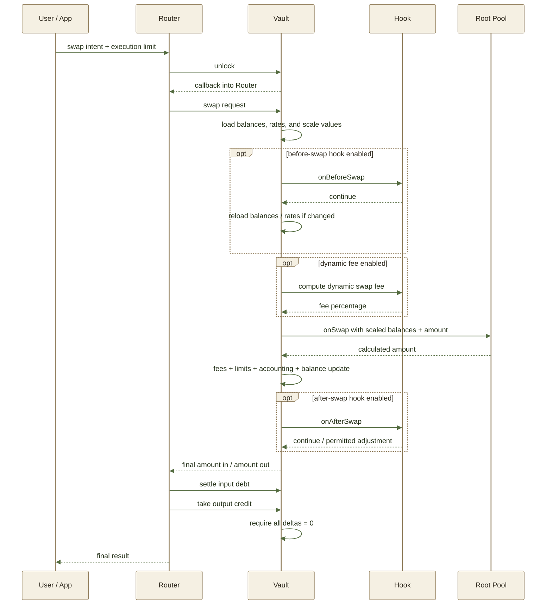
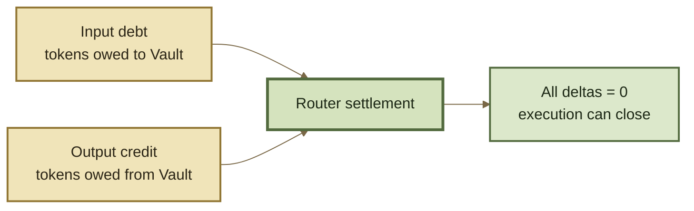

# Swap Lifecycle

A ROOTSTOCK swap executes as **one atomic workflow** across the Router, Vault, Root Pool, and any configured Hooks.

The Router expresses what the user wants to do. The Vault prepares and accounts for the operation. The Root Pool calculates the market result. The Router then settles the resulting token movements before the Vault allows the transaction to complete.


**A calculated swap is not yet a completed swap.** The operation succeeds only when its execution limits pass and every resulting token credit and debt is settled.


***

### Lifecycle at a glance





This diagram shows a single-pool swap. Batch and multihop swaps can repeat the internal swap portion while using the same transient accounting model before final settlement.

***

### 1. The user defines the trade

A swap begins with the information needed to define both the market action and its acceptable execution range.

For a typical swap this includes:

* the input and output tokens;
* the Root Pool;
* Exact In or Exact Out;
* the fixed amount;
* the execution limit;
* a deadline;
* optional `userData`.

The execution limit depends on the swap mode.



The input amount is fixed.

```
Spend exactly X Token A
Receive at least Y Token B
```

The minimum output protects the user from receiving too little.



The output amount is fixed.

```
Receive exactly Y Token B
Spend at most X Token A
```

The maximum input protects the user from spending too much.



The Router receives this intent and begins the protocol execution.

***

### 2. The Vault opens an execution context

The Router does not simply transfer tokens into a pool and wait for tokens back.

It first **unlocks the Vault**. The Vault then calls back into the Router, giving it an execution context in which supported operations can create temporary token credits and debts.

```
Router → unlock Vault
             ↓
       Vault callback
             ↓
    Router executes operations
```

During this context, intermediate amounts do not all need to settle immediately.


A **debt** means the execution still owes tokens to the Vault.

A **credit** means the execution is entitled to take tokens from the Vault.


This transient accounting is what allows several internal operations to be composed before the final token transfers occur.

***

### 3. The Vault prepares pool-facing values

Tokens do not all use the same decimal precision, and some supported assets can also have rates associated with them.

Before values are sent to pool mathematics, the Vault normalizes them into the precision expected by the pool.

```
raw token amount
      ↓
decimal scaling
      ↓
rate scaling, where applicable
      ↓
pool-facing scaled value
```

The Vault also loads the pool's current **live balances** so the calculation uses the state relevant to the swap.

This separation keeps normalization and rounding policy out of individual pool implementations. A Root Pool can focus on its market mathematics instead of rebuilding token-decimal handling.

See Token Scaling.

***

### 4. Configured Hooks run around the swap

A Root Pool may have a Hook configured for specific lifecycle points.

#### Before the swap

If the pool enables a before-swap Hook, the Vault calls it before the main pricing operation.

```
Vault → onBeforeSwap → Hook
```

A before-swap Hook can perform supported custom behavior. Because that behavior may affect balances or token rates, the Vault refreshes the relevant state before continuing.

#### Dynamic fee calculation

If dynamic swap fees are enabled, the fee Hook runs **after the before-swap Hook and before the Root Pool calculates the trade**.

```
onBeforeSwap
      ↓
dynamic fee
      ↓
pool calculation
```

Otherwise, the configured static swap fee applies.

#### After the swap

An enabled after-swap Hook runs after the core swap has updated its accounting and pool balances.

Depending on the pool's registered Hook configuration, it can perform additional behavior and may adjust the calculated amount where adjusted amounts are explicitly enabled.


Hooks are optional. Their available lifecycle points and adjustment permissions are determined by the pool's Hook configuration.


See Hooks and Dynamic Fees.

***

### 5. The Root Pool calculates the trade

The Vault sends the Root Pool normalized inputs including the current live balances, the relevant token indexes, the swap mode, and the amount being solved.

The Root Pool then applies its invariant.

```
current pool state
        +
swap parameters
        +
pool invariant
        ↓
calculated amount
```

For **Exact In**, the pool calculates the output.

For **Exact Out**, the pool calculates the required input.

Different pool families can therefore produce different results from similar balances because their invariants define different markets.

The important architectural boundary remains:

> **The Root Pool calculates the market result. The Vault owns the surrounding accounting.**

***

### 6. Fees, limits, and accounting are applied

Swap fees interact differently with the two swap modes.



The fee is calculated from the fixed input amount.

The fee portion is removed before the remaining scaled input is passed through the pool's swap calculation.

```
exact input
   ↓
swap fee
   ↓
net amount enters pool math
   ↓
output calculated
```



The requested output is passed through pool math first.

The pool calculates the required input, after which the applicable swap fee is incorporated into the final amount the trader must provide.

```
exact output
   ↓
pool calculates required input
   ↓
swap fee added
   ↓
final input required
```



The Vault converts the calculated values back into raw token amounts and checks the user's execution limit.

If the limit passes, the operation creates the corresponding accounting entries:

```
Token In  → debt
Token Out → credit
```

The Vault also updates the Root Pool's recorded balances to reflect the swap.

***

### 7. The Router settles the result

Returning a calculated amount from the Root Pool does not finish the transaction.

The Router must settle what the execution owes and collect what it is owed.





For a simple swap:

```
user pays Token A
        ↓
Token A debt settles

Vault releases Token B
        ↓
Token B credit settles
```

Once the Router finishes, the Vault checks the transient accounting context.

```
outstanding token deltas = 0
```

Only then can the unlocked execution successfully close.

***

### Atomic execution

The entire lifecycle occurs inside one transaction.

If an execution limit fails, a required Hook rejects the operation, payment cannot settle, or outstanding token deltas remain when the execution context closes, the transaction reverts.

There is therefore no successful state in which the market calculation completed but the corresponding swap remained partially settled.


**Calculate → account → settle → verify.**

All four belong to the same atomic transaction.


***

### Why calculation and settlement are separate

Separating market calculation from immediate token transfer gives ROOTSTOCK two important properties.

#### Pools stay focused on market math

A Root Pool does not need to implement the entire transfer and settlement system. It can concentrate on its invariant and pool-specific behavior.

#### Routers can compose operations

Credits produced by one operation can become inputs to another before final settlement.

```
Token A
  ↓
Pool 1
  ↓
temporary Token B credit
  ↓
Pool 2
  ↓
Token C credit
  ↓
final settlement
```

Only the net obligations need to be settled when the execution context closes.

That is the same accounting model that makes batch swaps and more complex Router workflows possible.

***

### Continue

<table data-full-width="true"><thead><tr><th>Page</th><th>What it explains</th></tr></thead><tbody><tr><td><strong>Swaps</strong></td><td>The conceptual model for exchanging assets through Root Pools.</td></tr><tr><td><strong>Exact In &#x26; Exact Out</strong></td><td>How fixed amounts, calculated amounts, limits, and rounding differ.</td></tr><tr><td><strong>Accounting &#x26; Settlement</strong></td><td>How transient credits and debts are recorded, netted, and settled.</td></tr><tr><td><strong>Token Scaling</strong></td><td>How raw token amounts become standardized pool-facing values.</td></tr><tr><td><strong>Batch &#x26; Multihop Swaps</strong></td><td>How several swap steps share one execution and settlement context.</td></tr><tr><td><strong>Hooks</strong></td><td>The configurable lifecycle callbacks available around pool operations.</td></tr></tbody></table>
