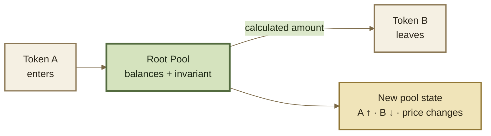

# Swaps

## Swaps

A **swap** exchanges one asset for another using liquidity held in a Root Pool.

The input asset enters the pool, the output asset leaves, and the pool's invariant determines the exchange relationship from its current balances. The Vault accounts for the resulting token movement, while a Router exposes the operation to users and applications.


**The core model:** a swap changes pool inventory. The invariant prices that change; the Vault and Router make it settle.


***

### What a swap changes

Suppose a pool begins with equal balances:

```
before
Token A: 100
Token B: 100
```

A trader swaps Token A for Token B:

```
trade
Token A: +10
Token B: - calculated amount
```

The pool finishes with **more Token A and less Token B**. Because its balances changed, the price implied by the pool also changes.





The exact calculation depends on the pool type. Weighted, Stable, and Custom Pools can use different market mathematics while sharing the same surrounding swap infrastructure.

***

### Exact In and Exact Out

Every swap fixes one side of the trade and calculates the other.



You know exactly how much you want to spend.

```
I will send exactly 100 Token A.
How much Token B will I receive?
```

The input is fixed and the output is calculated. A minimum-output limit protects the trade from executing below an acceptable result.

For conservative rounding, the calculated amount out is rounded **down**.



You know exactly how much you want to receive.

```
I want exactly 100 Token B.
How much Token A must I send?
```

The output is fixed and the required input is calculated. A maximum-input limit protects the trade from spending more than an acceptable amount.

For conservative rounding, the calculated amount in is rounded **up**.



The market is the same in both modes. What changes is **which amount the caller fixes and which amount the protocol must solve for**.

See Exact In & Exact Out.

***

### Price impact and execution limits

A swap does not merely observe a price; it **moves along the pool's pricing curve**.

As the trade consumes one asset and adds another, later units execute against a different balance state than earlier units. The larger the trade relative to usable liquidity, the farther the pool moves along its invariant and the greater the potential price impact.

**Price impact** comes from the trade changing the pool itself. **Slippage tolerance** is different: it is a caller-defined execution limit protecting against a result becoming worse than expected between quoting and execution.


**Quote ≠ guarantee.** A query can estimate a swap against current state without moving tokens. The execution limit determines how much worse the final result may become before the transaction must revert.


See Price Impact & Slippage and Query & Simulate.

***

### Swap fees

Swap fees are charged on the **input side** of the trade.

* **Exact In:** the fee is taken from the specified input amount, and the remaining amount enters the pool's pricing calculation.
* **Exact Out:** the pool calculates the required input, and the applicable fee is added to that input amount.

A pool can use a configured static fee or, where enabled, a dynamically computed fee through a Hook.

Swap-fee economics and fee distribution belong on Fees & LP Returns. Programmable fee logic is covered in Dynamic Fees.

***

### Single-pool and routed swaps

A swap does not have to use only one pool.



The trade uses one Root Pool directly:

```
Token A → Root Pool → Token B
```

The pool calculates one market transition from the input asset to the output asset.



A route can use several pools or conversion steps:

```
Token A → Pool 1 → Token B → Pool 2 → Token C
```

The Batch Router can compose these steps in one transaction. Intermediate token amounts can remain inside Vault accounting as temporary credits and debts instead of being externally transferred after every hop.



This separation matters: **the Router chooses and composes the path; each Root Pool only prices the step that passes through it.**

See Batch & Multihop Swaps and Routers.

***

### After the swap

The pool's new balances imply a new internal price. The pool does not read a global order book to decide what that price should be.

If the resulting price differs meaningfully from other venues, arbitrageurs may trade the difference. Those trades change the balances again and can move the pool back toward the wider market.

***

### Continue

<table data-full-width="true"><thead><tr><th>Page</th><th>What it explains</th></tr></thead><tbody><tr><td><strong>Swap Lifecycle</strong></td><td>How a swap moves through Router, Vault, pool math, Hooks, accounting, and settlement.</td></tr><tr><td><strong>Exact In &#x26; Exact Out</strong></td><td>Fixed and calculated amounts, execution limits, and rounding behavior.</td></tr><tr><td><strong>Batch &#x26; Multihop Swaps</strong></td><td>How several swap steps can be composed into one route.</td></tr><tr><td><strong>Price Impact &#x26; Slippage</strong></td><td>Why trades move pool prices and how execution limits protect callers.</td></tr><tr><td><strong>Query &#x26; Simulate</strong></td><td>How applications estimate an operation before sending a transaction.</td></tr><tr><td><strong>Swap Guide</strong></td><td>How to construct and execute a swap integration.</td></tr></tbody></table>
