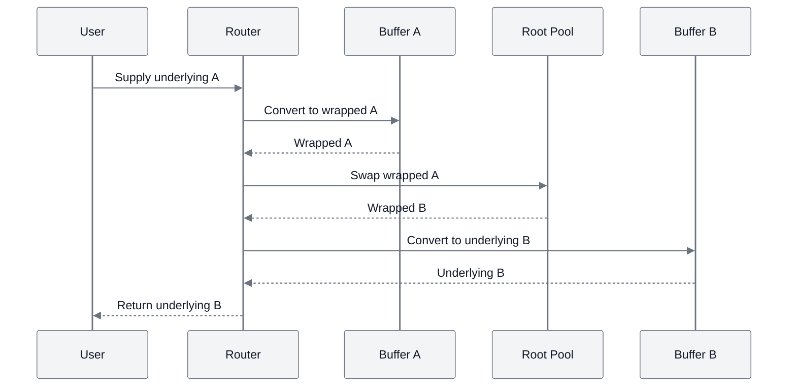

# ERC-4626 Buffers

## ERC-4626 Buffers

An **ERC-4626 buffer** is a Vault-side bridge between an ERC-4626 wrapped token and the asset underneath it.

For example:

```
USDC ↔ wrapped USDC
```

A buffer can keep some of **both forms** available inside the Vault. This lets many routes move between the underlying asset and its wrapped version without calling the external ERC-4626 vault every time.


**The simple idea:** a buffer keeps the underlying asset and its wrapped share close to the market so ROOTSTOCK can move between them efficiently.


***

### First: what is ERC-4626?

ERC-4626 is a standard commonly used for tokenized vaults.

A user deposits an **underlying asset** and receives a **wrapped vault share** representing their position.

Conceptually:

```
underlying asset
      ↓ deposit
ERC-4626 vault
      ↓
wrapped share
```

And in reverse:

```
wrapped share
      ↓ redeem
ERC-4626 vault
      ↓
underlying asset
```

Examples can include lending-vault shares, yield-bearing wrappers, or other tokenized vault positions.

The wrapped token and underlying asset are related, but they are still **different ERC-20 tokens**.

***

### Why buffers exist

Suppose a Root Pool trades wrapped assets, but the user holds the underlying asset.

Without a buffer, the route may need to leave ROOTSTOCK's internal execution path and call the external ERC-4626 vault to create or redeem wrapped shares.

With a funded buffer, the Vault may already have both sides available.

```mermaid
%%{init: {"theme":"base","themeVariables":{"fontFamily":"Inter, ui-sans-serif, system-ui","primaryTextColor":"#111827","lineColor":"#6B7280"}}}%%
flowchart LR
    U["Underlying asset"]
    B["ERC-4626 Buffer"]
    W["Wrapped share"]
    P["Root Pool"]

    U <-->|"convert"| B
    B <-->|"convert"| W
    W <-->|"trade"| P

    classDef asset fill:#FDE68A,stroke:#9A6A16,stroke-width:2px,color:#111827;
    classDef buffer fill:#E8F5E9,stroke:#3F7D4A,stroke-width:3px,color:#111827;
    classDef wrapped fill:#E8F5E9,stroke:#3F7D4A,stroke-width:2px,color:#111827;
    classDef pool fill:#FCE7F3,stroke:#BE4B87,stroke-width:3px,color:#111827;

    class U asset;
    class B buffer;
    class W wrapped;
    class P pool;
```



The buffer is therefore not primarily a market.

It is **conversion infrastructure around a market**.

***

### A buffer is not a Root Pool

This is the most important distinction.

| Root Pool                                  | ERC-4626 Buffer                                  |
| ------------------------------------------ | ------------------------------------------------ |
| Creates an AMM market                      | Connects an underlying asset and wrapped share   |
| Has an invariant or pricing rule           | Uses the ERC-4626 conversion relationship        |
| Facilitates trading between pool assets    | Facilitates wrapping and unwrapping              |
| Issues RPT for pool ownership              | Uses separate internal buffer-share accounting   |
| Can earn swap fees through market activity | Is not itself a swap-fee-generating AMM          |
| Defines market-specific behavior           | Exists inside the Vault as shared infrastructure |


**A buffer is not a small two-token AMM.**

The underlying asset and wrapped share are two representations connected by the ERC-4626 vault, not two independently priced assets being traded through an AMM invariant.


***

### How a buffer handles a conversion

Imagine a route needs to turn USDC into an ERC-4626 wrapped USDC token.

There are two possible situations.



The buffer already holds enough wrapped shares.

```
user supplies USDC
      ↓
buffer receives USDC
      ↓
buffer releases wrapped USDC
      ↓
route continues
```

The external ERC-4626 vault does not need to perform the entire conversion for that step.

This can reduce execution cost.



The buffer does not have enough of the required side.

ROOTSTOCK can use the ERC-4626 wrapper itself to perform the necessary wrap or unwrap operation.

```
user supplies USDC
      ↓
buffer cannot satisfy full conversion
      ↓
ERC-4626 vault performs required wrapping
      ↓
route continues
```

The route still works, but it requires additional external execution and can therefore cost more gas.



An initialized buffer can therefore still facilitate wrapping or unwrapping even when its own reserves are empty.

The reserves are an **optimization**, not the source of the underlying ERC-4626 conversion.

***

### Why buffer liquidity can save gas

Calling an external vault adds work.

Depending on the direction, the ERC-4626 contract may need to process a deposit, mint, withdrawal, or redemption.

A funded buffer can satisfy common conversions from inventory already held inside ROOTSTOCK's Vault.

The difference is conceptually:

```
with available buffer inventory

underlying
    ↓
buffer
    ↓
wrapped
```

instead of:

```
without enough buffer inventory

underlying
    ↓
external ERC-4626 operation
    ↓
wrapped
```

The second path is still valid, but generally requires more external contract interaction.

***

### Buffers make wrapper-based markets easier to use

Buffers become especially useful when a Root Pool itself contains wrapped or yield-bearing assets.

Imagine a market containing:

```
wrapped A ↔ wrapped B
```

A user may only hold:

```
underlying A
```

and may want:

```
underlying B
```

Buffers let the routing layer connect those two worlds.


From the user's perspective, the route can look like:

```
underlying A
      ↓
wrapped A
      ↓
Root Pool trade
      ↓
wrapped B
      ↓
underlying B
```

The Router and Vault coordinate the intermediate conversions.

This is one of the foundations of **boosted-style liquidity**, where the market can primarily hold productive wrapped assets while users can still interact using familiar underlying assets.

***

### Buffers are part of routing

A route can contain different kinds of steps.

For example:

```
Buffer
  ↓
Root Pool
  ↓
Buffer
```

The routing layer needs to know which steps represent normal Pool operations and which represent ERC-4626 buffer conversions.

Conceptually:



The buffer does not replace routing.

It gives the Router another execution primitive it can use inside a larger route.

See Router Types.

***

### Buffer liquidity

Buffers can themselves hold liquidity.

A buffer contains inventory of:

```
underlying asset
+
wrapped ERC-4626 share
```

That inventory makes conversions more likely to complete without reaching into the external ERC-4626 vault.

Initialization establishes the relationship between the wrapped token and its underlying asset.

After initialization, the inherited v3 model restricts normal additions and removals of buffer liquidity to **proportional** operations.

That keeps buffer accounting simpler and avoids turning buffer liquidity management into another source of implicit wrapping or unwrapping.

***

### Buffer shares are not RPT

Someone who supplies buffer liquidity does **not** receive an ordinary Root Pool Token.

Buffers are not Root Pools.

The inherited architecture instead maintains **internal buffer shares**.

```
Root Pool liquidity
      ↓
RPT
      ↓
transferable pool ownership

Buffer liquidity
      ↓
internal buffer shares
      ↓
buffer accounting
```

Buffer shares track how much of the buffer belongs to a liquidity provider, but they are not ordinary transferable pool tokens.

Only the owner of those shares can use them to remove the corresponding buffer liquidity.


**Do not treat buffer shares as RPT.**

They belong to a separate accounting system for Vault infrastructure rather than AMM ownership.


***

### Buffers are infrastructure, not an LP strategy

Providing liquidity to a buffer has a different purpose from providing liquidity to a Root Pool.

A Root Pool LP supplies market inventory and can participate in the economics associated with that market.

A buffer provider supplies **conversion inventory**.

In the inherited architecture, a buffer itself does not create:

* AMM swap fees;
* a separate market;
* RPT ownership;
* an additional yield source simply because assets sit in the buffer.

The main reason to fund one is infrastructural: improving routes, reducing external wrapping operations, and making a wrapped asset easier to use throughout the protocol.

That makes buffers particularly relevant for protocols, DAOs, or other parties that want to improve access to their ERC-4626 asset.

***

### Buffer conversion and Rate Providers are different

ERC-4626 buffers and Rate Providers both relate wrapped assets to another unit, but they perform different jobs.

|                          | ERC-4626 Buffer                           | Rate Provider                                            |
| ------------------------ | ----------------------------------------- | -------------------------------------------------------- |
| **Purpose**              | Move between underlying and wrapped forms | Tell the Vault how a token's value should be interpreted |
| **Holds liquidity**      | Yes, optionally                           | No                                                       |
| **Used for routing**     | Yes                                       | Not as a routing step                                    |
| **Used by Pool scaling** | Not directly                              | Yes, for `WITH_RATE` tokens                              |
| **Performs conversion**  | Yes                                       | No                                                       |

A wrapped asset may use both.

For example:

```
Rate Provider
→ helps the Pool interpret the wrapped token

Buffer
→ helps the Router move between wrapped and underlying forms
```

See Rate Providers and Token Types.

***

### What can go wrong?

A buffer adds convenience, but it does not remove the risks of the underlying system.

Its operation can depend on:

* the ROOTSTOCK Vault;
* the ERC-4626 wrapper;
* the underlying ERC-20 asset;
* the wrapper's conversion behavior;
* available buffer inventory;
* the external vault's deposit and withdrawal behavior;
* limits, pauses, or other restrictions imposed by the external system.

If an external ERC-4626 vault cannot successfully mint, redeem, deposit, or withdraw when required, the fallback conversion may also fail.

Likewise, a malicious or incorrectly implemented wrapper can make the relationship between shares and underlying assets unsafe.


A buffer makes a supported ERC-4626 relationship easier to route through.

It does **not** make the wrapper, underlying protocol, or underlying asset risk-free.


See Token Compatibility.

***

### Buffer configuration is separate from Pool configuration

A Root Pool containing a wrapped token and a buffer for that wrapped token are separate pieces of protocol state.

Conceptually:

```
Root Pool
→ defines the market

Token configuration
→ tells the Vault how the Pool asset is accounted for

Rate Provider
→ reports an external rate when required

ERC-4626 Buffer
→ connects wrapped and underlying forms for execution
```

They can work together, but none of them should be treated as another name for the others.

***

### Deployment status

ERC-4626 buffers are part of the inherited Balancer v3 architecture.

The exact buffers, wrapped assets, Routers, and supported routes available in a ROOTSTOCK deployment should be determined from the current deployment and contract registry.


**Protocol capability is not deployment availability.**

ROOTSTOCK inheriting buffer support does not mean every ERC-4626 token automatically has an initialized and funded buffer.


***

### What to remember

```
ERC-4626 vault
→ defines the underlying ↔ wrapped relationship

Buffer
→ keeps conversion inventory close to ROOTSTOCK

Router
→ uses the buffer inside larger routes

Root Pool
→ trades the market assets
```

A buffer is therefore best understood as a **conversion bridge inside the Vault**.

It lets wrapper-based markets remain focused on their preferred assets while making those markets easier to enter and exit using the underlying tokens users may already hold.

***

### Related pages

* Token Types
* Rate Providers
* Router Types
* Adding & Removing Liquidity
* Token Compatibility
