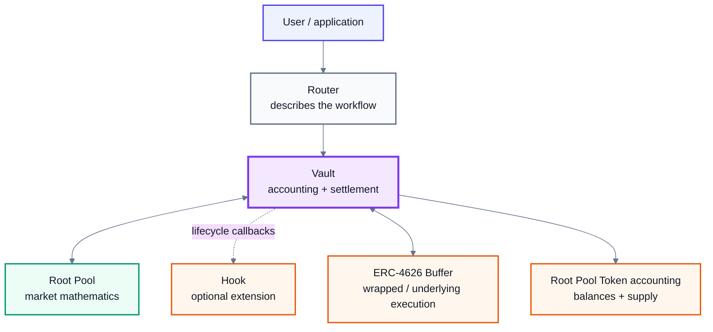
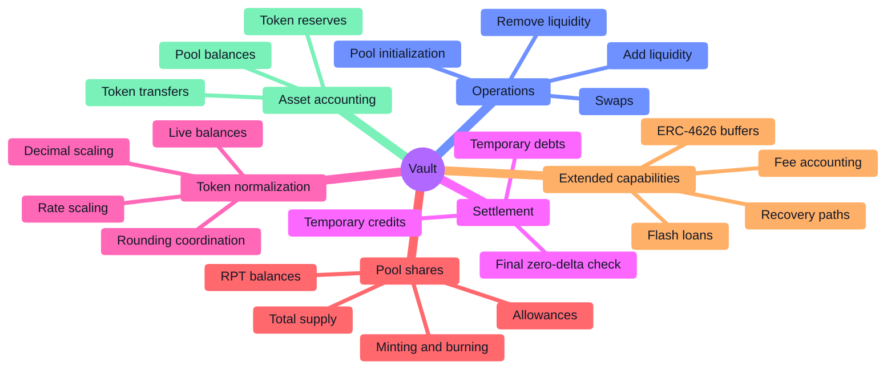
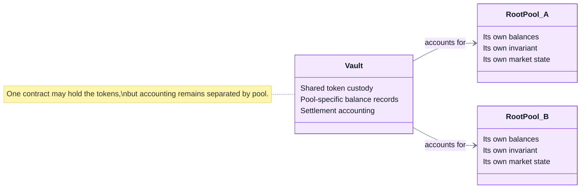
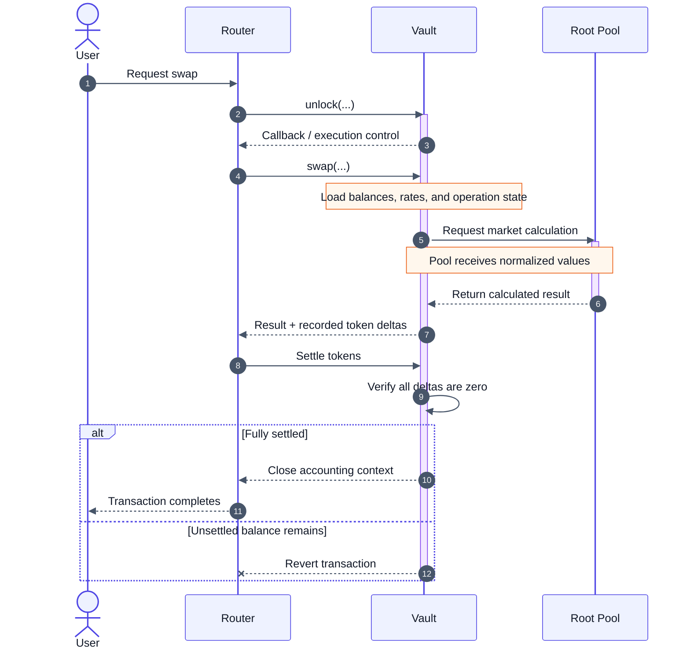
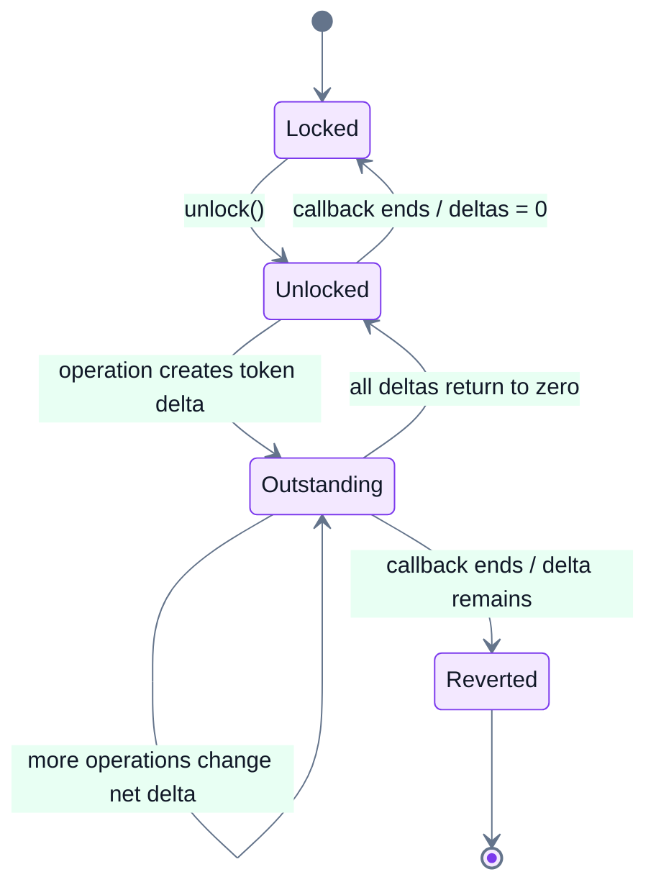

# Rootstock Vaults

## Vault

The **Vault** is ROOTSTOCK's shared accounting and settlement layer.

It holds the assets used by Root Pools, keeps each pool's balances separate, coordinates swaps and liquidity operations, normalizes token values for pool mathematics, tracks temporary credits and debts during transactions, and maintains Root Pool Token accounting.

The important idea is separation of responsibilities:


**Routers describe what the user wants to do. The Vault makes the accounting safe and consistent. Root Pools provide the market-specific mathematics.**


A Root Pool therefore does not need to be a complete exchange system by itself. It can concentrate on the mathematical behavior that makes its market different while using the Vault for common infrastructure.

***

### Why the Vault exists

An AMM has to do much more than calculate a price.

It must also:

* hold and transfer tokens;
* know which assets belong to which pool;
* add and remove liquidity;
* mint and burn pool shares;
* normalize tokens with different decimals;
* account for tokens with external rates;
* apply consistent rounding;
* track fees;
* compose several operations safely;
* verify that every transaction finishes fully settled;
* provide common safety and recovery paths.

If every pool implemented all of this independently, every new market design would also need a new accounting system.

ROOTSTOCK instead places these shared responsibilities in the Vault.





Balancer v2 introduced the shared Vault model. The inherited v3 architecture pushes the separation further: more common liquidity mechanics, token normalization, rounding coordination, pool-share accounting, and transaction settlement live in the shared core rather than being reimplemented by every pool.

***

### The three main layers

For most users, ROOTSTOCK can be understood as three cooperating layers.

<table><thead><tr><th width="140">Layer</th><th>Main responsibility</th></tr></thead><tbody><tr><td><strong>Router</strong></td><td>Turns a user action into a sequence of protocol operations.</td></tr><tr><td><strong>Vault</strong></td><td>Holds assets, tracks balances, applies shared accounting rules, and settles the transaction.</td></tr><tr><td><strong>Root Pool</strong></td><td>Supplies the invariant, swap calculations, and other market-specific mathematics required by the Vault.</td></tr></tbody></table>

Hooks and other extensions can participate around this core flow, but they do not remove these basic boundaries.


**The Vault is not the user interface.** Applications and normal users should generally enter through a Router. Direct Vault interaction is primarily relevant to specialized integrations and protocol-level development.


***

### What the Vault is responsible for

The Vault is easier to understand as a collection of related accounting responsibilities rather than as one giant function.





These responsibilities share one accounting foundation, but they remain separate concepts. Their detailed behavior belongs on their dedicated pages.

***

### Shared Vault does not mean shared pool liquidity

One of the easiest misconceptions is to imagine the Vault as one enormous pool of tokens.

It is not.

The Vault can physically hold the same ERC-20 token for many Root Pools while maintaining **separate accounting for each pool**.





If Pool A and Pool B both contain USDC, the Vault may custody both sets of USDC at the same address. That does **not** mean Pool A can price trades using Pool B's USDC.

Each pool retains its own balance state and its own market mathematics.

Therefore:

> **Shared custody improves composability. It does not merge liquidity or price impact between pools.**

This distinction is fundamental.

***

### How one operation moves through the Vault

Consider a normal swap.

The user sees one action: exchange one token for another.

Internally, several components cooperate.





The same architectural pattern can support swaps, liquidity changes, and more complicated Router workflows.

The Pool is consulted when market-specific mathematics are needed. The Vault surrounds that calculation with the accounting rules necessary to execute it safely.

***

### The Vault speaks two accounting languages

A useful distinction is between **real token balances** and the **normalized values used by pool mathematics**.

#### Raw balances

Raw balances represent actual ERC-20 token quantities in their native units.

For example:

* USDC normally uses 6 decimals;
* an 18-decimal token uses 18 decimals;
* a yield-bearing token may also represent a changing amount of some underlying asset.

These formats are inconvenient for generic pool mathematics.

#### Normalized values

Before values are passed into inherited v3 pool mathematics, the Vault can transform them into a common representation.

The basic path is:

```
raw token amount
        ↓
decimal scaling
        ↓
18-decimal fixed-point value
        ↓
rate scaling, when configured
        ↓
yield-fee adjustment, when applicable
        ↓
live balance
        ↓
Root Pool mathematics
```

Balancer v3 calls 18-decimal normalized values `scaled18`.

A **live balance** is a pool balance after the relevant decimal scaling, rate scaling, and applicable yield-fee adjustment have been applied.

The practical consequence is important:

> A Root Pool does not need to independently solve token-decimal and rate-normalization problems every time it performs its core mathematics.

See Token Scaling and Rate Providers.

***

### The Vault also coordinates rounding

Fixed-point arithmetic cannot represent every mathematical result exactly.

Something eventually has to decide whether a result rounds up or down.

In the inherited v3 design, rounding is coordinated by the Vault because the Vault knows **which operation is occurring** and therefore which direction protects pool accounting.

The general user-facing principle is:

* amounts **received** by the caller are rounded down;
* amounts **paid or burned** by the caller are rounded up.

For custom pool mathematics, the pool still has to implement its mathematical primitives correctly. But the surrounding operation and required rounding direction are coordinated by the shared execution layer.

This is another reason the Vault is more than a token custodian.

See Rounding & Invariant Approximation.

***

### Transient accounting

Traditional accounting might transfer tokens after every individual action.

The inherited v3 Vault can instead keep a temporary record of what is **owed to** or **owed by** the Vault while a transaction is executing.

Think of it as opening a tab.

```
Vault interaction begins
        ↓
temporary accounting tab opens
        ↓
operations create credits and debts
        ↓
credits and debts can offset one another
        ↓
remaining balances are settled
        ↓
tab must equal zero
        ↓
interaction may close
```

This is called **transient accounting**.

#### Why it matters

Suppose a composed operation creates these effects for token A:

| Stage                                 | Remaining obligation |
| ------------------------------------- | -------------------: |
| Vault sends 100 A during an operation |           100 A owed |
| Another operation returns 70 A        |            30 A owed |
| Another operation returns 20 A        |            10 A owed |
| Final settlement transfers 10 A       |              **0 A** |

There was no reason to settle the full 100 A after the first step if subsequent operations were going to offset most of it.

Only the final net position matters.

***

### The settlement invariant

The entire transient-accounting model reduces to one critical rule:


**Before the outer Vault interaction can finish, every tracked token delta must be zero.**


Conceptually, for every tracked token (t):

\[ \Delta\_t = 0 ]

The lifecycle can be represented as a state machine:





If the interaction reaches its end while a non-zero token delta remains, the transaction reverts.

This lets Routers compose complex operations without removing the fundamental accounting guarantee.

See Accounting & Settlement.

***

### Why this helps multistep transactions

Transient accounting becomes particularly useful when several actions touch the same assets.

For example, imagine a route:

```
Token A → Token B → Token C
```

The intermediate Token B may be produced by one operation and consumed by the next.

The protocol does not necessarily need to treat each intermediate stage as an independent user transfer. The Vault can account for the operations inside one atomic transaction and settle the final net token positions.

That makes the Vault an important foundation for:

* multihop swaps;
* batch operations;
* Router-composed workflows;
* liquidity operations combined with other actions;
* flash-loan-style execution.

The detailed routing behavior belongs in Routing & Routers and the Router pages.

***

### Root Pool Token accounting

The Vault does not only account for the assets **inside** Root Pools.

The inherited v3 architecture also centralizes accounting for the **shares representing ownership of those pools**.

In ROOTSTOCK terminology, these are **Root Pool Tokens (RPTs)**.

At a conceptual level, the shared accounting system keeps track of:

* each holder's RPT balance;
* allowances;
* total RPT supply;
* minting when liquidity creates pool shares;
* burning when pool shares are redeemed.

The pool-token surface remains ERC-20 compatible, while the critical accounting state is coordinated through the Vault.

This allows pool asset balances and pool-share state to change atomically as part of the same operation.

For example:

```
add liquidity
     ↓
pool asset balances increase
     +
RPT supply / holder balance increases
     ↓
both changes complete together
```

The inverse occurs when liquidity is removed.

The exact RPT mechanics belong on the **Root Pool Tokens** page.

***

### Vault accounting versus pool mathematics

The boundary is worth making explicit.

#### The Vault knows

* which operation is running;
* which pool is involved;
* the pool's registered tokens;
* raw pool balances;
* normalized live balances;
* temporary transaction deltas;
* pool-share accounting;
* shared fee and settlement state;
* the surrounding rounding requirements.

#### The Root Pool knows

* its invariant;
* how its market responds to balance changes;
* its pool-specific swap mathematics;
* the mathematical primitives required by the Vault.

Neither layer replaces the other.

A sophisticated custom pool can introduce completely different market behavior without having to replace the common accounting system.

That is the central extensibility advantage of the architecture.

***

### ERC-4626 buffers are not Root Pools

The inherited Vault also contains a separate mechanism for **ERC-4626 liquidity buffers**.

A buffer connects:

* an ERC-4626 underlying asset; and
* its wrapped ERC-4626 share token.

Buffers can help the Vault move between the two representations during composed operations.


**A buffer is not a Root Pool.** It does not have an AMM invariant, and its internal liquidity shares are not ordinary Root Pool Tokens.


Keeping this distinction clear matters because pool liquidity and buffer liquidity follow different accounting models.

See ERC-4626 Buffers.

***

### Fees belong around the operation

Because the Vault coordinates shared execution state, the inherited architecture also places important fee accounting around Vault operations.

This includes concepts such as:

* swap fees;
* protocol portions of fees;
* pool-creator portions where configured;
* yield fees for eligible rate-bearing tokens.

The Vault overview does not need the exact percentage formulas or permission structure. Those belong on the relevant fee, pool-configuration, and Developer Reference pages.

The important concept here is that **fee accounting is part of the common execution environment rather than something every pool has to reinvent independently**.

***

### Safety and recovery

The Vault is also part of the protocol's safety boundary.

The inherited v3 architecture includes shared mechanisms for pausing affected operations and a recovery-liquidity path designed to preserve proportional withdrawal capability under emergency conditions.

Those controls should not be interpreted as ordinary user workflows. Their permissions, time windows, and exact deployment configuration belong under **Security** and **Emergency Controls**.

The conceptual point is simpler:

> Shared accounting also creates a shared place to enforce protocol-wide safety invariants.

***

### Token compatibility

The Vault's accounting model assumes compatible token behavior.

The inherited v3 design is built around standard ERC-20 tokens and explicitly treats several behaviors as incompatible with direct pool accounting, including:

* tokens whose balances change asynchronously through rebasing;
* double-entry-point token behavior;
* pool tokens using more than 18 decimals.

Rate-bearing assets are handled differently. Compatible tokens can be registered with external Rate Providers so the Vault can incorporate their exchange rate into normalized pool values.

A wrapper can sometimes convert an otherwise incompatible asset into a representation suitable for the Vault, but wrapping does not automatically make an asset safe.

See Token Types and Token Compatibility.

***

### What the Vault is not

The name can make the Vault sound simpler—or broader—than it actually is.

**It is not one giant liquidity pool.**\
Balances remain attributed to individual Root Pools.

**It does not define every market's pricing curve.**\
Root Pools provide their own market mathematics.

**It is not normally the user's entry point.**\
Routers expose the workflows users and applications generally call.

**It does not make arbitrary ERC-20 behavior safe.**\
Tokens still have compatibility requirements.

**It does not eliminate settlement.**\
Transient accounting delays intermediate settlement; it does not remove the requirement that everything ultimately balances.

**It does not make all Root Pools economically identical.**\
Pools share infrastructure, not necessarily invariants, weights, fee settings, hooks, assets, or risk.

***

### A compact model

The Vault can be remembered as four connected jobs:

```
CUSTODY
Where are the tokens?
        ↓
ACCOUNTING
Which pool owns what?
        ↓
EXECUTION
What changed during this operation?
        ↓
SETTLEMENT
Has every obligation returned to zero?
```

Pool mathematics answers a different question:

```
Given this market's rules and balances,
what should the result be?
```

ROOTSTOCK separates those questions deliberately.


**The Vault provides one accounting system for many possible markets. Root Pools provide the mathematics that make those markets different.**


***

### Related pages

* Accounting & Settlement
* Token Types
* Token Scaling
* Rate Providers
* Rounding & Invariant Approximation
* ERC-4626 Buffers
* Token Compatibility
* Vault API
