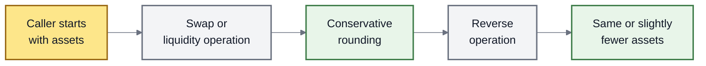
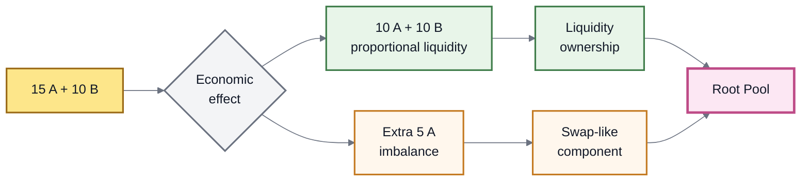

# Rounding & Invariant Approximation

## Rounding & Invariant Approximation

AMMs perform calculations using integers, but markets do not always produce perfectly divisible numbers.

A swap might mathematically return something like:

```
4.376829... tokens
```

while the token itself can only represent a finite number of decimal places.

ROOTSTOCK therefore needs rules for deciding **which way tiny numerical differences are rounded**.

The same problem appears at a larger scale when liquidity is added or removed unevenly. A non-proportional liquidity operation partly behaves like a trade, so the protocol needs a consistent way to price that hidden swap-like component.

These two mechanisms serve the same broader purpose:


**Different paths through a Root Pool should not create free value simply because of rounding or because a trade was expressed as a liquidity operation.**


***

### Why rounding matters

Suppose a calculation says a user should receive:

```
10.123456789... tokens
```

The blockchain eventually needs an exact integer amount in the token's smallest unit.

Something has to happen to the remaining fraction.

That difference is usually tiny.

But AMMs process many operations, and attackers can deliberately repeat transactions looking for small mathematical advantages.

A rounding error that consistently benefits the caller can therefore become an economic vulnerability.

***

### The basic rounding rule

The inherited v3 model follows one simple principle:


**If the caller receives something, round down.**

**If the caller pays or burns something, round up.**


This slightly favors the Pool whenever an exact result cannot be represented.

| Operation                   | What the caller fixes | What is rounded                |
| --------------------------- | --------------------- | ------------------------------ |
| **Exact-in swap**           | Amount paid           | Output rounds **down**         |
| **Exact-out swap**          | Amount received       | Input rounds **up**            |
| **Add liquidity**           | Tokens supplied       | RPT received rounds **down**   |
| **Add for exact RPT**       | RPT to receive        | Token input rounds **up**      |
| **Remove liquidity**        | RPT supplied          | Tokens received round **down** |
| **Remove for exact tokens** | Tokens to receive     | RPT burned rounds **up**       |

The differences are intended to be extremely small. The purpose is protection, not fee generation.

***

### Why favor the Pool?

Because opposite operations can be chained together.

For example:

```
Token A
   ↓
swap
   ↓
Token B
   ↓
swap back
   ↓
Token A
```

If both calculations rounded in the caller's favor, someone could potentially repeat the cycle and slowly extract value without taking genuine market risk.

Instead, ROOTSTOCK inherits the opposite rule:





A round trip should therefore return the same amount or slightly less—not more merely because of numerical precision.

The tiny residual remains with Pool liquidity.

***

### Rounding happens around Pool math

The Root Pool defines the market mathematics.

The Vault knows **which operation is being performed**.

That distinction matters because the correct rounding direction depends on whether a calculated value is being paid or received.

Conceptually:

```
Vault
  ↓
knows the operation
  ↓
chooses the safe rounding direction
  ↓
Root Pool performs its market math
  ↓
Vault completes the operation
```

This lets many different Root Pools share one consistent safety convention.

Custom Pools still have an important responsibility here: when the Vault asks the Pool to calculate its invariant in a particular direction, the Pool must respect that instruction.

More on that below.

***

## Liquidity Invariant Approximation

Rounding protects individual calculations.

**Liquidity invariant approximation** solves a related problem involving entire liquidity operations.

To understand it, first separate two ways of adding liquidity.

***

### Proportional liquidity is simple

Imagine a 50/50 Pool containing equal values of Token A and Token B.

A proportional deposit might look like:

```
10 A + 10 B
```

Both sides increase together.

The Pool becomes larger, but its relative composition does not meaningfully change.

```
before
A ██████████
B ██████████

add
A ++
B ++

after
A ████████████
B ████████████
```

This is primarily a **liquidity change**.

***

### Unbalanced liquidity also changes the market

Now suppose the same Pool receives:

```
15 A + 10 B
```

The extra Token A changes the Pool's relative inventory.

That imbalance has an economic effect similar to trading Token A against Token B.

A useful mental model is:





The exact decomposition depends on the Pool and its invariant.

The important idea is simpler:

> **Non-proportional liquidity contains a swap-like economic effect.**

***

### Why this needs special treatment

Without accounting for that effect, a user might be able to trade indirectly through liquidity operations.

Imagine two routes that create roughly the same change in Pool inventory:



```
provide proportional liquidity
        +
perform a swap
```

The swap portion is priced by the market and can incur a swap fee.



```
provide liquidity unevenly
```

Part of the operation changes Pool composition in a swap-like way.

That component should not receive better economics merely because it was packaged as a liquidity operation.



If these paths were treated inconsistently, liquidity operations could become a way to bypass normal swap economics.

***

### What invariant approximation does

ROOTSTOCK inherits Balancer v3's generalized liquidity machinery.

Instead of every Pool inventing entirely separate mathematics for every add/remove-liquidity mode, the Vault can use the Pool's **invariant** to reason about how much its overall liquidity state changed.

For a new reader, an invariant can be thought of as:

> **the Pool's mathematical measure of its current market state.**

Different Root Pools can use different invariants, but changes in that invariant provide the Vault with a common way to reason about liquidity changes.

For an unbalanced operation, the Vault uses this information to separate the economic effects of:

```
changing the size of the Pool
        +
changing the Pool's relative inventory
```

The second part is treated as swap-like.

***

### The fairness goal

The approximation is designed so that economically similar paths remain economically consistent.

Three properties matter most.

#### 1. No cheaper hidden swap

A user should not gain an advantage by expressing a trade through an unbalanced liquidity operation instead of using the swap path.

#### 2. Correct RPT ownership

The amount of RPT minted or burned should correspond to the liquidity value actually added or removed.

An imbalance should not let someone claim more Pool ownership than their contribution justifies.

#### 3. Similar paths should produce similar outcomes

Consider:

```
Route A
unbalanced liquidity operation
```

versus:

```
Route B
proportional liquidity
+
equivalent direct swap
```

The results should be economically close, while the indirect liquidity route must not become more favorable simply because of approximation or rounding.


**Same economic transformation → consistent economic treatment.**


***

### Why is it called an approximation?

Different AMMs use different invariants.

Weighted Pools, Stable Pools, and Custom Pools do not all respond to changing balances in exactly the same way.

The Vault therefore uses the invariant and Pool-supplied mathematical primitives to generalize liquidity operations across different Pool designs.

The indirect swap represented by an unbalanced liquidity operation is not literally executed as a separate swap transaction.

Instead, its economic effect is **approximated through the change in Pool state**.

Small numerical differences can remain because fixed-point arithmetic and different invariants are not perfectly continuous.

The protocol therefore aims for:

```
economically consistent
+
conservative
+
very close
```

rather than pretending every possible route is mathematically identical down to the final smallest token unit.

***

### Swap fees apply to the imbalance

The proportional part of a normal liquidity addition is not a trade.

The non-proportional part is different because it changes relative inventory.

Conceptually:

```
Proportional portion
        ↓
liquidity

Imbalanced portion
        ↓
swap-like activity
        ↓
swap-fee treatment
```

This prevents a user from using liquidity operations as a free alternative to swapping.

The exact fee calculation belongs on Fees & LP Returns.

***

### Rounding and approximation work together

These mechanisms protect different layers of the same system.

| Mechanism                   | Protects against                                               |
| --------------------------- | -------------------------------------------------------------- |
| **Rounding direction**      | Extracting value from tiny numerical errors                    |
| **Invariant approximation** | Extracting value by disguising swap-like activity as liquidity |
| **RPT mint/burn rules**     | Receiving too much ownership or surrendering too little        |
| **Swap-fee treatment**      | Avoiding the economics of an equivalent trade                  |

Together they protect the relationship between:

```
tokens
↕
market state
↕
RPT ownership
```

***

### For Custom Pool builders

Most users do not need to think about the implementation details behind this machinery.

Custom Pool developers do.

A Custom Pool supplies the market-specific mathematics that the Vault relies on. In particular, the inherited v3 interface uses two important primitives:

* **`computeInvariant`** — measures the Pool's invariant for its current balances;
* **`computeBalance`** — determines the balance required when the invariant changes by a given amount.

The Vault uses these primitives to support generalized liquidity operations.


A Custom Pool can implement mathematically plausible formulas and still be unsafe if its rounding or invariant behavior is inconsistent with the Vault.

Custom Pool testing must check the economics of complete operation paths—not only whether individual formulas return expected values.


A useful test is to compare:

```
unbalanced liquidity
```

against:

```
proportional liquidity
+
equivalent swap
```

across many balances, fee levels, and trade sizes.

The inherited Balancer v3 test suite performs this kind of comparison for its supported Pool mathematics.

See Custom Pools.

***

### What to remember

Rounding and invariant approximation sound like low-level mathematical details, but their purpose is straightforward.

```
Rounding
→ tiny numerical errors must not favor the caller

Invariant approximation
→ hidden swaps must not receive better treatment than direct swaps

Together
→ different paths through the Pool remain economically coherent
```

ROOTSTOCK can therefore support shared swap and liquidity machinery across different Root Pool designs without letting arithmetic precision or transaction shape become a source of free value.

***

### Related pages

* Adding & Removing Liquidity
* Fees & LP Returns
* Root Pool Tokens
* Custom Pools
* Token Scaling
* Security Model
