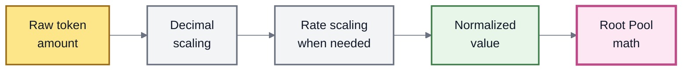
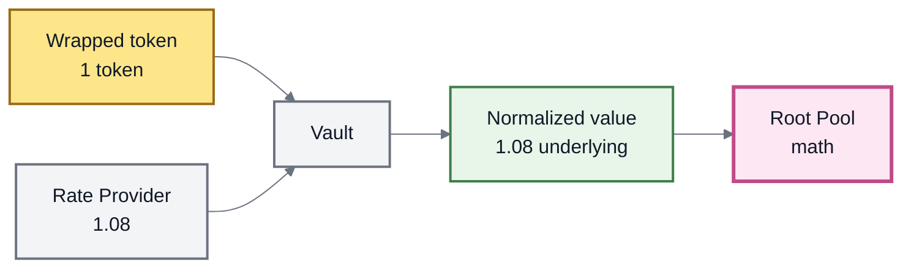
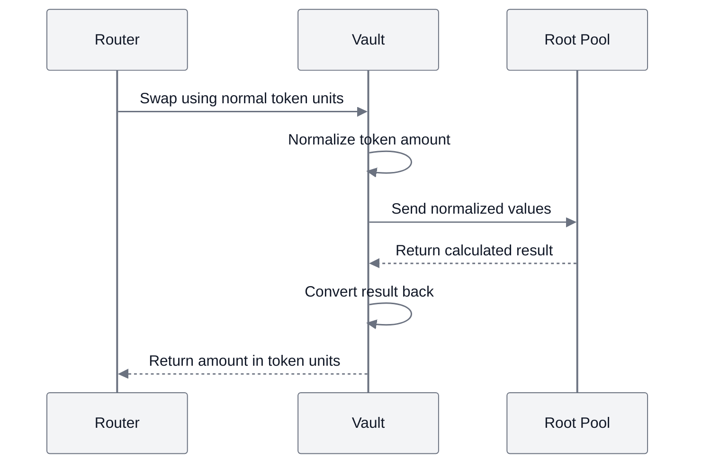

# Token Scaling

## Token Scaling

Different tokens can represent their amounts in different ways.

For example, USDC uses **6 decimals**, while many other ERC-20 tokens use **18 decimals**. Some wrapped or yield-bearing tokens also have a changing exchange rate to another asset.

That creates a problem for an AMM: **how can one Pool perform consistent mathematics when its tokens use different numerical formats?**

ROOTSTOCK solves this in the Vault through **token scaling**.


**The simple idea:** the Vault translates different token formats into one common format before Root Pool math runs.


***

### Why scaling exists

Imagine a Pool with two tokens:

```
Token A → 6 decimals
Token B → 18 decimals
```

One whole unit of Token A may be stored as:

```
1,000,000
```

while one whole unit of Token B is stored as:

```
1,000,000,000,000,000,000
```

Both mean **1 token**, but the raw numbers are very different.

A Root Pool should not have to repeatedly account for these differences itself.

Instead, the Vault normalizes token values first.





There are two main kinds of scaling:

1. **decimal scaling** — puts token amounts into the same numerical format;
2. **rate scaling** — accounts for an external exchange rate when a token requires one.

***

### Decimal scaling

The Vault normalizes supported token amounts to **18 decimals** before they are passed into Root Pool mathematics.

Balancer v3 refers to values in this format as **`scaled18`**.

A simple example makes this easier to see.

#### A 6-decimal token

One token is represented as:

```
1,000,000
```

To express it using 18 decimals, the Vault fills the 12-decimal difference:

```
1,000,000
    ↓
scale from 6 decimals to 18
    ↓
1,000,000,000,000,000,000
```

#### An 18-decimal token

One token is already represented as:

```
1,000,000,000,000,000,000
```

No decimal expansion is needed.

After normalization:

| Token   | Native decimals | Raw representation of 1 token | `scaled18` representation |
| ------- | --------------: | ----------------------------: | ------------------------: |
| Token A |               6 |                   `1,000,000` |                    `1e18` |
| Token B |              18 |                        `1e18` |                    `1e18` |

The Root Pool can now work with both using the same convention.


**Scaling does not change how many tokens exist.**

It only changes how the amount is represented while ROOTSTOCK performs its internal calculations.


***

### Rate scaling

Decimals are only one part of the problem.

Some tokens represent a changing amount of another asset.

Consider a wrapped token:

```
Today
1 wrapped token = 1.00 underlying

Later
1 wrapped token = 1.08 underlying
```

A wallet can still hold exactly:

```
1 wrapped token
```

but what that token represents has changed.

For tokens registered as `WITH_RATE`, the Vault uses a **Rate Provider** to account for this relationship.





The raw token balance did not change.

Its **rate-adjusted value** did.

This lets compatible Root Pools work with the token's current relationship to its reference asset rather than relying only on the nominal ERC-20 balance.

See Rate Providers.

***

### Decimal scaling and rate scaling are different

These transformations solve different problems.

|                | Decimal scaling                      | Rate scaling                                         |
| -------------- | ------------------------------------ | ---------------------------------------------------- |
| **Problem**    | Tokens use different decimal formats | A token represents a changing amount of another unit |
| **Example**    | 6 decimals vs. 18 decimals           | 1 wrapper becomes worth 1.08 underlying              |
| **Applied to** | Every supported pool token           | Tokens configured as `WITH_RATE`                     |
| **Purpose**    | Common numerical representation      | Account for the configured exchange rate             |

A token can need decimal scaling without needing rate scaling.

***

### `STANDARD` and `WITH_RATE`

A token's registered **Token Type** determines whether an external rate is part of its scaling.



A `STANDARD` token does not use an external Rate Provider.

Its path is simple:

```
raw amount
    ↓
decimal scaling
    ↓
scaled18
    ↓
Root Pool math
```

For rate-scaling purposes, its rate is treated as **1**.



A `WITH_RATE` token has a configured Rate Provider.

Its path includes an additional transformation:

```
raw amount
    ↓
decimal scaling
    ↓
rate scaling
    ↓
normalized value
    ↓
Root Pool math
```

The Vault incorporates the reported rate before the value reaches the Pool.



See Token Types.

***

### Live balances

ROOTSTOCK inherits another useful v3 concept: **live balances**.

A raw balance tells the Vault how many token units belong to a Pool.

A live balance is the normalized value prepared for Pool mathematics.

Conceptually:

```
Raw balance
    ↓
Decimal scaling
    ↓
Rate scaling, if configured
    ↓
Applicable yield-fee adjustment
    ↓
Live balance
```

So these two ideas should not be confused:

```
Raw balance
= token amount held in Vault accounting

Live balance
= normalized pool-facing value
```

For a simple `STANDARD` token, the difference may be mostly representational.

For a rate-bearing token, the difference can be economically meaningful.


**Root Pools receive live, normalized balances so they can focus on market mathematics instead of rebuilding token-conversion logic.**


***

### What happens during a swap?

Users do not need to calculate scaled values themselves.

They continue to swap normal ERC-20 amounts.

The Vault handles the translation around the Root Pool.





The important boundary is:

```
User / token world
        ↓
      Vault
        ↓
normalized math world
        ↓
    Root Pool
        ↓
      Vault
        ↓
User / token world
```

The Pool does not need to know how every ERC-20 chooses to represent its raw units.

***

### Scaling also applies to liquidity

The same idea applies when liquidity is added or removed.

The Vault normalizes the relevant token amounts before Root Pool calculations and converts the results back afterward.

This means common operations can work across Pools containing tokens with different decimal formats and, where configured, different rates.

***

### Why scaling lives in the Vault

Without centralized scaling, every custom Root Pool would need to reproduce the same machinery.

Each Pool would need to understand:

* token decimals;
* decimal conversion;
* external rates;
* conversion back to native units;
* consistent rounding around those conversions.

ROOTSTOCK instead keeps these shared concerns in the Vault.

That produces a cleaner separation:

| Vault                   | Root Pool                         |
| ----------------------- | --------------------------------- |
| Normalize token amounts | Define market mathematics         |
| Apply configured rates  | Calculate swaps                   |
| Maintain live balances  | Apply its invariant               |
| Convert values back     | Determine market-specific results |

This is the same architectural principle used throughout ROOTSTOCK:

> **shared mechanics belong in the Vault; market-specific mathematics belong in the Pool.**

***

### Scaling and rounding

Scaling sometimes requires division, and blockchain arithmetic cannot always represent every fractional result exactly.

Some values therefore need to be rounded.

The inherited v3 Vault handles the required rounding direction around these conversions so each Root Pool does not invent its own policy.

The important point here is simply:

```
normalize
    ↓
calculate
    ↓
convert back
    ↓
round consistently
```

The detailed rules belong on Rounding & Invariant Approximation.

***

### Scaling has limits

Scaling makes compatible tokens easier to use inside AMM mathematics.

It does **not** make every ERC-20 compatible with the Vault.

For example:

* tokens with more than 18 decimals are not supported by the inherited scaling model;
* unusual balance-changing behavior can still be incompatible;
* a `WITH_RATE` token depends on the correctness of its Rate Provider.


**Normalization is not a safety check.**

A token can be easy to scale and still be unsafe or incompatible for other reasons.


See Token Compatibility.

***

### The complete picture

Token scaling is the translation layer between ERC-20 tokens and Root Pool mathematics.

```
Token amount
    ↓
Decimal scaling
    ↓
Rate scaling when configured
    ↓
Live normalized balance
    ↓
Root Pool mathematics
    ↓
Convert result back
    ↓
Token amount
```

The result is simple:

**tokens can use different representations while Root Pools share one consistent mathematical environment.**

***

### Related pages

* Token Types
* Rate Providers
* Rounding & Invariant Approximation
* Token Compatibility
