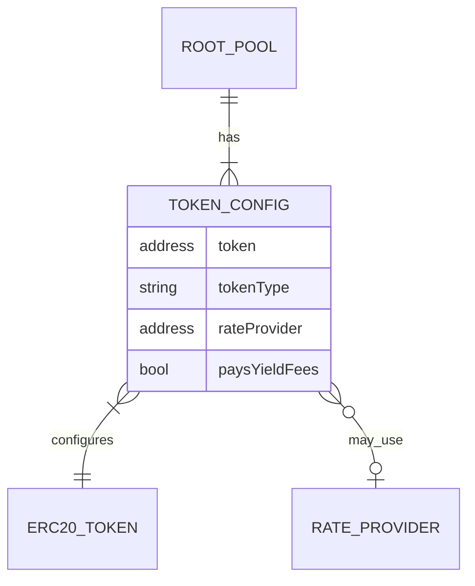
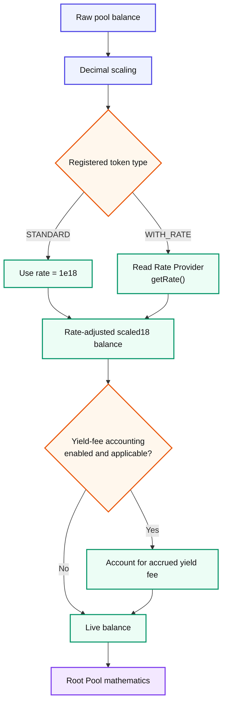
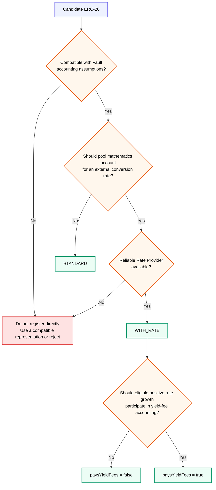

# Token Types

## Token Types

The Vault needs to know more than **which ERC-20 token** a Root Pool contains.

It also needs to know **how that token's unit should be interpreted when the pool performs its mathematics**.

The inherited v3 model therefore gives each registered pool token one of two accounting types:

* `STANDARD`
* `WITH_RATE`


**Token type answers one question:** should the Vault treat one token unit directly as itself, or first translate it through an external exchange rate?


This classification affects the normalized values the Vault supplies to Root Pool mathematics.

***

### Token type is pool configuration

A token type is not permanently attached to the ERC-20 contract.

It is part of the token configuration created when that token is registered inside a particular Root Pool.

Conceptually, each registration contains:

```
token
token type
Rate Provider
pays yield fees?
```





This distinction matters because several different ideas are otherwise easy to collapse together:

```
token address
      ≠
token type
      ≠
Rate Provider
      ≠
yield-fee setting
      ≠
token safety
```

They are related, but they answer different questions.

***

### The two token types



A `STANDARD` token does **not** use an external Rate Provider in Vault accounting.

Conceptually:

```
tokenType      = STANDARD
rateProvider   = none
paysYieldFees  = false
effective rate = 1
```

The Vault still performs normal **decimal scaling**. `STANDARD` does not mean that the raw token amount is passed directly into pool mathematics.

Instead, it means that after accounting for decimals, the Vault does not apply an additional external exchange-rate conversion.

Typical candidates are compatible ERC-20 assets whose own unit is already the unit the Root Pool intends to use for its mathematics.



A `WITH_RATE` token has an external relationship to another unit that the AMM should consider.

Its registration references a **Rate Provider**.

Conceptually:

```
tokenType      = WITH_RATE
rateProvider   = required
paysYieldFees  = true or false
effective rate = Rate Provider result
```

The upstream v3 example is **wstETH**. wstETH itself does not rebase, but one wstETH represents a changing amount of stETH as staking rewards accumulate.

A `WITH_RATE` configuration lets the Vault account for that changing relationship without requiring the Root Pool to reproduce the Rate Provider logic itself.



***

### How the Vault interprets the two types

Both token types go through decimal normalization.

The difference appears when the Vault determines the token's rate.





The resulting normalized balances are called **live balances** in the inherited architecture.

A live balance reflects the token's relevant:

1. decimal scaling;
2. rate scaling; and
3. applicable yield-fee adjustment.

Root Pools therefore receive a more uniform mathematical representation even when their underlying ERC-20 tokens use different decimals or represent different economic units.

See Token Scaling.

***

### Why a rate can matter

Consider a non-rebasing wrapper whose relationship to its underlying asset changes over time.

At first:

```
1 wrapped token = 1.00 underlying
```

Later:

```
1 wrapped token = 1.08 underlying
```

The ERC-20 balance might still say:

```
100 wrapped tokens
```

but economically those tokens now represent:

```
108 underlying
```

These are two different quantities:

```
token balance        = 100 wrapped
economic reference   = 108 underlying
```

A Root Pool that is designed to reason about the underlying economic unit may need the second quantity rather than blindly treating the wrapper's nominal balance as unchanged.

`WITH_RATE` provides the translation layer.

***

### Rate scaling does not create yield

The Rate Provider does not generate the token's growth.

It only reports a relationship that already exists elsewhere.

```
underlying protocol
        ↓
economic state changes
        ↓
wrapper / asset exchange rate changes
        ↓
Rate Provider reports the relationship
        ↓
Vault incorporates the rate
        ↓
Root Pool receives normalized values
```

For a staking wrapper, for example, staking rewards occur in the staking system.

The Rate Provider merely communicates the wrapper-to-underlying relationship to the Vault.

***

### A rate is not automatically a market price

`WITH_RATE` should not be read as:

> "This token has an oracle price."

A v3 Rate Provider exposes a general `getRate()` interface returning an **18-decimal fixed-point exchange rate between related units**.

What that rate means depends on the asset and the pool design.

Examples can include:

* wrapped asset → underlying asset;
* vault share → underlying asset;
* one accounting unit → another reference unit.

A Rate Provider therefore needs an explicitly understood semantic meaning.


**Do not treat an arbitrary price feed as interchangeable with a Rate Provider.**

The Root Pool's mathematics must actually be designed to interpret the reported relationship correctly.


See Rate Providers.

***

### Why ignoring an important rate can leak value

Suppose two economically related assets are intended to trade around parity **after accounting for their conversion rates**.

If one asset's conversion rate rises but the AMM continues treating its nominal token amount as unchanged, its internal accounting can lag behind its economic value.

External traders can then trade against that stale relationship.

The resulting arbitrage does not create the underlying yield. It can instead determine **who captures the value created elsewhere**.

Rate-aware accounting lets compatible pool designs incorporate the changing relationship directly into their normalized balances.


This does not mean every asset with a changing market price should be `WITH_RATE`.

`WITH_RATE` is for an exchange-rate relationship the Root Pool intentionally uses in its accounting model.


***

### Rate Provider risk becomes pool risk

A `WITH_RATE` token adds an external dependency.

The Root Pool is no longer relying only on:

```
token contract
+
Vault
+
pool mathematics
```

It also depends on:

```
Rate Provider
```

If the Rate Provider:

* returns an incorrect value;
* becomes manipulable;
* reverts;
* uses the wrong reference unit;
* changes semantics after an upgrade;

then the normalized values used by the pool can become incorrect or unavailable.

That makes Rate Provider selection part of the pool's **trust and security surface**, not merely metadata.

The detailed requirements belong on Rate Providers.

***

### `WITH_RATE` does not mean "pays yield fees"

These are separate configuration choices.

The inherited v3 model permits:

```
WITH_RATE + paysYieldFees = false
```

and:

```
WITH_RATE + paysYieldFees = true
```

A token needs a Rate Provider because its rate matters to accounting.

Whether positive rate growth is also subject to the protocol's yield-fee mechanism is another question.

By contrast, inherited v3 validation expects a `STANDARD` token to have:

```
rateProvider  = none
paysYieldFees = false
```

So the hierarchy is:

```
Does accounting require an external rate?
        │
        ├── No  → STANDARD
        │
        └── Yes → WITH_RATE
                    │
                    └── Separately decide whether
                        eligible rate growth pays yield fees
```

ROOTSTOCK's actual fee percentages and enabled fee policy are deployment state and should not be inferred from historical Balancer settings.

See Fees & LP Returns.

***

### Token type is not token compatibility

A token fitting conceptually into `STANDARD` or `WITH_RATE` does **not** establish that the token is safe for the Vault.

Token compatibility is a broader problem.

For example, the accounting model may need to consider:

| Question                                                                  | Why it matters                                                              |
| ------------------------------------------------------------------------- | --------------------------------------------------------------------------- |
| **Can the balance change without a normal transfer?**                     | Vault accounting may become stale.                                          |
| **Does transferring X actually move X?**                                  | Fee-on-transfer or unusual transfer logic can break accounting assumptions. |
| **Can the same balance be accessed through multiple token entry points?** | This can break assumptions about independently accounted assets.            |
| **Can transfers invoke unexpected external behavior?**                    | Callback or hook behavior expands the execution surface.                    |
| **Is the contract upgradeable or pausable?**                              | Behavior can change after pool creation.                                    |
| **Does it depend on a bridge or custodian?**                              | External trust remains even if the ERC-20 mechanics are compatible.         |
| **Does a Rate Provider exist and remain trustworthy?**                    | `WITH_RATE` accounting depends on it.                                       |

The inherited v3 Vault explicitly treats rebasing/asynchronously changing balances and double-entry-point designs as incompatible with its normal accounting assumptions.

See Token Compatibility.

***

### Wrappers and token types are different concepts

A wrapper can transform an asset into a representation with behavior that is easier for the Vault to account for.

The classic pattern is:

```
rebasing underlying
        ↓
non-rebasing wrapper
        ↓
WITH_RATE
        ↓
Rate Provider reports
wrapper / underlying relationship
```

But these concepts should not be collapsed:

**Wrapper** describes an asset relationship.

**`WITH_RATE`** describes how the Vault interprets a registered pool token.

**Rate Provider** supplies the conversion factor.

**ERC-4626 Buffer** is a separate Vault mechanism for exchanging between compatible ERC-4626 wrapped and underlying assets.

A token can therefore participate in more than one of these mechanisms without those mechanisms being the same thing.

See ERC-4626 Buffers.

***

### A compact decision model

When reasoning about a candidate pool token, ask the questions in this order:





The order matters.

A token should not reach the `STANDARD` versus `WITH_RATE` decision until its behavior is compatible with the Vault's accounting model in the first place.

***

### Related pages

* Rate Providers
* Token Scaling
* ERC-4626 Buffers
* Token Compatibility
